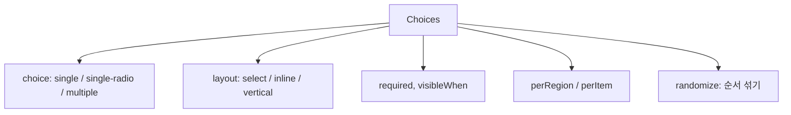
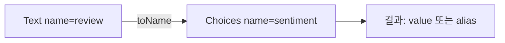

# Choices 속성

> Label Studio의 `<Choices>` 태그는 라디오 버튼이나 체크박스로 분류 선택지를 만든다. `choice`, `layout`, `required`, `perRegion` 같은 속성으로 단일·다중 선택과 표시 방식을 정한다.

## 쉽게 말하면
설문지의 객관식 문항을 만드는 부품이다. 한 개만 고르게 할지, 여러 개 고르게 할지, 가로로 늘어놓을지를 속성으로 정한다.

## 자세히
(Label Studio 문서 `tags/choices` 페이지를 직접 열어 확인. 2026-11-21 기준.)
- **필수 속성**: `name`(선택 그룹 식별자), `toName`(라벨링 대상 데이터 객체의 name).
- **`choice`**: `single`(기본), `single-radio`(라디오 버튼), `multiple`(체크박스).
- **표시**: `showInline`(가로 한 줄), `layout`(`select` 드롭다운 / `inline` / `vertical` 기본).
- **검증**: `required`와 `requiredMessage`로 선택을 강제.
- **범위**: `perRegion`(영역별 선택), `perItem`(항목별 선택). 전체 작업이 아닌 일부 범위에 붙인다.
- **조건부 표시**: `visibleWhen`, `whenTagName`, `whenLabelValue`, `whenChoiceValue`.
- **동적 선택지**: `value="$필드"`로 작업 데이터에서 선택지를 받고 `allowNested`+`children`으로 중첩 가능(결과는 배열의 배열).
- **`randomize`**: 로딩마다 선택지 순서를 섞어 **위치 편향을 줄인다**(저장 결과에는 영향 없음).
- **결과**: 선택한 `value`(별칭 `alias`가 있으면 alias)가 저장된다.
- **예**
```xml
<View>
  <Text name="review" value="$text" />
  <Choices name="sentiment" toName="review" choice="single-radio" showInline="true">
    <Choice value="Positive" alias="P" />
    <Choice value="Neutral" alias="N" />
    <Choice value="Negative" alias="NG" />
  </Choices>
</View>
```

## 그림으로 보기



## 예시
- 리뷰 감성 3지선다: `single-radio` + `showInline`.
- 교육 활용: 같은 문항을 순서 고정/랜덤으로 라벨링시켜 위치 편향 차이를 관찰.

## 헷갈리는 것과 비교
| 개념 | 차이 |
|---|---|
| Choices | 분류(선택) 라벨 |
| Labels | 텍스트·이미지 영역에 다는 라벨 |
| alias | 저장되는 값의 별칭 |

## 더 읽을거리
- [Label Studio Choices 태그](https://labelstud.io/tags/choices) — 속성 전체와 예시.
