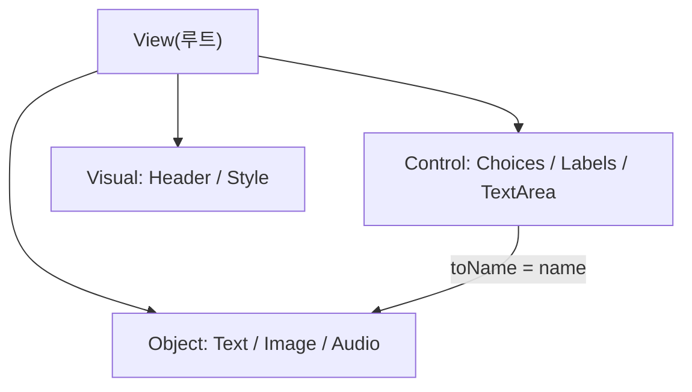
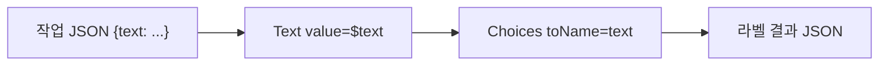

# Label Studio 설정 태그

> Label Studio의 라벨링 화면은 XML 설정 하나로 정의한다. 설정은 데이터를 보여 주는 Object 태그, 라벨을 다는 방식을 정하는 Control 태그, 화면 모양을 꾸미는 Visual 태그로 이루어진다.

## 쉽게 말하면
시험지 양식을 만드는 일이다. "윗칸에는 사진(Object)을 보여 주고, 아랫칸에는 고양이/강아지 중 하나 고르는 체크박스(Control)를 두고, 제목 줄(Visual)을 붙이자"를 태그로 적으면 그대로 라벨링 화면이 생긴다.

## 자세히
(Label Studio 공식 설정 가이드와 태그 목록 페이지를 직접 열어 확인하고, 예시 XML은 파이썬으로 직접 파싱해 검증.)
- **세 종류(가이드)**
  - **Object**: 데이터 유형과 입력 원천을 정한다. 태그 목록: Audio, Chat, HyperText, Image, List, Paragraphs, PDF, Table, Text, TimeSeries, Video 등(ReactCode는 실험적).
  - **Control**: 주석 방식과 결과 표시. Choices(분류), Labels(의미·개체명 인식), TextArea(전사), Rectangle·Polygon·Brush(영역), Rating, Taxonomy, Number, Relation 등.
  - **Visual**: 화면 구성. View(선택지 배치 제어)·Header·Style·Collapse·Filter·Markdown.
- **구조**: 루트는 `<View>`. 가이드의 고양이/강아지 예:
```xml
<View>
  <Image name="image_object" value="$image_url"/>
  <Choices name="image_classes" toName="image_object">
    <Choice value="Cat"/>
    <Choice value="Dog"/>
  </Choices>
</View>
```
- **속성 규칙(태그 목록 페이지)**: `name`은 Object·Control 태그 모두에 필요하고, `toName`은 **모든 Control 태그에 필요하며 Object 태그의 `name`과 일치**해야 한다. `value="$필드명"`은 각 작업(task)의 데이터 필드를 가져온다. `choice="multiple"`을 주면 한 이미지에 여러 선택이 가능(가이드). 다른 허용 값, `showInLine`, `required`, `perRegion`은 이번에 열어 본 페이지에 설명이 없어 확인하지 못했다.
- **직접 검증**: 아래 예시 3개를 XML 파서로 읽어 구조가 올바르고 모든 `toName`이 존재하는 `name`을 가리키는지 확인했다(Label Studio를 실제로 설치·실행한 것은 아니다).
- **설계 팁(제안)**: 작업 유형별로 Object+Control 쌍을 고른다 — 이미지 분류: Image+Choices, 개체명 인식: Text+Labels, 음성 전사: Audio+TextArea, 객체 탐지: Image+RectangleLabels. 선택지는 규칙서의 라벨 정의와 같은 표현을 쓴다([라벨 일관성 규칙](#label-consistency-guideline)).

## 그림으로 보기



## 예시
```xml
<View>
  <Header value="문의 감정 분류"/>
  <Text name="text" value="$text"/>
  <Choices name="sentiment" toName="text" choice="single" showInLine="true">
    <Choice value="긍정"/><Choice value="중립"/><Choice value="부정"/>
  </Choices>
</View>
```
```xml
<View>
  <Labels name="ner" toName="text">
    <Label value="PER"/><Label value="ORG"/>
  </Labels>
  <Text name="text" value="$text"/>
</View>
```
- 사내 문의 텍스트 1,000건을 위 설정으로 가져와 CS 담당자가 감정을 라벨링.

## 헷갈리는 것과 비교
| 개념 | 차이 |
|---|---|
| Object 태그 | 무엇을 보여 줄지(데이터) |
| Control 태그 | 어떻게 라벨을 달지(입력 도구) |
| Visual 태그 | 화면 장식·구성 |
| [Label Studio ML 백엔드](#label-studio-ml-backend) | 모델 예측을 사전 라벨로 연결 |

## 더 읽을거리
- [Label Studio: Set up your labeling config](https://labelstud.io/guide/setup) — 세 태그 종류·예제(열어 확인).
- [Label Studio Tags](https://labelstud.io/tags/) — 태그 목록·name/toName 규칙(열어 확인).
