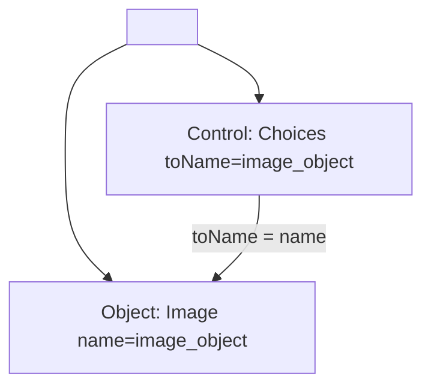
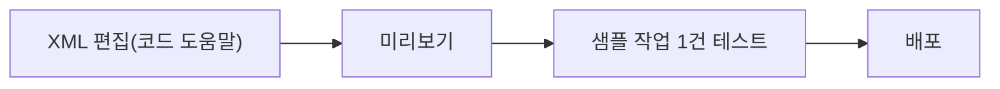

# 설정 XML 검증

> Label Studio 라벨링 설정은 `<View>` 안에 객체 태그(데이터)와 제어 태그(라벨)를 두고 `toName`으로 연결한다. 편집 화면의 코드 도움말과 프로젝트 설정으로 오류를 줄이고 점검한다.

## 쉽게 말하면
배선도에 전구(데이터 표시)와 스위치(라벨 선택)가 있고, 스위치가 어느 전구를 켜는지 이름표(`toName`)로 이어진다. 이름표가 틀리면 켜지지 않는다.

## 자세히
(Label Studio 문서 `guide/setup`을 직접 열어 확인. 문서는 검증 절차와 오류 메시지 형식은 다루지 않는다. 확인 못 한 부분은 제안으로 표시.)
- **태그 3종**: Object(데이터 소스, 예: `Image`, `Text`), Control(주석 유형·라벨, 예: `Choices`+`Choice`), Visual(화면 배치). 전체를 `<View>`로 감싼다.
- **연결**: 문서 예시는 제어 태그의 `toName`을 객체 태그의 `name`과 같게 둔다(`toName="image_object"`). 문서가 이를 공식 규칙으로 명시하지는 않는다.
- **편집 팁**: 코드 보기에서 `<`를 입력하면 태그, 공백을 입력하면 속성 제안, Tab으로 채택. 변경은 프로젝트 **Settings → Labeling Interface**.
- **작업 중 변경 제한**: 진행 중인 주석이 있으면 해당 라벨 삭제·라벨링 유형 변경은 그 주석을 지운 뒤에야 가능.
- **CLI/API**: `--label-config config.xml` 또는 백엔드 API로 설정.
- **점검 체크리스트(제안)**: ① toName ↔ name 일치 ② `value="$필드"`가 작업 data 키와 일치([작업 JSON](#label-studio-task-json)) ③ name 중복 없음 ④ 라벨 값 오타·대소문자 ⑤ 샘플 작업 1건으로 화면 미리보기.

## 그림으로 보기

## 예시
- 이미지 분류 설정에서 `toName`을 `image_obj`로 잘못 적어 선택지가 안 나타남 → name과 맞춰 해결.
- 교육 활용: 일부러 오류를 넣은 설정을 주고 찾기 퀴즈.

## 헷갈리는 것과 비교
| 개념 | 차이 |
|---|---|
| Object 태그 | 보여 줄 데이터 |
| Control 태그 | 라벨·선택 UI |
| Visual 태그 | 화면 배치 |

## 더 읽을거리
- [Label Studio: 라벨링 설정](https://labelstud.io/guide/setup) — XML 구조·편집 팁.
