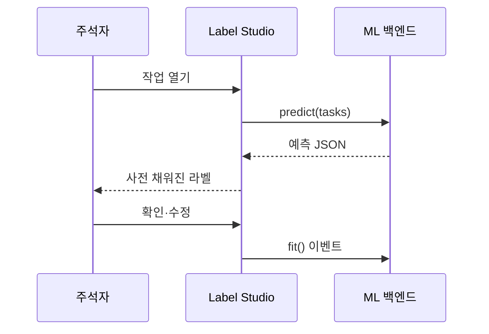
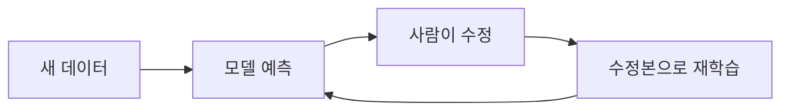

# Label Studio ML 백엔드

> 내 모델을 웹 서버로 감싸 Label Studio에 연결하면, 모델이 만든 예측이 라벨링 화면에 미리 채워진 라벨로 나타난다. 사람은 처음부터 달지 않고 예측을 확인·수정하면 되므로 라벨링 속도를 높인다.

## 쉽게 말하면
신입 직원이 문서 분류를 하기 전에 조수가 "이건 불만으로 보이는데요"라고 초안 스티커를 붙여 놓는 상황이다. 직원은 스티커가 맞는지만 확인하고 틀린 것만 고친다. 조수는 직원이 고친 결과를 보고 점점 나아진다.

## 자세히
(Label Studio의 ML 통합 가이드와 label-studio-ml-backend GitHub README를 직접 열어 확인.)
- **용도(가이드)**: 사전 주석(pre-annotation), 대화형 라벨링, 모델 평가·미세조정. 사전 주석은 모델이 자율적으로 라벨을 예측하고 사람이 검토하게 한다.
- **요청 흐름**: 주석자가 작업을 열면 Label Studio가 ML 백엔드에 요청을 보내고, 백엔드가 예측을 반환해 화면에 나타난다.
- **SDK(README)**: `label-studio-ml`은 ML 코드를 웹 서버로 감싼다. 정적인 사전 주석 데이터만 불러오려면 예측을 임포트하는 편이 낫다. 라이선스 Apache-2.0.
  - `label-studio-ml create my_ml_backend` → Dockerfile, docker-compose.yml, model.py, _wsgi.py, README.md, requirements.txt 생성. 추론·학습 로직은 `model.py`.
  - **`predict(tasks, context, **kwargs)`**: Label Studio 작업(JSON)을 받아 Label Studio가 기대하는 JSON 형식의 예측을 반환. `context`는 대화형 라벨링용.
  - **`fit()`(선택)**: 학습이나 지속 상태가 필요한 작업(가중치 저장 등). 기본적으로 작업 생성·주석 갱신 이벤트에서 실행되며 프로젝트 설정의 Webhooks에서 이벤트를 바꿀 수 있다. `self.get(key)`·`self.set(key, value)`로 저장값을 읽고 쓴다.
  - 보조: `label_config`, `parsed_label_config`, `model_version`, `get_local_path(url, task_id)`(파일 다운로드·캐시).
- **실행**: 예제는 docker-compose로 `http://localhost:9090`. Docker 없이는 `label-studio-ml start my_ml_backend`(`-p`로 포트). 미디어 접근에는 `LABEL_STUDIO_URL`과 `LABEL_STUDIO_API_KEY`가 필요. Label Studio가 컨테이너 안에서 돌면 `localhost`가 컨테이너 자신을 가리키므로 `host.docker.internal`이나 호스트 IP를 쓴다(가이드).
- **연결**: 프로젝트 설정 → Model → Connect Model에서 이름·백엔드 URL·기본 인증·추가 매개변수·대화형 사전 주석 여부를 입력. API로도 가능.
- **예측 vs 주석**: 예측은 사람이 검토할 모델 제안, 주석은 사람이 확정한 라벨. 데이터 관리자에서 예측을 가져오거나 프로젝트 설정에서 자동 사전 라벨링을 켠다.
- **대화형 사전 주석(스마트 도구)**: Rectangle·Ellipse·Polygon·KeyPoint·Brush 태그에서 모델이 주석자 행동에 반응. 설정에 `smart="true"`.
- **능동 학습**: 자동 능동 학습 루프는 Enterprise 기능이고 Community Edition은 작업을 수동 정렬하고 예측을 가져오는 식으로 흉내 낸다(가이드)([능동 학습 라벨링](#active-learning-labeling)).
- **예제 백엔드(README)**: 텍스트(bert_classifier, flair, gliner, huggingface_ner, huggingface_llm, spacy, sklearn_text_classifier, llm_interactive 등), 비전(grounding_dino, grounding_sam, segment_anything_2_image, mmdetection, yolo), OCR·음성(easyocr, paddleocr, tesseract, nemo_asr), 시계열(timeseries_segmenter)·문서(docling).
- 주의(제안): 모델 예측을 그대로 신뢰하면 "자동화 편향"으로 오류를 승인하게 된다 — 표본은 예측을 가린 채 라벨링해 정확도를 측정한다.

## 그림으로 보기



## 예시
```bash
pip install label-studio-ml
label-studio-ml create my_ml_backend      # 뼈대 생성
label-studio-ml start my_ml_backend -p 9090
```
(README의 명령. 직접 실행하진 않았다.)
- 사내 이미지 불량 라벨링: yolo 백엔드가 박스를 미리 그려 놓고 작업자는 틀린 박스만 수정.

## 헷갈리는 것과 비교
| 개념 | 차이 |
|---|---|
| 예측(prediction) | 모델 제안. 사람이 검토 |
| 주석(annotation) | 사람이 확정한 라벨 |
| 사전 주석 | 라벨링 전 모델이 미리 채움 |
| 대화형 사전 주석 | 주석자 행동에 모델이 실시간 반응 |

## 더 읽을거리
- [Label Studio: ML 통합 가이드](https://labelstud.io/guide/ml) — 연결·예측·학습·스마트 도구(열어 확인).
- [label-studio-ml-backend (GitHub)](https://github.com/HumanSignal/label-studio-ml-backend) — 생성·predict·fit·예제·라이선스(열어 확인).
