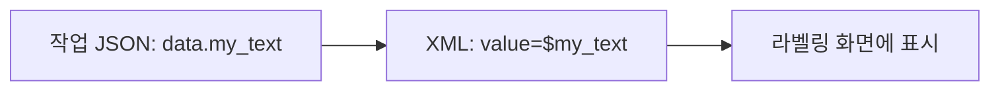
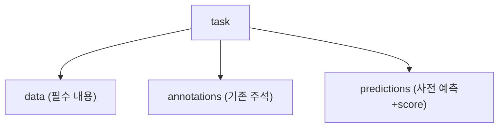

# 작업(task) JSON과 $필드

> Label Studio에 데이터를 넣는 단위가 작업(task) JSON이다. 설정 XML의 `value="$필드"`가 작업의 `data` 안 같은 이름 키를 읽어 화면에 보여 준다.

## 쉽게 말하면
엽서의 주소란(설정 XML)에 "받는 사람: $이름"이라고 써 두고, 편지 한 통(작업 JSON)마다 `이름` 칸에 실제 이름을 채우는 것이다.

## 자세히
(Label Studio 문서 `guide/tasks` 페이지를 직접 열어 확인. 2026-11-21 기준.)
- **구조**: 작업 목록은 JSON 리스트이고 각 작업의 필드는 `data` 키 아래에 둔다. `data` 키가 없으면 파일 전체를 작업 1개로 본다. 주석·예측이 없다면 `data` 중첩 없이 필드를 직접 써도 된다.
- **매핑**: `data`의 키는 설정의 `$` 참조와 일치해야 한다. `<Text name="message" value="$my_text"/>`는 `my_text`를 읽는다. 중첩도 가능(`$texts[2]`, `$audio.url`). `$` 없는 `value`는 리터럴 텍스트.
- **`valueType`**: 텍스트 태그에서 `url`이면 URL 내용을 불러오고 `text`/`json`이면 값을 직접 저장.
- **선택 키**: `annotations`(내보내기 형식의 기존 주석), `predictions`(사전 라벨링용 모델 결과, `score`는 능동 학습 샘플링에 사용).
- **가져오기 형식**: JSON, CSV/TSV(열 이름이 데이터 키), TXT(한 줄이 작업 1개), HTML/이미지/오디오/비디오(미디어는 URL 참조). JSONL·Parquet는 클라우드 스토리지 등 제한이 있다.
- **예**
```json
[{
  "data": { "my_text": "Opossums are great" },
  "predictions": [{
    "result": [{ "from_name": "sentiment_class", "to_name": "message",
                 "type": "choices", "value": { "choices": ["Neutral"] } }],
    "score": 0.95
  }]
}]
```

## 그림으로 보기



## 예시
- 스프레드시트 CSV를 올리면 열 이름이 data 키가 되어 `$열이름`으로 바로 쓴다.
- 교육 활용: 같은 설정에 JSON만 바꿔 다른 문장을 표시하며 "템플릿과 데이터의 분리"를 설명.

## 헷갈리는 것과 비교
| 개념 | 차이 |
|---|---|
| data | 화면에 보일 입력 데이터 |
| annotations | 사람이 단 라벨 |
| predictions | 모델이 단 사전 라벨 |

## 더 읽을거리
- [Label Studio: 작업 데이터 형식](https://labelstud.io/guide/tasks) — 구조·형식·예시.
