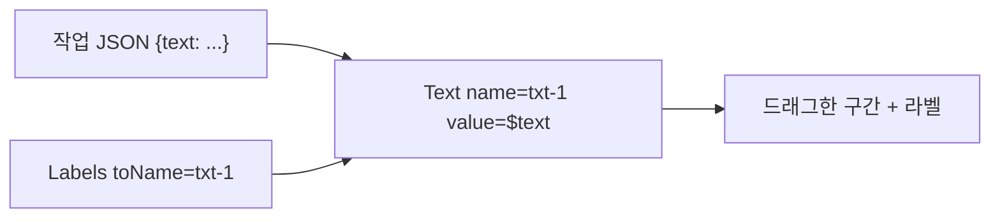
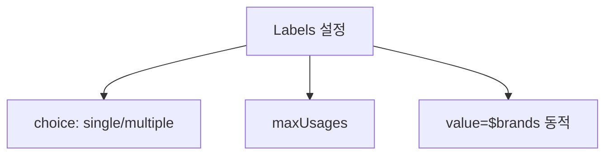

# 텍스트 개체명 설정

> Label Studio에서 개체명 인식(NER) 라벨링은 `<Text>`에 `<Labels>`와 `<Label>`을 묶는 설정 XML로 만든다. 사용자가 텍스트 구간을 드래그하면 그 구간에 라벨이 붙는다.

## 쉽게 말하면
문서에 형광펜을 칠하되 색마다 "회사", "사람", "날짜"처럼 의미를 정해 둔 것이다. 설정 파일은 그 형광펜 색 목록과 대상 문서를 연결한다.

## 자세히
(Label Studio 문서 `tags/labels` 페이지를 직접 열어 확인. 페이지의 예시는 NER 전용이 아니라 일반 텍스트 라벨링 구조이며, 결과 JSON 예시는 없었다.)
- **기본 구조**
```xml
<View>
  <Labels name="type" toName="txt-1">
    <Label alias="B" value="Brand" />
    <Label alias="P" value="Product" />
  </Labels>
  <Text name="txt-1" value="$text" />
</View>
```
- **연결**: `Labels`의 `toName`이 `Text`의 `name`과 같아야 한다. `Text`의 `value="$text"`는 작업 JSON의 `text` 필드를 가져온다.
- **`Labels` 속성**: `choice`(`single` 기본 / `multiple`, 영역당 라벨 수), `maxUsages`(작업당 최대 사용 횟수), `showInline`(기본 true), `opacity`(기본 0.6), `fillColor`, `strokeColor`(기본 `#f48a42`), `strokeWidth`(기본 1), `value`(동적 라벨 목록 `$brands`).
- **`Label` 속성**: 문서 예시상 `value`, `alias`, `showAlias`, `background`. 문서 페이지는 `hotkey`를 다루지 않았다(다른 페이지에서 확인 필요).
- **동적 라벨**: `<Labels name="product" toName="shelf" value="$brands" />`처럼 작업 데이터에서 라벨 목록을 가져온다.
- **오류 팁(제안)**: toName 불일치, 라벨 값 오타, 같은 `name` 중복이 가장 흔한 원인.

## 그림으로 보기



## 예시
- 계약서에서 회사명·금액·날짜 구간에 라벨을 달아 NER 학습 데이터 제작.
- 교육 활용: 설정 XML을 바꿔 보며 UI가 어떻게 변하는지 보는 실습.

## 헷갈리는 것과 비교
| 개념 | 차이 |
|---|---|
| Labels(NER) | 텍스트 구간에 라벨 |
| [Choices](#label-studio-choices-attributes) | 문서 전체 분류 |
| Relations | 구간 사이 관계 라벨 |

## 더 읽을거리
- [Label Studio Labels 태그](https://labelstud.io/tags/labels) — 속성과 동적 라벨.
