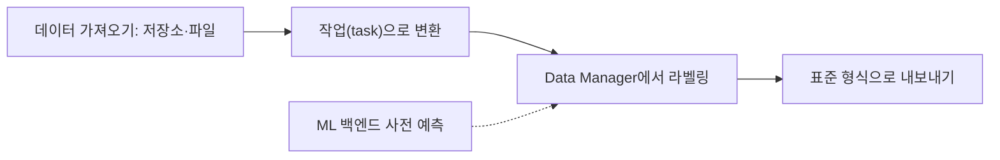
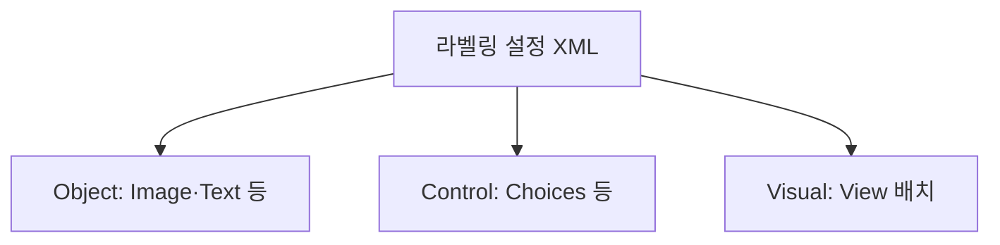

# Label Studio

> 이미지·오디오·텍스트·HTML·시계열·비디오 데이터에 라벨을 붙이는 오픈소스(Apache 2.0) 웹 기반 라벨링 도구다. 라벨링 화면을 XML 비슷한 설정으로 정의하고, 모델 예측으로 미리 라벨링한 뒤 사람이 검수하는 흐름을 지원한다.

## 쉽게 말하면
정답 다는 일을 위한 "온라인 채점 프로그램"이다. 문제지(데이터)를 올리고, 채점 화면(고양이/강아지 선택 버튼)을 설정하면 여러 사람이 브라우저에서 라벨을 붙이고, 결과를 표준 형식으로 내려받는다.

## 자세히
(GitHub README와 공식 설정 가이드를 직접 열어 확인. 이번 조사에서 직접 설치·실행은 하지 못했다.)
- **설치(README)**: Python 3.10+에서 `pip install label-studio` 후 `label-studio` 실행 → `http://localhost:8080`. Docker는 `docker pull heartexlabs/label-studio:latest`, `docker run -it -p 8080:8080 -v $(pwd)/mydata:/label-studio/data heartexlabs/label-studio:latest`(데이터는 `./mydata`). README에는 버전 번호가 적혀 있지 않았다.
- **지원 데이터(README)**: 이미지, 오디오, 텍스트, HTML, 시계열, 비디오. 표준화된 출력 형식을 제공한다.
- **라벨링 설정(공식 가이드)**: XML 비슷한 파일이며 태그가 세 종류다 — **Object**(입력 데이터), **Control**(주석 종류·결과), **Visual**(화면 배치). 공식 예시는 이미지 분류: `View` 안에 `Image` 태그(이미지 URL 필드를 가리킴)와 Cat·Dog 선택지를 가진 `Choices`를 둔다. `choice="multiple"`이면 여러 개 선택 가능. 설정은 `label-studio <project> start --label-config config.xml`로 주거나 서버 API로 준다. 텍스트·박스 라벨 태그와 가져오기·내보내기 형식 세부는 이번에 확인하지 못했다.
- **ML 보조 라벨링(README)**: Machine Learning SDK로 자체 모델을 연결해 **사전 라벨링(모델 예측)**, 온라인 학습, 능동 학습을 지원한다. ML 백엔드 설정은 별도 저장소.
- **데이터 연결(공식 가이드 소개 페이지)**: S3·Google Cloud·Azure·Databricks·Redis·로컬 파일, API·Python SDK·웹훅 연동. Community Edition과 Enterprise가 구분된다.
- **쓸 때의 주의(일반적)**: 도구는 화면과 수집 흐름만 준다. 라벨 품질은 [라벨링 규칙서](#label-consistency-guideline)와 [품질 관리](#data-labeling-qa)가 좌우한다. 외부에 올리지 않는 사내 데이터는 자체 호스팅이 가능한지 먼저 확인한다.

## 그림으로 보기



## 예시
공식 가이드 예시를 줄인 설정(이미지 분류):
```xml
<View>
  <Image name="image" value="$image"/>
  <Choices name="choice" toName="image">
    <Choice value="Cat"/>
    <Choice value="Dog"/>
  </Choices>
</View>
```
교육 소재: 상담 문의 20건을 직접 라벨링해 보고 라벨러 간 불일치를 비교하는 실습(제안).

## 헷갈리는 것과 비교
| 개념 | 차이 |
|---|---|
| Label Studio | 오픈소스 라벨링 도구(Community Edition) |
| 상용 라벨링 플랫폼 | 관리형 인력·QA 포함 서비스(예: 외주 업체) |
| [데이터 라벨링](#data-labeling) | 도구가 아니라 작업 전체 |
| [모델 보조 사전 라벨링](#model-assisted-prelabeling) | Label Studio가 지원하는 방식 |

## 더 읽을거리
- [Label Studio GitHub](https://github.com/HumanSignal/label-studio) — 설치·데이터 유형·ML 백엔드·라이선스(README 직접 확인).
- [Label Studio: 라벨링 설정](https://labelstud.io/guide/setup) — Object·Control·Visual 태그와 예시(직접 확인).
