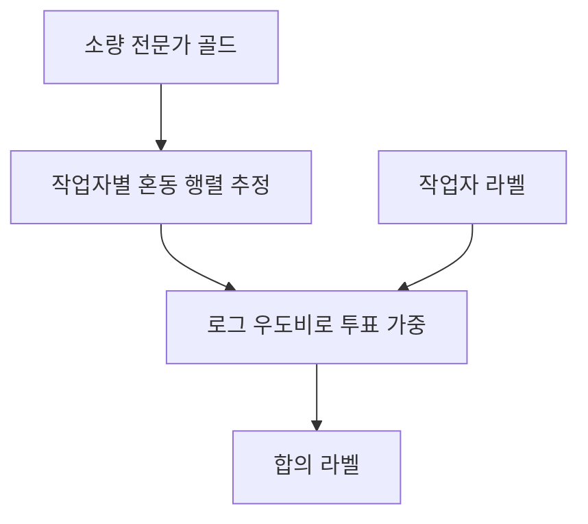
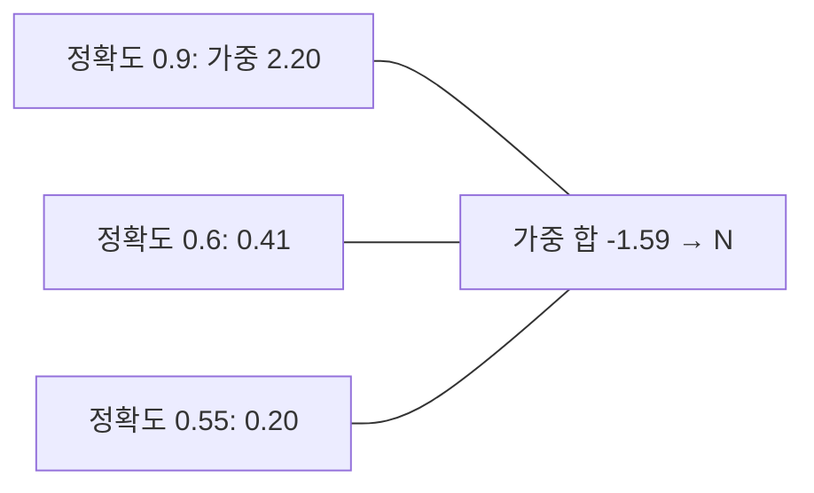

# 라벨러 편향 보정

> 라벨러 편향 보정은 소량의 전문가 정답(골드)으로 각 작업자의 응답 패턴(혼동 행렬)을 추정하고, 신뢰할 만한 작업자의 표에 더 큰 가중치를 줘서 다수결보다 정확한 합의 라벨을 만드는 방법이다. Snow 외(2008)가 비전문가 라벨링에 적용했다.

## 쉽게 말하면
심사위원마다 후한 사람, 박한 사람, 아무렇게나 점수 주는 사람이 있다. 각자의 성향을 미리 알면 후한 사람의 8점은 6점으로 보정하고, 찍는 사람의 표는 무시할 수 있다.

## 자세히
- **방법(Snow 외, EMNLP 2008, 논문 본문 5절)**: Dawid & Skene를 따라 라벨과 작업자를 Naive Bayes 비슷한 다항 모델로 본다. 각 예시의 참 라벨 x가 있고, 작업자 응답은 참 라벨이 주어지면 서로 조건부 독립이라고 가정한다. 작업자별 응답 확률 P(응답 | 참 라벨)은 **전문가가 라벨한 소량의 골드 예시에서의 작업자 성적 빈도**로 추정한다(최대우도·라플라스 평활화 1개 사전 개수 사용). 새 예시의 참 라벨 사후 로그 오즈는 각 작업자의 응답에 대한 로그 우도비의 합이며, 이는 곧 가중 투표다. 50%보다 정확한 작업자는 양의 표, 순수 노이즈는 0표, 정답과 반대로 움직이는 작업자는 음의 표를 갖는다. 정확도만 쓰는 단순형은 작업자 표에 log(acc/(1−acc))를 곱한다.
- **보고된 효과(같은 논문)**: 순진한 다수결 대비 골드 보정 라벨이 RTE(텍스트 함의)에서 평균 +4.0%, 사건 주석에서 +3.4% 정확도를 높였다(주석자 2~10명 평균). 수치 데이터에는 가우스 노이즈 모델로 보정해 감정 과제에서 피어슨 상관이 평균 +0.6% 올랐다. 이 수치는 해당 논문의 설정이며 다른 작업에는 그대로 옮겨지지 않는다. 논문은 소수 작업자가 작업의 큰 몫을 하고, 작업자 정확도 편차가 크다는 점도 지적한다.
- **직접 계산한 가중 투표 예(정확도 0.9, 0.6, 0.55인 세 작업자)**: 가중치 log(acc/(1−acc))는 2.20, 0.41, 0.20이다. 고정확도 작업자가 "N", 나머지 둘이 "Y"라고 하면 단순 다수결은 Y(2대1)지만, 가중 점수는 −1.59로 N 쪽이다. 이처럼 믿을 만한 한 명이 부정확한 두 명을 이길 수 있다.
- **전제와 한계(해석)**: ① 골드 예시가 필요하다 ② 작업자 독립 가정이 깨지면 과신한다([주석자 공통 편향](#shared-annotator-bias)) ③ 작업자당 골드 표본이 적으면 추정이 불안정하다. 골드가 없으면 Dawid-Skene EM이 대안이다([Dawid-Skene 모델](#dawid-skene-model)).

## 그림으로 보기

## 예시
- 코드 개념: `weight = math.log(acc/(1-acc))`; 점수 = Σ weight × (±1) → 부호로 라벨 결정.
- 교육 활용: 세 작업자의 정확도를 주고 단순 다수결과 가중 투표 결과가 갈리는 사례를 직접 만들어 본다.

## 헷갈리는 것과 비교
| 개념 | 차이 |
| --- | --- |
| 라벨러 편향 보정 | 골드로 작업자 성향을 추정해 가중 |
| 단순 다수결 | 모두 1표 |
| [CROWDLAB](#crowdlab) | 모델 예측도 함께 사용하는 현대적 방식 |
| [Dawid-Skene 모델](#dawid-skene-model) | 골드 없이 EM으로 추정 |

## 더 읽을거리
- [Cheap and Fast — But is it Good? (Snow 외, EMNLP 2008)](https://aclanthology.org/D08-1027/) — 골드 기반 편향 보정, 가중 투표
