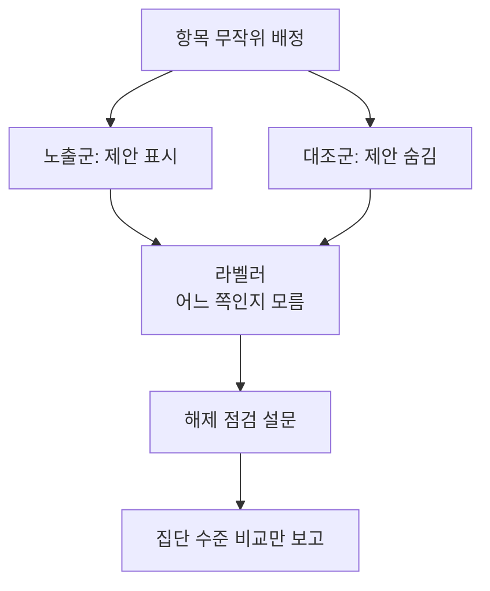
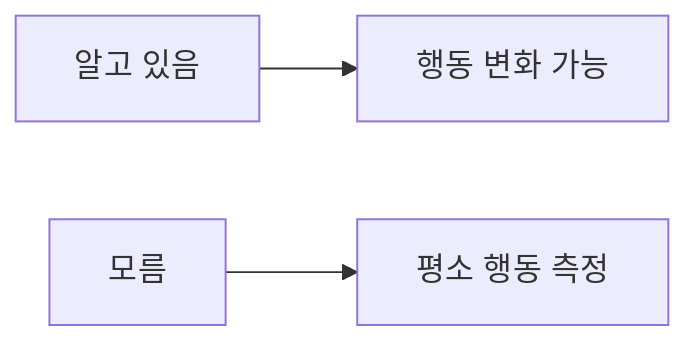

# 노출 여부 비공개 배정

> 라벨러에게 **어느 항목이 모델 제안 노출군이고 어느 항목이 비노출 대조군인지 알리지 않는** 운영 방식이다. 자기가 측정되고 있다는 것을 아는 순간 행동이 달라질 수 있기 때문에, 비교 결과가 평소 행동을 반영하게 하려는 장치다.

## 쉽게 말하면
시험 감독관이 "지금부터 이 문제만 채점합니다"라고 알려 주면 그 문제만 열심히 푸는 학생이 생긴다. 어느 문제가 채점되는지 모르면 평소처럼 푼다. 대신 숨기는 데는 한계가 있고, 아예 속이는 방식은 피해야 한다.

## 자세히
(위키백과 "Blinded experiment"와 "Hawthorne effect" 문서를 직접 열어 확인. 라벨링 적용은 제안이다.)
- **눈가림(blinding)의 원리**: 단일 눈가림은 참가자가 배정 사실을 모르게, 이중 눈가림은 참가자와 연구자 모두 모르게 하는 것이다. 알고 있으면 기대에 따라 보고나 평가가 달라질 수 있으며 대개 무의식적이다. 문서는 용어가 모호하므로 "누가 무엇에 대해 눈가림 되었는지"를 명시하라고 권한다.
- **관찰 사실을 알 때의 변화(호손 효과)**: 관찰된다는 사실을 알고 행동이 달라지는 반응성이다. 원래 호손 공장 연구(1924~1932)에서 조명을 어떻게 바꿔도 생산성이 오르는 등의 결과가 나왔지만 이후 해석에 반론이 많다. 니스벳은 "미화된 일화"라고 불렀고, 레빗과 리스트가 원자료를 다시 찾아 분석한 결과 원래 주장보다 훨씬 약한 증거만 확인됐다. 애덤은 관찰 자체보다 참가자가 상황을 어떻게 해석하느냐가 중요하다고 주장했다. 따라서 "관찰받으면 항상 크게 달라진다"를 단정하지 말고, 라벨링에서 실제로 달라지는지는 직접 측정해야 한다.
- **한계(위키백과)**: 눈가림이 불가능하거나 비윤리적인 상황이 있고, 참가자가 부작용 등으로 자기 배정을 추측하는 **눈가림 해제(unblinding)**가 편향의 원천이다. 눈가림이 부실하면 효과 크기와 거짓 양성이 부풀 수 있다. 눈가림이 잘 되었는지를 평가·보고한 연구는 드물다.
- **라벨링에서의 적용 방안(제안)**
  1. **UI 차이 줄이기**: 비노출 항목은 "제안 없음"이 그냥 보이므로 숨겨도 티가 난다. 모델이 확신이 낮을 때도 제안을 비우는 규칙을 이미 쓰면 "제안 없음"이 흔한 상태가 되어 구분이 어렵다.
  2. **무엇을 알리고 무엇을 숨길지**: 라벨러에게 "품질 점검을 위해 일부 항목은 제안 없이, 일부는 있는 상태로 제공된다"는 일반 정책은 알리되, **어느 항목인지는 알리지 않는다**. 정책을 완전히 숨기는 기만은 신뢰와 윤리 문제가 있으므로 피한다.
  3. **측정 확인**: 라벨러가 구분할 수 있는지 설문으로 물어 눈가림이 해제됐는지 점검(위키백과가 지적하듯 대부분 연구가 하지 않는 일).
  4. **분석가도 눈가림**: 두 집단 비교를 하는 사람은 군 이름을 A/B로만 보고 분석 계획을 먼저 고정(확증 편향 방지).
  5. **집계 보고**: 라벨러 개인을 평가하는 지표로 쓰지 않고 집단 수준 편향 지표로만 보고(역효과 방지).
- **한계**: 눈가림을 해도 노출군의 "제안 있음"은 라벨러가 볼 수 있다. 완벽한 눈가림은 불가능하므로 해제 정도를 측정하고 보고하는 것이 현실적이다.

## 그림으로 보기

## 예시
- 라벨링 도구가 확신이 낮은 항목에서 제안을 비우는 것이 일상이라면, 무작위 대조군에서도 "제안 없음"이 자연스럽게 섞여 라벨러가 측정 여부를 알아채기 어렵다. 분기 말에 "어느 항목이 점검용이었다고 생각하나요?" 설문으로 눈가림 해제율 확인.
- 교육 소재: 호손 효과 논쟁을 통해 "측정 방식이 결과를 바꾼다"를 실습으로 설명.

## 헷갈리는 것과 비교
| 개념 | 차이 |
|---|---|
| 노출 여부 비공개 | 라벨러가 대조군인지 모르게 운영 |
| [비노출군 무작위 배정](#hidden-control-randomization) | 대조군을 어떻게 고르나 |
| [제안 비노출 대조 표본](#suggestion-hidden-control-sample) | 비교 설계 전체 |
| [골드 문항 노출과 교체](#gold-question-leak) | 정답 문항이 알려지는 문제(정보 유출) |

## 더 읽을거리
- [Blinded experiment — 위키백과](https://en.wikipedia.org/wiki/Blinded_experiment) — 단일·이중 눈가림, 눈가림 해제의 한계(직접 확인).
- [Hawthorne effect — 위키백과](https://en.wikipedia.org/wiki/Hawthorne_effect) — 원래 연구와 비판적 재해석(직접 확인).
