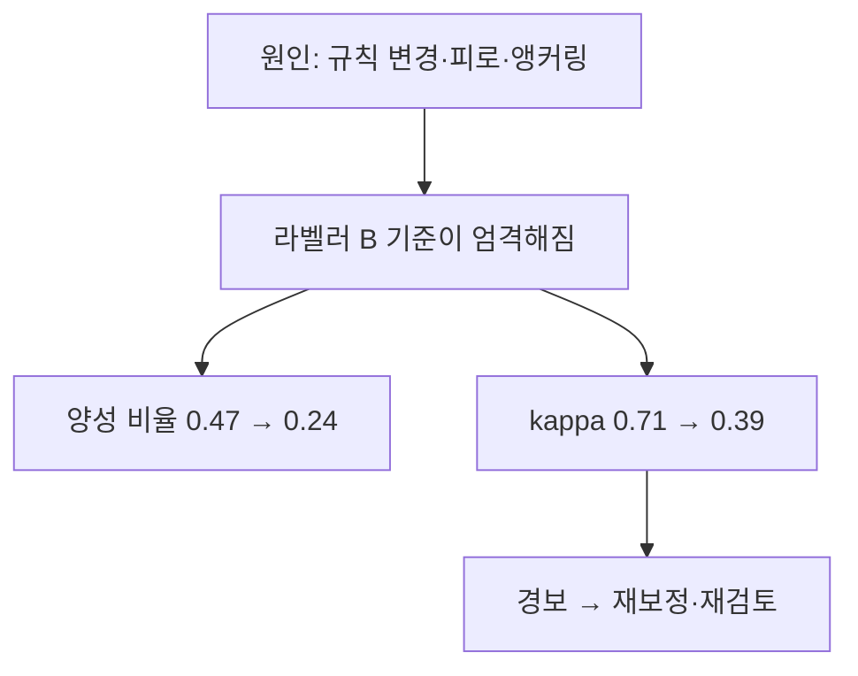
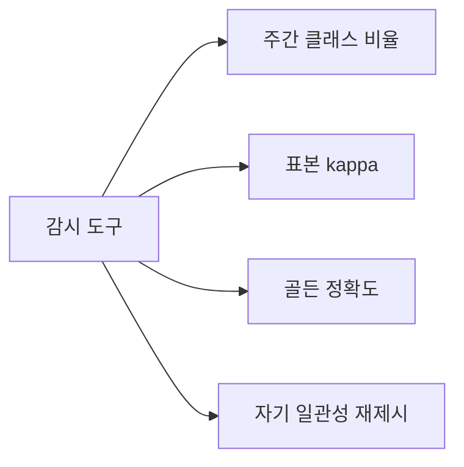

# 라벨러 기준 드리프트

> 시간이 지나면서 **라벨러가 같은 항목에 다른 기준을 적용하기 시작하는 현상**이다. 규칙 변경, 피로, 반복 작업으로 인한 습관, 새 사례의 영향 등으로 생기며, 모르고 지나가면 데이터의 라벨 분포가 서서히 바뀐다.

## 쉽게 말하면
처음엔 모두가 "이 정도면 불량"이라는 기준이 같았는데, 몇 주 지나자 한 검사원이 점점 까다로워져 같은 제품을 더 자주 불량으로 판정하는 것이다. 본인은 눈치채지 못한다.

## 자세히
- **징후**: ① 라벨러 한 명의 클래스 비율이 주차별로 이동 ② 라벨러 간 kappa 하락 ③ 같은 항목을 다시 줬을 때 과거 라벨과 어긋남(자기 일관성 하락) ④ 보정·골든 문항 정확도 하락.
- **직접 시뮬레이션(이진 라벨, 주당 400개, 두 라벨러 A·B, 항목의 잠재 강도에 개인 노이즈를 더해 임계값으로 판정. B의 임계값을 주마다 0.12씩 올려 점점 까다롭게)**
  | 주 | A 양성 비율 | B 양성 비율 | kappa | 일치율 |
  |---|---|---|---|---|
  | 0 | 0.47 | 0.47 | 0.714 | 0.858 |
  | 2 | 0.47 | 0.37 | 0.613 | 0.810 |
  | 4 | 0.50 | 0.34 | 0.599 | 0.800 |
  | 6 | 0.50 | 0.24 | 0.454 | 0.728 |
  | 7 | 0.54 | **0.24** | **0.387** | 0.680 |
  B의 양성 비율이 0.47→0.24로 반 토막 나는 동안 kappa는 0.714→0.387로 떨어졌다. 주 단위 표본 kappa는 흔들림이 있어(3주차 0.695 반등) 한두 주 값이 아니라 **추세**로 판단한다. 비율 이동(B 0.24 vs A 0.54)은 kappa보다 먼저, 더 직접적으로 단서를 준다.
- **원인 분류**: 가이드 개정이 일부에만 전파됨, 피로·속도 압박, 앞서 본 항목의 영향(앵커링), 라벨러 교체·휴가 복귀, 도메인의 실제 변화(데이터 자체가 바뀜 — 이 경우는 진짜 드리프트가 아닌 개념 변화일 수 있음).
- **감시 방법**: ① 라벨러·클래스별 주간 비율 차트 ② [표본 이중 라벨링](#sampled-double-annotation)의 주간 kappa ③ [골든 문항](#golden-items)·보정 문항 정확도 ④ 이전 라벨 재제시(자기 일관성). 기준선 몇 주의 평균·변동을 잡고 벗어나면 경보(관리도 방식, 경험칙).
- **대응**: 즉시 보정 회의, 경계 사례 로그와 가이드 재공지, 해당 기간 라벨 재검토([재보정 조건](#recalibration-trigger)), 라벨에 라벨러 ID·날짜·가이드 버전을 남겨 문제 구간만 추적 가능하게 한다.
- 합성 시뮬레이션이며 실제로는 규칙 변경·피로가 겹쳐 더 복잡하다.

## 그림으로 보기

## 예시
- 한 달간 혐오 표현 라벨링에서 라벨러 B의 "혐오" 비율이 0.18→0.09로 감소, 가이드 개정 공지를 놓친 것이 원인 → 재공지와 해당 구간 재라벨.
- 교육: 평가자 신뢰도(채점 기준 흔들림)를 설명하는 사례.

## 헷갈리는 것과 비교
| 개념 | 차이 |
|---|---|
| 라벨러 기준 드리프트 | 사람의 판정 기준이 변함 |
| [데이터 드리프트](#data-drift) | 입력 데이터 분포가 변함 |
| [개념 드리프트](#concept-drift) | 정답의 의미 자체가 변함 |
| 라벨러 간 불일치 | 처음부터 기준이 다름 |

## 더 읽을거리
- [Overview of Annotation Creation (arXiv 1602.05753)](https://arxiv.org/abs/1602.05753) — IAA 추적, 가이드 버전 관리, 주석 메타데이터 기록.
- [Snow et al. 2008](https://aclanthology.org/D08-1027/) — 라벨러 편향 보정이 품질을 개선한다는 보고(PDF 본문 확인).
