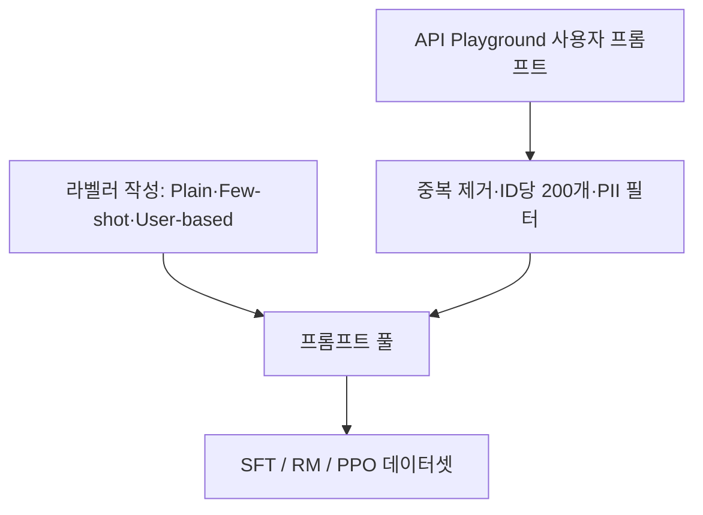
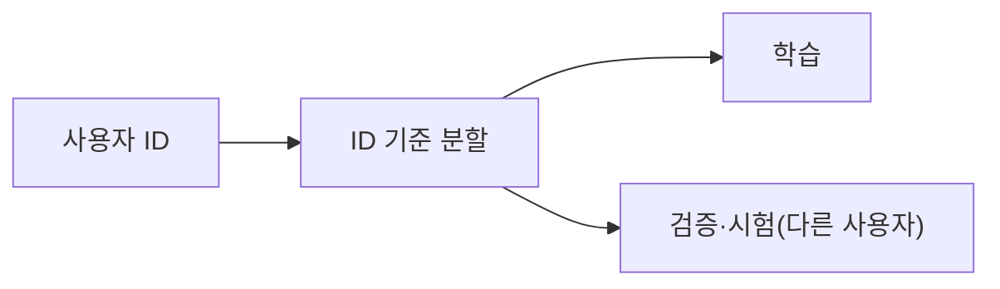

# 프롬프트 출처(라벨러 작성 vs API)

> InstructGPT의 학습 프롬프트는 초기에는 라벨러가 직접 쓴 것, 이후에는 OpenAI API 플레이그라운드에 사용자가 입력한 것을 섞어 썼다. 출처마다 성격과 위험이 다르다.

## 쉽게 말하면
연습 문제를 만드는 방법이 두 가지다. 선생님이 직접 만드는 문제(통제는 쉽지만 한정적)와 실제 학생들이 질문한 내용을 모으는 방법(현실적이지만 개인정보·편중 문제).

## 자세히
(InstructGPT 논문 arXiv 2203.02155 3.2절을 직접 읽고 확인.)
- **부트스트랩**: 첫 모델을 만들 때는 지시형 프롬프트가 API에 거의 없어서 라벨러가 직접 썼다. 세 종류 — **Plain**(다양한 임의 과제), **Few-shot**(지시와 여러 입력·출력 쌍), **User-based**(API 대기자 신청서에 적힌 사용 사례에 맞춘 프롬프트).
- **API 프롬프트**: 시범 데이터만으로 학습한 초기 InstructGPT를 쓰는 **Playground**에서 사용자가 낸 프롬프트. 이용자에게는 데이터가 모델 학습에 쓰일 수 있음을 반복 알림으로 안내했고, **프로덕션 API 고객 데이터는 쓰지 않았다**.
- **정제**: 긴 공통 접두사가 같은 프롬프트를 휴리스틱으로 중복 제거, **사용자 ID당 200개 상한**, 학습·검증·시험을 **사용자 ID 기준**으로 분할, 학습 분할에서 **PII 필터링**.
- **규모**: SFT 약 13k(API+라벨러), RM 33k(API+라벨러), PPO 31k(API만). 사용 사례 분포는 생성이 많고 분류·QA는 상대적으로 적다(표 1).
- 시사점(제안): 라벨러 작성 데이터는 다양성을 보장하나 실제 분포와 다를 수 있고, API 데이터는 현실적이나 특정 사용자·영어 편중이 생길 수 있다.

## 그림으로 보기

## 예시
- 사내 상담 로그를 학습에 쓸 때: 상담원 ID당 건수 상한, 고객 정보 마스킹, 상담원 기준 분할 — InstructGPT 절차를 그대로 응용.
- 교육 활용: 실제 사용자 데이터를 쓸 때의 동의·개인정보 처리 모범 사례.

## 헷갈리는 것과 비교
| 개념 | 차이 |
|---|---|
| 라벨러 작성 프롬프트 | 초기 부트스트랩, 다양성 설계 |
| API 프롬프트 | 실제 사용 분포, PII·동의 처리 필요 |
| [SFT 에폭](#sft-epochs-overfitting) | 학습 방식의 문제(데이터 출처와 별개) |

## 더 읽을거리
- [InstructGPT 논문 (arXiv 2203.02155)](https://arxiv.org/abs/2203.02155) — 3.2절 데이터셋.
