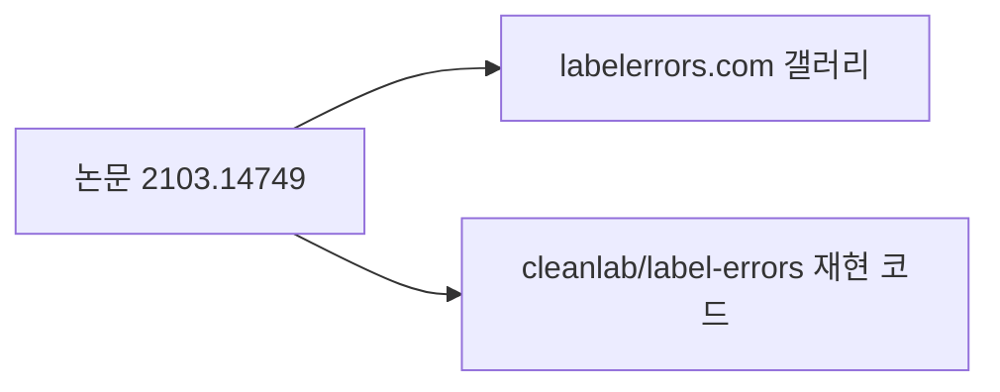
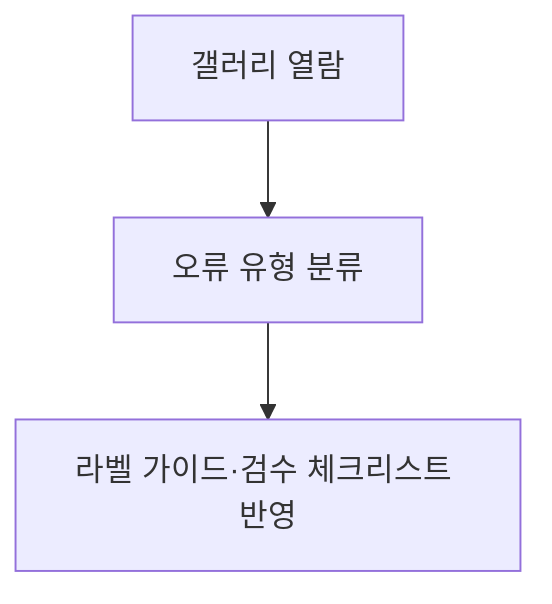

# labelerrors.com 수정 세트

> labelerrors.com은 2021년 NeurIPS 논문 "Pervasive Label Errors in Test Sets"의 짝 사이트로, 컴퓨터 비전·자연어·오디오 10개 데이터셋 시험 세트에서 찾은 라벨 오류를 갤러리로 보여 준다.

## 쉽게 말하면
유명 시험지들에서 정답이 틀린 문제만 모아 놓은 "오답 전시관"이다. 어떤 문제가 왜 틀렸는지를 눈으로 보면, 라벨 오류가 얼마나 사소하고 또 얼마나 어이없는지 실감할 수 있다.

## 자세히
- **구성(웹 검색 결과 요약, 사이트 본문은 직접 열었으나 제목만 표시됨)**: 논문은 10개 시험 세트를 다루고, 사이트는 텍스트·오디오 데이터셋을 포함한 모든 데이터셋의 오류를 갤러리로 제공한다고 논문 초록·검색 결과가 설명한다. 사이트는 논문과 같은 2021년 3월에 공개됐다.
- **재현성**: 논문의 모든 라벨 오류는 `cleanlab/label-errors` 저장소로 재현할 수 있다고 안내한다. cleanlab README는 이 사이트를 cleanlab으로 정리한 데이터셋의 사례로 소개한다.
- **현재 상태(미확인)**: 수정된 시험 세트를 내려받을 수 있는지, 사이트가 지금도 갱신되는지는 이번에 확인하지 못했다. 사용 전 직접 접속해 확인한다.
- **활용(해석)**: ① 자기 도메인과 비슷한 데이터셋의 오류 유형(모호 라벨·잘못된 클래스·다중 객체)을 훑어 라벨 가이드에 반영 ② 교육 자료로 "유명 데이터셋도 틀린다"는 사례를 쓴다 ③ [시험 세트 라벨 오류율](#test-set-label-error-rate) 수치의 근거를 확인한다.

## 그림으로 보기

## 예시
- 워크숍에서 갤러리의 이미지 20장을 보여 주고 "이 라벨이 맞는가?"를 투표한 뒤 정답 공개.
- 교육 활용: 오류 유형을 "잘못된 클래스 / 여러 클래스가 모두 맞음 / 라벨 규칙 모호"로 분류해 보는 활동.

## 헷갈리는 것과 비교
| 개념 | 차이 |
| --- | --- |
| labelerrors.com | 논문에서 찾은 시험 세트 오류 갤러리 |
| cleanlab 라이브러리 | 오류를 찾는 도구 |
| [시험 세트 라벨 오류율](#test-set-label-error-rate) | 갤러리 뒤의 수치 |
| [벤치마크 순위 불안정](#benchmark-ranking-instability) | 오류의 영향 |

## 더 읽을거리
- [Pervasive Label Errors in Test Sets (arXiv 2103.14749)](https://arxiv.org/abs/2103.14749) — 논문 초록과 갤러리 안내
- [MIT CSAIL 뉴스](https://www.csail.mit.edu/news/major-ml-datasets-have-tens-thousands-errors) — 연구 소개 기사(검색 결과로 확인, 본문 미정독)
