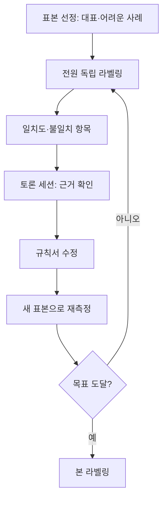
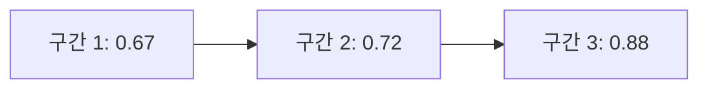

# 라벨러 보정 세션

> 같은 데이터를 여러 라벨러가 따로 라벨링한 뒤 **불일치한 항목을 함께 놓고 토론해 기준을 맞추고, 규칙서(가이드라인)를 고치는 모임**이다. 이를 몇 라운드 반복해 라벨러들의 판단 기준을 통일한다.

## 쉽게 말하면
심사위원들이 같은 작품에 각자 점수를 매긴 뒤, 점수가 갈린 작품을 놓고 "우리 기준이 어디서 달랐지?"를 이야기하며 심사 기준표를 고치는 회의다. 한 번으로 끝나지 않고 점수가 비슷해질 때까지 몇 번 반복한다.

## 자세히
(arXiv 2204.06885 PDF와 arXiv 2611.14581 PDF의 해당 절을 직접 읽어 확인.)
- **사례 1 — 다크웹 문서 말뭉치(Jin 등 2022)**: 처음 150개 문서를 **50개씩 3구간**으로 나눠 라벨러 10명이 같은 문서를 라벨링하고 Fleiss 카파로 일치도를 쟀다. 각 구간이 끝나면 **토론 세션**으로 불일치를 해결하고 가이드라인을 수정했다. 구간별 일치도는 **0.67 → 0.72 → 0.88**. 논문은 Landis와 Koch 기준으로 0.60 초과를 "상당한", 0.80 초과를 "거의 완벽한" 일치로 해석한다고 설명하며, 이 훈련 세션이 라벨러들이 점진적으로 공통 합의에 이르는 데 도움이 되었다고 해석한다.
- **사례 2 — 에이전트 평가 라벨링(Im 2026-11)**: 두 라벨러가 처음(1라운드) 일치율 **0.650**이었던 축에서 사전에 정한 절차에 따라 기준 정렬 회의를 한 번 열고 기준을 명확히("대화 중 실수를 고쳤더라도 최종 상태가 정책을 지키면 준수")한 뒤 독립적으로 다시 판정했다. **일치율은 0.742로 올랐지만 카파는 0.306에 머물렀다.** 두 라벨러 모두 "준수" 비율이 올라 우연 일치가 늘었기 때문이라고 저자들이 설명한다. 판정 전 라벨은 모두 보존해 공개했다. 정책 준수는 사람 둘이 같은 정책 문서를 읽어도 일치하기 어려운 축이었다고 논문이 적는다.
- **두 사례의 교훈**: ① 보정은 **일치율만 보면 속을 수 있다** — 클래스 분포가 치우치면 카파는 낮게 나온다([카파 vs 단순 일치율](#kappa-vs-percent-agreement)) ② 보정으로 기준이 한쪽으로 쏠리면 우연 일치가 달라질 수 있다 ③ 보정 전 라벨을 보존해 개선을 증명 ④ 사례 1은 라벨러 10명·구간 50건, 사례 2는 2명이라 규모가 다르고 두 사례의 수치를 서로 직접 비교하면 안 된다.
- **운영 절차(제안)**: ① 대표적이고 어려운 사례를 골라 **전원이 먼저 독립 라벨링** ② 일치도(카파/AC1과 일치율)와 불일치 항목 목록 산출 ③ 세션에서 **불일치 항목을 하나씩 근거와 함께** 토론하고 규칙서의 정의·예시·경계 사례를 수정 ④ 수정 규칙으로 **새 표본**에서 다시 독립 라벨링해 개선 확인(같은 표본 재사용은 암기 효과) ⑤ 사전에 정한 목표(예: 카파 0.8)에 도달하거나 개선이 멈출 때까지 반복 ⑥ 세션 기록(결정과 이유)을 규칙서 버전과 함께 보관 ⑦ 시간이 지나면 기준이 흐르므로 정기적으로 재보정(이 항목은 논문에서 확인한 것이 아니라 제안).
- **함정(제안)**: 목소리 큰 사람이 기준을 정하는 쏠림, 정답이 없는 주관적 항목을 합의로 억지 통일(모호성 신호를 잃음), 보정 세션 직후에만 좋고 이후 다시 벌어짐.

## 그림으로 보기

## 예시
- 고객 문의 감정 라벨링 팀 6명: 문의 50건 라벨링 후 불일치 12건을 토론해 "반어법은 부정으로 분류" 규칙을 추가하고 새 50건으로 재측정.
- 교육 소재: "같은 AI 결과를 다르게 읽는 팀원들"을 소재로 한 기준 정렬 워크숍(HR·콘텐츠 검수 교육).

## 헷갈리는 것과 비교
| 개념 | 차이 |
|---|---|
| 라벨러 보정 세션 | 불일치 토론으로 기준을 맞추는 모임 |
| [관리형 인력 라벨링](#managed-workforce-labeling) | 인력 운영 방식(보정이 구성 요소) |
| [라벨링 벤더 SLA](#vendor-labeling-sla) | 계약 조건 |
| [골드 문항 노출과 교체](#gold-question-leak) | 정답 문항으로 품질 검사 |

## 더 읽을거리
- [Shedding New Light on the Language of the Dark Web (arXiv 2204.06885)](https://arxiv.org/abs/2204.06885) — 3구간 훈련 세션과 카파 0.67→0.72→0.88(PDF 직접 확인).
- [When Evaluators of AI Agents Disagree (arXiv 2611.14581)](https://arxiv.org/abs/2611.14581) — 기준 정렬 회의 후 일치율 0.650→0.742, 카파 0.306(PDF 직접 확인).
