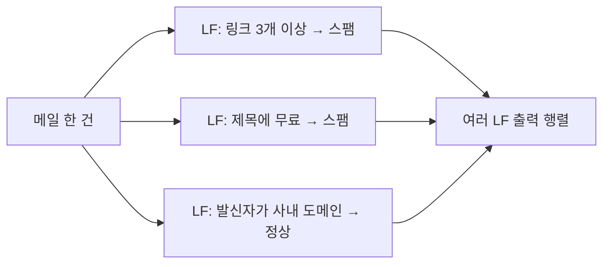
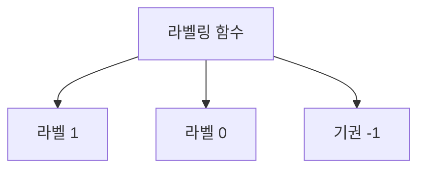

# 라벨링 함수

> 데이터 한 건을 보고 라벨을 붙이거나(+기권) 판단을 보류하는 작은 규칙 코드다. 정확도는 완벽하지 않아도 되고, 여러 개를 모아 서로의 약점을 상쇄한다. Snorkel의 데이터 프로그래밍에서 사람이 쓰는 기본 단위다.

## 쉽게 말하면
스팸 메일을 가려내는 "경험 많은 직원의 감"을 코드로 적어 둔 것이다. "링크가 3개 넘으면 스팸 같다", "제목에 '무료'가 있으면 스팸 같다" 같은 한 줄 규칙이 하나씩 라벨링 함수이고, 자신 없는 메일에는 "모르겠다"고 기권한다.

## 자세히
(Snorkel 논문 arXiv 1711.10160 초록과 Snorkel LFAnalysis 문서를 직접 열어 확인, 규칙 예시는 직접 구현한 시뮬레이션 기반.)
- **정의(논문 초록)**: 라벨링 함수는 정확도와 상관관계를 모르는 **임의의 휴리스틱을 인코딩한 프로그램**이다. 목표는 손으로 라벨링하지 않고 강한 모델을 학습시키는 것.
- **세 가지 출력**: 라벨(예: 스팸=1, 정상=0) 또는 **기권(ABS, 내부적으로 −1)**. 기권이 핵심이다 — 확실할 때만 말하게 해 정확도를 높이고 서로 다른 규칙이 다른 데이터를 맡게 한다.
- **규칙의 종류(제안)**: 패턴(정규식·키워드), 메타데이터(발신 도메인), 외부 지식(사전·지식 기반), 다른 모델의 예측, 사람이 쓴 휘발성 규칙.
- **직접 시뮬레이션(1,000건, 스팸 비율 40%, 정확도·커버리지를 지정한 가상 LF 4개)**: lf_url(정확도 0.9·커버리지 0.2), lf_keyword(0.7·0.5), lf_short(0.6·0.8), lf_noisy(0.55·0.9). 측정된 커버리지는 각각 0.226·0.505·0.804·0.887, 실제 정확도는 0.894·0.683·0.608·0.547. **정확도가 낮은 규칙일수록 더 많은 데이터에 라벨을 붙이는** 전형적인 구조다.
- **좋은 LF의 조건(제안)**: 정확도가 우연(0.5)보다 확실히 높고, 서로 다른 신호를 쓰며, 데이터 일부에서만 말한다. 소량의 사람 라벨(개발 세트)로 LF 정확도를 점검한다(`lf_empirical_accuracies`).
- **누수 주의**: 라벨 규칙이 시험 라벨을 보고 만들어지면 [데이터 누수](#data-leakage). 개발 세트와 시험 세트를 분리한다.
- 이어서: 여러 LF를 합치는 [라벨 모델](#label-model-denoising), 평가는 [LF 커버리지와 충돌](#lf-coverage-conflict).

## 그림으로 보기



## 예시
```python
ABSTAIN, SPAM, HAM = -1, 1, 0
def lf_many_links(x):          # 링크가 3개 이상이면 스팸
    return SPAM if x.text.count("http") >= 3 else ABSTAIN
def lf_internal_sender(x):     # 사내 도메인이면 정상
    return HAM if x.sender.endswith("@mycompany.com") else ABSTAIN
```
(Snorkel의 `@labeling_function()` 데코레이터로 감싸 쓰는 형태. 위 코드는 구조를 보이는 예시이며 Snorkel 패키지는 이 환경에 설치하지 않았다.)
- 교육 활용: 비개발자는 규칙을 자연어로 쓰고, LLM이 규칙 코드를 짜게 하는 방식으로 접근 가능(제안).

## 헷갈리는 것과 비교
| 개념 | 차이 |
|---|---|
| 라벨링 함수 | 규칙 하나, 틀릴 수 있고 기권 가능 |
| [라벨 모델](#label-model-denoising) | 여러 LF 출력을 합쳐 확률 라벨 생성 |
| 수동 라벨링 | 사람이 한 건씩 정답 지정 |
| [LLM 라벨러 프롬프트](#llm-labeler-guideline-prompt) | LLM 자체를 하나의 LF처럼 사용 가능 |

## 더 읽을거리
- [Snorkel: Rapid Training Data Creation with Weak Supervision (arXiv 1711.10160)](https://arxiv.org/abs/1711.10160) — LF 정의와 결과(초록 확인).
- [Snorkel LFAnalysis 문서](https://snorkel.readthedocs.io/en/master/packages/_autosummary/labeling/snorkel.labeling.LFAnalysis.html) — 커버리지·정확도 분석 함수(열어 확인).
