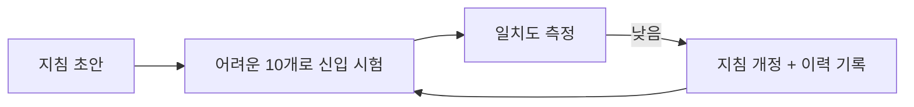

# 라벨링 지침 설계

> 라벨러가 같은 순서로 같은 기준을 적용하도록 **판단 절차·근접 오답 예시·동점 규칙·변경 이력**을 갖춘 지침을 쓰는 일이다.

## 쉽게 말하면
요리 레시피에 "소금 약간"이라고만 쓰면 사람마다 맛이 다르다. 단계, 분량, 실수 사례를 적어야 누가 만들어도 비슷한 맛이 난다.

## 자세히
(Koji 가이드를 직접 읽었다.)
- **판단 절차(Koji)**: 확인 순서를 정해 모든 라벨러가 규칙을 **같은 순서로** 적용 → 분산이 줄어든다.
- **근접 오답 예시(Koji)**: 라벨마다 **해당할 것처럼 보이지만 아닌 사례 2~3개**와 이유를 적는다.
- **동점 규칙(Koji)**: 두 라벨에 모두 맞는 항목을 위한 규칙을 이름 붙여 명시.
- **변경 이력(Koji)**: 개정 날짜를 모두 기록. 변경이 이전 라벨을 무효화할 수 있다.
- **시험(Koji)**: 신입에게 **과거의 가장 어려운 10개**를 주고 선임 라벨과 맞는지 본다.
- **일치도 목표(Koji·Kili)**: Krippendorff α **0.800 이상**이면 정답으로 쓸 만하고, 0.667~0.800은 잠정, **0.667 미만**이면 라벨러가 아니라 **과제 명세**가 문제. Kili도 정답 키·학습 데이터용은 0.8을 목표로 제안.
- **함께**: 라벨별 일치도를 보고한다(전체가 높아도 한 라벨이 깨질 수 있음).

## 그림으로 보기

## 예시
- "불만" 라벨 지침: ① 감정 표현 확인 → ② 구체적 요구 있으면 "요청" → 근접 오답: "배송이 늦어서 아쉽네요(감정만, 요구 없음)"(제안).

## 헷갈리는 것과 비교
| 개념 | 차이 |
|---|---|
| 지침 설계 | 사전에 기준을 문서화 |
| [adjudication](#adjudication) | 사후에 불일치를 결정 |
| [라벨러 간 신뢰도](#inter-labeler-reliability) | 지침 품질을 재는 지표 |

## 더 읽을거리
- [Koji — Data annotation quality guide](https://www.koji.so/docs/data-annotation-quality-guide) — 직접 읽음.
- [Kili — Inter-rater reliability](https://kili-technology.com/blog/inter-rater-reliability) — 직접 읽음.
