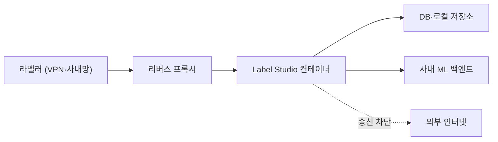
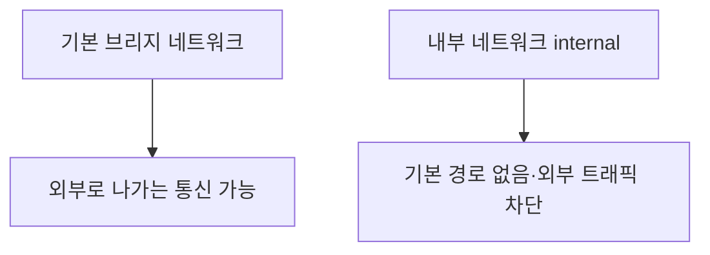

# 라벨링 도구 네트워크 격리

> 자체 호스팅한 라벨링 도구(예: Label Studio)가 **외부 인터넷으로 나가는 통신을 못 하도록** 사내망·방화벽·도커 내부 네트워크로 막는 구성이다. 데이터를 서버에 두는 것만으로는 부족하고, 도구가 스스로 내보내는 통신도 막아야 한다.

## 쉽게 말하면
기밀 서류를 사내 회의실에서만 다루기로 했어도, 회의실 전화선이 바깥으로 이어져 있으면 누가 어떤 서류를 열었는지 같은 기록이 새어 나갈 수 있다. 네트워크 격리는 그 전화선을 끊고 사내 사람만 들어올 문을 남기는 일이다.

## 자세히
(Label Studio 저장소의 `base.py`·`docs/source/guide/security.md`와 Docker 공식 문서를 직접 열어 확인. 저장소는 develop 브랜치, 2026-11-22 기준. 법적 자문이 아니다.)
- **도구가 내보내는 통신(문서·코드)**
  - 사용 통계: 문서는 페이지 방문 수, 주석 수, 라벨링 설정의 데이터 유형 등을 수집하며 오픈소스판은 `COLLECT_ANALYTICS=False`로 끌 수 있다고 한다. 코드의 기본값은 `True`(`get_bool_env('COLLECT_ANALYTICS', ... True)`).
  - 브라우저 쪽: 콘텐츠 보안 정책(CSP) 설정에 `googletagmanager`, `google-analytics`, `*.ingest.sentry.io` 같은 외부 주소가 허용 목록으로 들어 있다. 이 주소들로 브라우저가 실제로 통신하는지는 확인하지 못했다. Sentry는 `SENTRY_DSN`이 설정될 때만 쓰이는 것으로 보인다(기본 None).
  - 외부 URL 가져오기: 업로드·임포트가 URL을 읽는 기능을 악용하는 SSRF를 막기 위한 설정 `SSRF_PROTECTION_ENABLED`가 있다. 보안 가이드는 "기본값은 비활성화, 운영에서는 켜라"고 쓰는데, 같은 날 읽은 `base.py`는 기본값 `True`다. **문서와 코드가 다르니 배포 버전의 설정을 직접 확인**한다.
  - ML 백엔드·클라우드 저장소(S3 등)를 연결하면 그쪽과 통신한다.
- **격리 방법(Docker 공식 문서)**: `docker network create --internal`로 만든 내부 네트워크에서는 컨테이너끼리만 통신하고, 기본 경로(default route)가 없으며 방화벽 규칙이 다른 네트워크와의 트래픽을 막는다. 단 게이트웨이 IP로는 접근 가능해 그 주소에 바인딩한 호스트 서비스는 열려 있고, 호스트는 컨테이너 IP에 직접 접근할 수 있다. 기본 브리지 네트워크는 외부로 나가는 통신(마스커레이딩)을 허용하므로 격리하려면 별도 설정이 필요하다. 사내 사용자가 접속하려면 앞단 리버스 프록시를 두 네트워크에 걸쳐 두는 식으로 구성한다(제안).
- **점검 체크리스트(제안)**
  1. 라벨링 서버의 **외부 송신(egress)을 기본 차단**하고 필요한 주소만 허용
  2. `COLLECT_ANALYTICS=false` 명시, 설치 후 실제 송신 시도를 로그·방화벽으로 확인
  3. 사전 라벨용 ML 백엔드도 같은 내부 네트워크에 두기([Label Studio ML 백엔드](#label-studio-ml-backend))
  4. 라벨러 브라우저가 외부 분석 주소로 요청하지 않는지 개발자 도구나 프록시 로그로 확인
  5. 접근은 VPN·사내망 안으로 제한, HTTPS
- **한계**: 격리는 데이터 반출 위험을 줄일 뿐 라벨러의 화면 촬영 같은 인적 유출은 못 막는다([외부 라벨러 비밀 유지](#external-labeler-confidentiality)).

## 그림으로 보기

## 예시
- 고객 상담 녹취를 텍스트로 옮긴 데이터를 라벨링하는 사내 프로젝트: Label Studio와 ML 백엔드를 내부 전용 도커 네트워크에 두고 `COLLECT_ANALYTICS=false`, 외부 송신은 방화벽에서 차단.
- 교육 소재: "자체 호스팅이 곧 안전은 아니다"를 설정 하나(분석 수집 기본 True)로 보여 주기.

## 헷갈리는 것과 비교
| 개념 | 차이 |
|---|---|
| 네트워크 격리 | 도구의 외부 통신을 기술적으로 차단 |
| [자체 호스팅 라벨링과 개인정보](#self-hosted-labeling-privacy) | 전체 개인정보 점검 틀 |
| [외부 라벨러 비밀 유지](#external-labeler-confidentiality) | 사람·계약 측면 통제 |
| 접근 제어(VPN) | 누가 들어오나, 격리는 무엇이 나가나 |

## 더 읽을거리
- [Label Studio security.md](https://github.com/HumanSignal/label-studio/blob/develop/docs/source/guide/security.md) — 수집 정보, `COLLECT_ANALYTICS`, SSRF 설정 안내(직접 확인).
- [Label Studio base.py](https://github.com/HumanSignal/label-studio/blob/develop/label_studio/core/settings/base.py) — 환경 변수 기본값(직접 확인).
- [docker network create 문서](https://docs.docker.com/reference/cli/docker/network/create/) — `--internal`의 동작과 한계(직접 확인).
