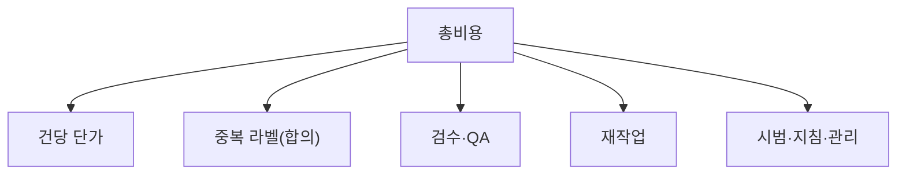
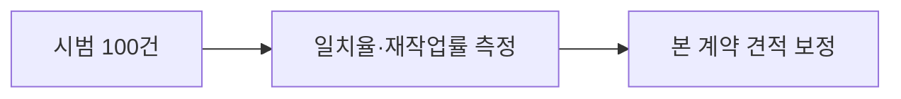

# 라벨링 총비용 계산

> 라벨링 비용은 건당 단가가 전부가 아니다. 도구 사용료, 중복 라벨, 품질 검수, 재작업, 시범 운영, 관리 인건비를 합쳐 계산해야 한다. 이 노드에서 출처로 확인된 것은 Labelbox의 단위 과금 방식뿐이다.

## 쉽게 말하면
식당 한 끼 가격(건당 단가)만 보고 예산을 짜면 안 된다. 배달비, 서비스료, 반찬 리필(재작업), 위생 점검(QA)이 모두 더해진다.

## 자세히
(Labelbox 문서 billing 페이지를 하위 에이전트가 WebFetch 요약으로 읽은 노트. 그 밖의 항목은 **미확인**.)
- **Labelbox 단위(LBU) 소비**: Catalog(월) — 이미지·텍스트·오디오·채팅 행 60개당 1 LBU. Annotate(1회) — 데이터 행 1개당 1 LBU(문서는 쪽당 1, 영상은 150프레임당 1, 타일 지리·의료는 행당 4, 실시간 멀티모달·LLM은 행당 20). Model(1회) — 5행당 1 LBU. 건너뛴 행도 라벨링된 것으로 센다. 무료 계정은 월 500 LBU.
- **서비스 가격**: 해당 페이지에는 전문 라벨러 서비스 언급만 있고 **가격이 없다**. LBU당 0.10달러, "시간당 10달러부터" 같은 수치는 제3자 검색 요약이라 미확인. Scale AI·Appen 가격은 열지 않았다(견적 기반으로 알려짐, 미확인).
- **일반적 비용 구성(제안, 벤더 문서로 미확인)**: 단가 × 건수 + 중복 라벨 수(합의용) + QA·검수 비율 + 재작업 + 시범 운영과 지침 작성 + 도구·인프라 + 프로젝트 관리. 중복·합의 지표는 [Label Studio 통계 문서](https://docs.humansignal.com/guide/stats)에 정의가 있다(요약으로 확인).
- **계산 틀(제안)**: 총비용 = (기본 단가 × 중복 수 + 검수 단가 × 검수 비율) × 건수 × (1 + 재작업률) + 고정비. 시범 100건으로 재작업률과 일치율을 먼저 측정한다.

## 그림으로 보기

## 예시
- 건당 단가 100원·중복 3회·검수 10%·재작업률 15%이면 단가만의 3배 이상이 될 수 있다(계산 예, 가상 수치).
- 교육 활용: 견적서를 받아 숨은 비용 항목을 찾는 실습.

## 헷갈리는 것과 비교
| 개념 | 차이 |
|---|---|
| 건당 단가 | 광고되는 가격 |
| 총비용 | 중복·QA·재작업까지 포함 |
| [주석 비용 비교](#annotation-cost-comparison) | 사람·크라우드·LLM의 단가 비교 |

## 더 읽을거리
- [Labelbox 청구 문서](https://docs.labelbox.com/docs/billing) — LBU 소비 규칙(요약으로 확인).
