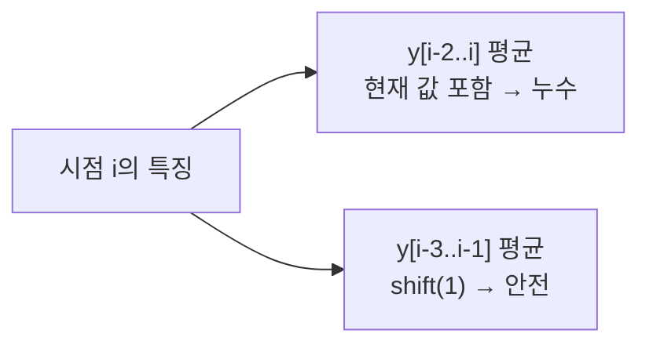
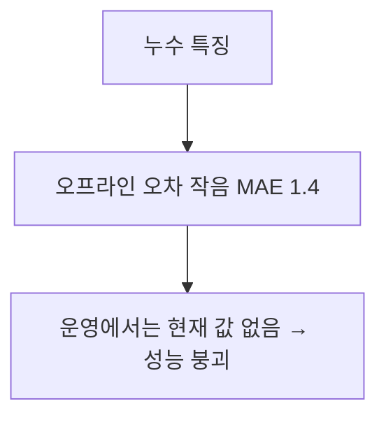

# 지연 특징과 shift

> 시계열에서 **과거 값으로 만든 특징(지연·이동평균)** 을 쓸 때, 그 계산이 **예측하려는 시점의 값을 포함하지 않도록** 한 칸 뒤로 밀어(`shift`) 쓰는 습관이다. 안 밀면 정답이 특징에 섞여 성능이 부풀려진다.

## 쉽게 말하면
"오늘 기온을 맞히려는데 참고 자료가 '오늘 포함 최근 3일 평균'"이라면 오늘 값이 이미 참고 자료 안에 들어 있어 반칙이다. "어제까지 3일 평균"으로 하루 밀어야 진짜 예측이 된다.

## 자세히
(앞서 읽은 `TimeSeriesSplit` 문서의 검색 요약에 shift(1) 예가 있었으나 그 글은 직접 확인하지 못했다. 아래는 **이 지도에서 순수 Python으로 직접 실행한 시연**이며 장난감 데이터로 방법의 원리를 보여 줄 뿐 일반 결과가 아니다.)
- **직접 실행한 예(10개 시점의 값 y)**: `y = [10, 12, 11, 15, 14, 18, 20, 19, 25, 24]`. 윈도우 3의 이동평균 특징을 두 가지로 만들었다.
  - **누수 있음**: 시점 i의 특징 = `y[i-2..i]` 평균(현재 값 포함) → `[10.0, 11.0, 11.0, 12.67, 13.33, 15.67, 17.33, 19.0, 21.33, 22.67]`
  - **한 칸 shift(안전)**: 시점 i의 특징 = `y[i-3..i-1]` 평균(어제까지) → `[None, 10.0, 11.0, 11.0, 12.67, 13.33, 15.67, 17.33, 19.0, 21.33]`
- **측정 결과(같은 코드)**: 특징과 정답 y의 상관은 누수 있음 **0.976**, shift 후 **0.934**. 특징을 그대로 예측값으로 쓴 평균절대오차(MAE)는 누수 있음 **1.400**, shift 후 **2.963**. 즉 누수 특징은 **오차를 절반 이하로 보이게** 하지만 실제로는 현재 값이 섞여 있어서다. 운영에서는 현재 값을 알 수 없으므로 성능이 무너진다.
- **원리(일반)**: 특징 계산 창이 예측 시점의 값을 포함하면 모델은 정답의 일부를 입력으로 받는다. 서빙에서는 그 값이 없으므로 학습 때 본 성능을 재현하지 못한다([시점 누수](#point-in-time-leakage)).
- **pandas 관용구(일반)**: `df['y'].rolling(3).mean().shift(1)`처럼 **집계한 뒤 shift(1)** 한다. 이 구문은 이 지도에서 실행하지 않았다. 순서(집계 후 shift, 또는 shift 후 집계)와 `rolling`의 창 정의(현재 행 포함 여부)는 라이브러리 문서로 확인한다.
- **gap과의 관계**: 특징이 최대 lag k를 참조하면 학습/시험 분할에서 [분할 gap](#split-gap-buffer)을 k 이상으로 둬야 한다. shift는 **특징 쪽**의 방어, gap은 **분할 쪽**의 방어이며 둘 다 필요할 수 있다.
- **확인 방법(제안)**: 특징을 지우거나 shift한 뒤 성능이 급락하면 의심한다. 단일 특징의 상관이 비정상적으로 높거나, 오프라인 성능이 운영보다 훨씬 좋을 때도 단서다.

## 그림으로 보기



## 예시
```python
y = [10, 12, 11, 15, 14, 18, 20, 19, 25, 24]
def rolling_mean(xs, w, i):
    seg = xs[max(0, i-w+1): i+1]; return sum(seg)/len(seg)
leaky = [rolling_mean(y, 3, i) for i in range(len(y))]
safe  = [None] + [rolling_mean(y, 3, i-1) for i in range(1, len(y))]
```
- 교육 소재: 같은 특징을 한 칸 밀기 전후로 정확도를 비교해 반칙을 체험.

## 헷갈리는 것과 비교
| 개념 | 차이 |
|---|---|
| shift(1) | 특징이 현재 값을 포함하지 않게 한 칸 밀기 |
| [분할 gap 완충 구간](#split-gap-buffer) | 학습·시험 사이를 비워 누수 방지 |
| [시간 기반 분할 규칙](#time-based-split-rule) | 시간순 분할이라는 상위 규칙 |
| [시점 누수](#point-in-time-leakage) | 이 습관이 막으려는 문제 |

## 더 읽을거리
- [sklearn TimeSeriesSplit](https://scikit-learn.org/stable/modules/generated/sklearn.model_selection.TimeSeriesSplit) — 시계열 분할과 gap(직접 읽음, shift 예는 없음).
