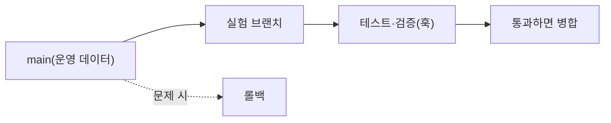
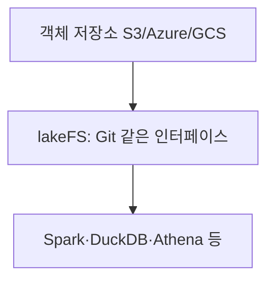

# lakeFS 데이터 버전 관리

> lakeFS는 객체 저장소(S3·Azure Blob·GCS)를 Git 같은 저장소로 바꿔 주는 도구다. 데이터 레이크를 코드처럼 브랜치·커밋으로 관리해 재현 가능하고 원자적인 데이터 작업을 만든다.

## 쉽게 말하면
창고 전체를 복사하지 않고 "가상의 창고 지점(브랜치)"을 만들어 거기서 마음껏 실험하고, 문제 없으면 본점에 합치는 방식이다. 문제가 생기면 과거 상태로 되돌린다.

## 자세히
(lakeFS GitHub README를 직접 열어 확인. 2026-11-21 기준. 공식 문서 사이트 모델 페이지는 리다이렉트·404로 열지 못했다.)
- **정의**: 소스 공개(source-available) 도구로 객체 저장소를 Git 같은 저장소로 변환. S3와 API가 호환되어 Spark, Hive, Athena, DuckDB, Presto 등과 쓸 수 있다. AWS S3·Azure Blob Storage·Google Cloud Storage를 지원.
- **실행**: `pip install lakefs` 후 `python -m lakefs.quickstart`, 또는 `docker run ... treeverse/lakefs:latest run --quickstart`(포트 8000).
- **용도(README)**
  - **ETL 테스트**: 운영 환경 복제본(격리 환경)에서 ETL을 시험해 다운스트림 영향을 막는다.
  - **재현성**: 현재 상태뿐 아니라 과거 시점의 데이터 상태를 Git 같은 인터페이스로 재현 — 디버깅, ML 학습 정확도 검증, 감사에 유리.
  - **Write-Audit-Publish**: 훅으로 테스트를 통과한 데이터만 운영에 반영.
  - **롤백**: 심각한 데이터 오류 시 이전 상태로 되돌리며, 데이터 복사본을 만들지 않고 버전을 제공한다고 설명.
- **라이선스**: Business Source License 1.1(비운영 용도 무료, 조직 내부 업무용 비수정 운영 사용 무료, 각 버전은 출시 4년 후 Apache 2.0). 사용 전 약관 확인 필요.
- **비교(제안)**: DVC는 Git과 함께 파일 단위 포인터를, lakeFS는 객체 저장소 계층에서 브랜치·커밋을 제공한다.

## 그림으로 보기

## 예시
- 새 전처리 결과를 브랜치에서 검증한 뒤에만 `main`에 병합해 대시보드를 보호.
- 교육 활용: 코드 브랜치와 데이터 브랜치의 유사성 설명.

## 헷갈리는 것과 비교
| 도구 | 방식 |
|---|---|
| lakeFS | 객체 저장소 위 브랜치·커밋 |
| [DVC](#dvc) | 파일 포인터 + 파이프라인 |
| [Git LFS](#git-lfs-pointer-file) | 큰 파일 포인터 |

## 더 읽을거리
- [lakeFS README (GitHub)](https://github.com/treeverse/lakeFS) — 개요·용도·라이선스.
