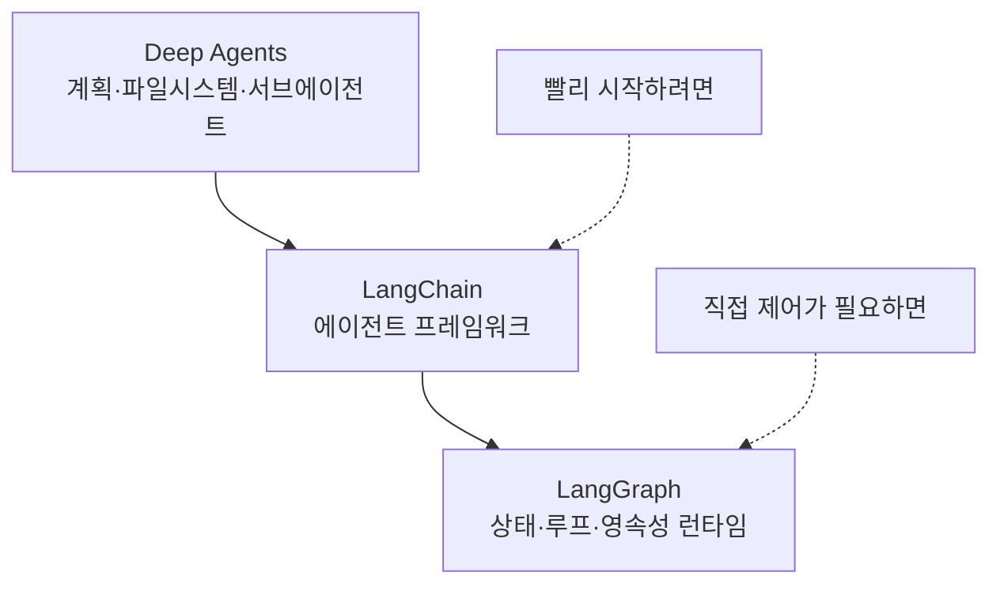
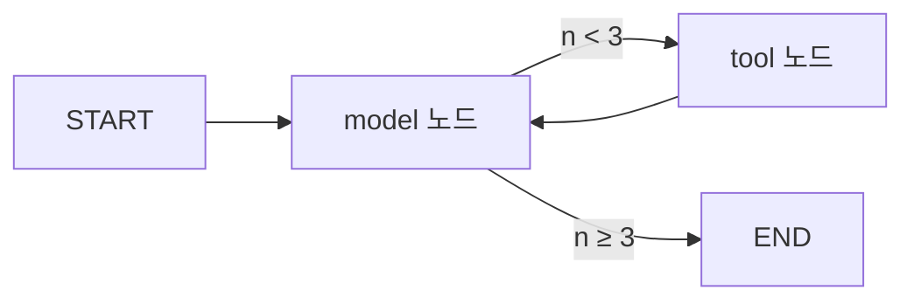

# LangChain과 LangGraph

> **LangChain**은 에이전트를 빠르게 만들게 해 주는 **프레임워크(추상화 계층)**, **LangGraph**는 그 밑에서 상태·루프·저장·사람 개입을 직접 제어하게 해 주는 **저수준 오케스트레이션 런타임**이다. LangChain의 에이전트는 LangGraph 위에 만들어져 있다. 여기에 **Deep Agents**라는 "배터리 포함" 하네스 계층이 더 있다.

## 쉽게 말하면
요리로 치면 LangChain은 밀키트(재료와 순서가 정해져 빨리 완성), LangGraph는 주방과 조리 도구(순서·불·타이밍을 내가 직접 정함), Deep Agents는 계획을 세우고 보조 요리사까지 딸린 풀코스 세트다.

## 자세히
(LangChain 공식 문서 "products" 개념 페이지 기준)
- **LangChain**: 에이전트 루프, 구조화된 콘텐츠 블록, 미들웨어 같은 **추상화**를 제공하는 에이전트 프레임워크. LangGraph 위에 만들어졌지만 "LangGraph를 몰라도 LangChain을 쓸 수 있다".
- **LangGraph**: 장시간 실행되는 **상태 있는** 에이전트를 만들고 관리·배포하기 위한 **저수준 오케스트레이션 프레임워크이자 런타임**. 내구성 있는 실행(durable execution), 스트리밍, 사람 개입(human-in-the-loop), 영속성(persistence), 오케스트레이션 직접 제어.
- **Deep Agents**: 계획·컨텍스트 관리용 파일시스템 접근·서브에이전트를 더한, 의견이 담긴 "배터리 포함" **에이전트 하네스**(LangGraph 기반).
- **선택 기준**(문서): 빠른 시작·팀 표준화 → LangChain / 세밀한 제어·운영급 내구성이 필요한 상태 있는 워크플로 → LangGraph / 미리 정의된 도구·프롬프트·서브에이전트가 필요한 장시간 자율 작업 → Deep Agents.
- **직접 실행**(langgraph 1.2.24, LLM 없이 가짜 모델): LangGraph로 "모델 → 도구 → 모델" 루프를 노드와 조건부 엣지로 직접 짰다. `model`이 `n`이 3 미만이면 `tool`로, 아니면 종료로 가게 했고, 실행 기록은 `['model#0','tool','model#1','tool','model#2']`였다. 이처럼 **분기·반복을 직접 그리는 것**이 LangGraph의 영역이고, LangChain은 이런 루프를 미리 만들어 둔 에이전트로 감싼다.
- **비교 정리**:

| 항목 | LangChain | LangGraph |
|---|---|---|
| 수준 | 높은 추상화 | 낮은 수준(직접 제어) |
| 시작 속도 | 빠름 | 설계 필요 |
| 제어 | 미들웨어 등으로 확장 | 노드·엣지·상태 직접 |
| 운영 기능 | LangGraph를 통해 상속 | 내구성·스트리밍·영속성 |

- 한계: LangChain 생태계는 버전 변화가 빠르고(패키지 분리·이름 변경) 제품 정의가 갱신되므로 사용 시점의 공식 문서를 확인한다.

## 그림으로 보기



## 예시
```python
g = StateGraph(S)
g.add_node("model", model); g.add_node("tool", tool)
g.add_edge(START, "model")
g.add_conditional_edges("model", lambda s: "tool" if s["n"] < 3 else END)
g.add_edge("tool", "model")
```
- 실무 선택: 사내 FAQ 에이전트는 LangChain으로 빨리 시작, 승인 단계·장애 복구가 필요한 결재 자동화는 LangGraph로 직접 설계.

## 헷갈리는 것과 비교
| 개념 | 차이 |
|---|---|
| LangChain | 에이전트 프레임워크(높은 추상화) |
| LangGraph | 저수준 오케스트레이션 런타임 |
| Deep Agents | LangGraph 기반 배터리 포함 하네스 |
| [LangGraph 상태](#langgraph-state) | LangGraph의 핵심 개념 |

## 더 읽을거리
- [LangChain docs: Products](https://docs.langchain.com/oss/python/concepts/products) — LangChain·LangGraph·Deep Agents 구분과 선택 기준.
