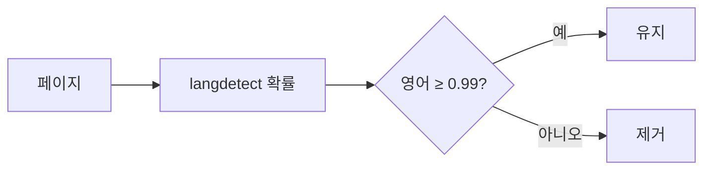
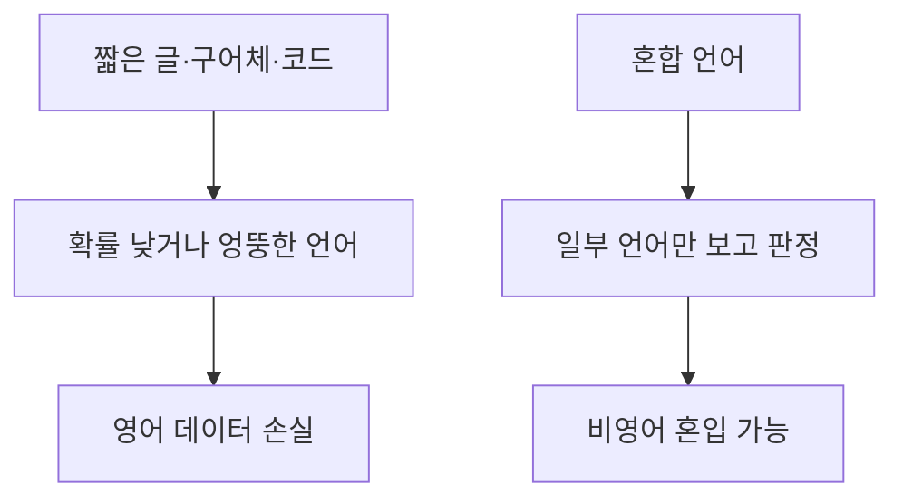

# 언어 감지 임계값

> C4는 `langdetect`가 **영어일 확률 0.99 이상**이라고 판단한 페이지만 남겼다. 높은 임계값은 비영어를 확실히 거르지만, **짧은 글·구어체·코드·혼합 언어 문서**에서 오판이 많아 영어 데이터도 함께 잃는다.

## 쉽게 말하면
외국어 시험 채점관이 "이건 틀림없이 영어"라고 99% 확신할 때만 통과시키는 규칙이다. 확신이 넘치는 긴 영어 문장은 통과하지만, 짧은 메모나 줄임말투성이 글은 채점관이 자신 없어 떨어뜨린다.

## 자세히
(T5 논문 arXiv 1910.10683 2.2절의 "영어일 확률 0.99 이상" 규정 + langdetect 1.0.9 직접 실행, 시드 고정)
- 기준: 논문은 langdetect로 영어 확률이 0.99 미만인 페이지를 모두 제거했다. 다운스트림 과제가 영어 중심이라는 이유다([C4 규칙](#c4-filter-rules)).
- 직접 실행(문장별 상위 판정과 확률, 영어 0.99 통과 여부):

| 입력 | 판정(확률) | EN≥0.99 |
|---|---|---|
| 긴 일반 영어 문장 | en 1.00 | 통과 |
| 과학 설명 영어 문장 | en 1.00 | 통과 |
| "lol that was soooo good gonna watch again tmrw" | en 0.71, so 0.14 | **탈락** |
| "Add water. Stir. Bake 20 min."(레시피) | **af(아프리칸스어) 1.00** | **탈락** |
| 독일어 + 영어 문장이 섞임 | de 0.57, en 0.43 | 탈락 |
| 독일어 문장 | de 1.00 | 탈락(의도대로) |
| `def add(a, b): return a + b` | **cy(웨일스어) 1.00** | 탈락 |
| 한국어 + 영어 섞인 문장 | **en 1.00** | **통과** |
- 해석: ① 짧고 구어체인 영어는 확률이 낮거나 엉뚱한 언어로 판정돼 버려진다 ② 코드·짧은 명령문은 무관한 언어로 확신 있게 오판된다 ③ 한국어가 섞인 글이 영어 1.00으로 통과한 것은 **영어 부분만 보고 판정하는 것처럼** 보여(내부 동작은 확인하지 않음) 임계값만으로 비영어 혼입을 막지 못한다. 문장 8개의 관찰이라 통계가 아니라 사례다.
- 실무(제안): 다국어 데이터에는 언어별 임계값을 두거나 문서 대신 문단 단위로 판정, 짧은 글은 별도 처리, 제외 표본 점검, fastText 계열 등 다른 감지기와 비교([제외 문서 저장](#exclusion-writer)).

## 그림으로 보기



## 예시
```python
from langdetect import detect_langs
detect_langs("Add water. Stir. Bake 20 min.")   # [af:1.0] — 짧은 영어가 오판
```
- 교육: 높은 임계값이 정밀도를 올리는 대신 재현율을 깎는 전형적인 예.

## 헷갈리는 것과 비교
| 개념 | 차이 |
|---|---|
| 임계값 0.99 | 엄격: 오탐 적음, 미탐(영어 손실) 많음 |
| 임계값 0.5 | 느슨: 영어 많이 남김, 비영어 혼입 증가 |
| [한국어 코퍼스 휴리스틱](#heuristic-filter-korean) | 영어 기준 규칙을 한국어에 맞추는 문제 |

## 더 읽을거리
- [T5 논문 (arXiv 1910.10683)](https://arxiv.org/abs/1910.10683) — langdetect 0.99 기준(PDF 본문 읽음).
- [langdetect (PyPI)](https://pypi.org/project/langdetect/) — 라이브러리(1.0.9 설치해 실행).
