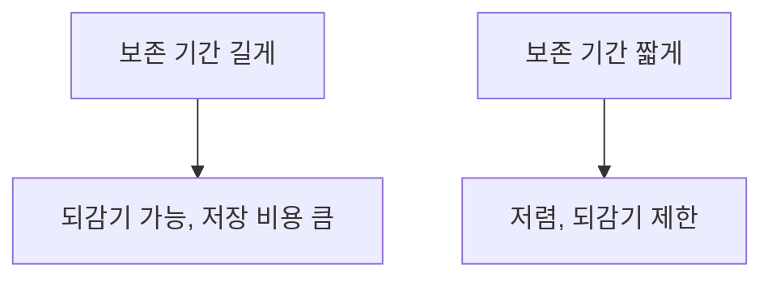

# 체크포인트 보존 정책

> 체크포인트는 스레드가 길어질수록 계속 쌓이므로, 오래된 것을 주기적으로 지우는 보존(retention) 정책을 직접 마련해야 한다.

## 쉽게 말하면
게임 자동 저장이 무한정 쌓이면 저장 공간이 차고 불러오기도 느려진다. 오래된 저장본을 정기적으로 정리하는 규칙이 보존 정책이다.

## 자세히
LangGraph durable execution 문서(이번에 연 페이지) 기준:
- 긴 대화에서 체크포인트가 누적되어 **지연 시간과 저장 비용**에 영향을 줄 수 있다.
- 문서가 제시하는 대책은 **주기적 가지치기**다. 내장 보존 API나 TTL은 **이 페이지에 없고**, 예제 주석에 "N일보다 오래된 체크포인트를 삭제하는 cron 작업을 고려하라"는 정도만 있다.
- 관련 지침: `PostgresSaver`/`AsyncPostgresSaver`의 `thread_id`는 255자 미만. `InMemorySaver`는 재시작하면 사라진다. 운영은 Postgres, 개발은 SQLite 권장. `checkpointer.setup()`이 인덱스 포함 테이블을 만든다.
- 서브그래프는 자체 체크포인트 네임스페이스를 가져 부모가 업데이트를 바로 못 볼 수 있다.
- 따라서 실무에서는 DB 쪽에서 오래된 행을 지우는 스케줄 작업을 둔다(일반 관행, 이번에 구체 방법은 확인하지 못함). 지우면 [타임 트래블](#langgraph-time-travel)로 되돌릴 수 있는 시점도 사라진다. 내구 실행의 durability 모드(exit·async·sync) 등은 이 페이지에 없어 확인하지 못했다.

## 그림으로 보기



## 예시
```python
from langgraph.checkpoint.postgres import PostgresSaver
checkpointer = PostgresSaver.from_conn_string("postgresql://...")
checkpointer.setup()   # 테이블·인덱스 생성
# 삭제는 별도 스케줄 작업으로: 예) 30일 지난 thread의 체크포인트 행 정리(직접 구현)
```
고객 상담 에이전트라면 "30일 보존 후 삭제"를 개인정보 정책과 함께 정한다([저장 데이터 암호화](#encryption-at-rest)도 검토).

## 헷갈리는 것과 비교
| 개념 | 차이 |
|---|---|
| 보존 정책 | 체크포인트를 얼마나 남길지 |
| [체크포인터](#langgraph-checkpointer) | 저장 장치 |
| [Store](#langgraph-store) | 스레드를 넘는 장기 기억 |
| [내구 실행](#langgraph-durable-execution) | 중단 후 이어 실행하는 능력 |

## 더 읽을거리
- [LangGraph Durable execution](https://docs.langchain.com/oss/python/langgraph/durable-execution) — 체크포인트 누적 경고와 저장소 권장.
