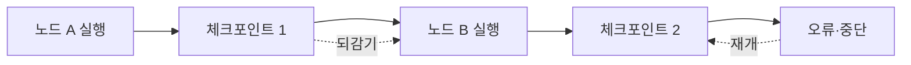

# 체크포인트와 영속성

> LangGraph가 실행 중 각 단계의 상태를 스냅샷(체크포인트)으로 저장해, 중단 후 재개·되감기·사람 개입을 가능하게 하는 기능.

## 쉽게 말하면
게임의 자동 저장이다. 한 판이 끝날 때마다 저장해 두면 앱이 꺼져도 그 지점부터 이어 하고, 이전 저장으로 돌아가 다른 선택도 해 볼 수 있다.

## 자세히
LangGraph 문서 기준(2026-10 확인):
- **체크포인트**: 그래프 상태의 저장된 스냅샷. **체크포인터**가 저장·로드한다. 그래프를 `compile(checkpointer=...)`할 때 붙인다. 구현은 인메모리, SQLite, PostgreSQL 등.
- **스레드**: 하나의 `thread_id`로 묶인 체크포인트들. 같은 thread_id로 부르면 이어서, 새 id면 새로 시작한다.
- 얻는 것: ① 스레드 단위 **단기 기억**(대화 지속), ② [사람 개입](#human-in-the-loop), ③ **타임 트래블**(과거 체크포인트 조회·복귀), ④ **내결함성**(실패해도 처음부터가 아니라 마지막 지점에서 재개).
- **스토어**는 체크포인터와 별개로 스레드 간에 공유하는 장기 데이터(사용자 선호 등)를 둔다([에이전트 메모리](#agent-memory)).
- 운영에서는 재시작에도 남는 DB 기반 체크포인터를 쓴다.

## 그림으로 보기


## 예시
```python
from langgraph.checkpoint.memory import InMemorySaver
graph = builder.compile(checkpointer=InMemorySaver())
cfg = {"configurable": {"thread_id": "user-42"}}
graph.invoke({"messages": ["안녕"]}, cfg)   # 같은 cfg로 부르면 대화가 이어짐
```

## 헷갈리는 것과 비교
| 개념 | 차이 |
| --- | --- |
| 체크포인트 | 한 스레드 안의 단계별 상태 |
| 스토어 | 스레드를 넘나드는 장기 데이터 |
| 프롬프트 캐싱 | 비용 최적화. 상태 복구와 무관 |

## 더 읽을거리
- [LangGraph Persistence](https://docs.langchain.com/oss/python/langgraph/persistence) — 체크포인트·스레드·타임 트래블
