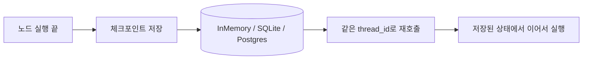
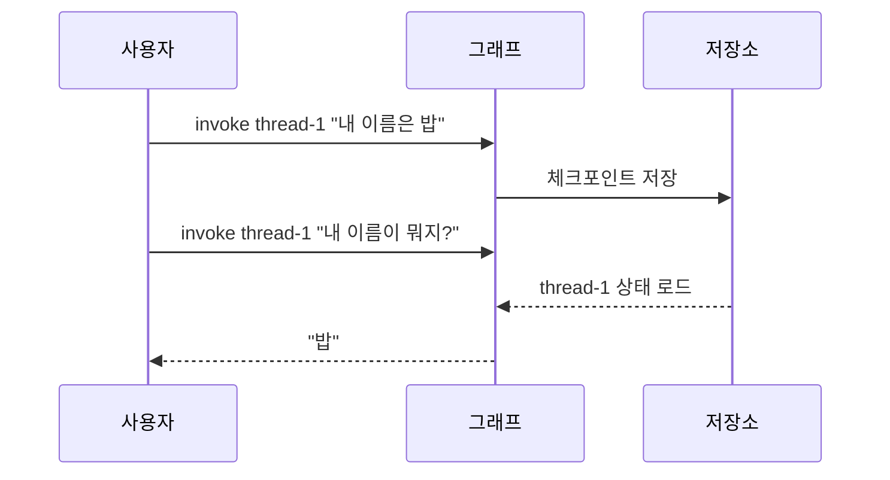

# 체크포인터와 thread_id

> 체크포인터(checkpointer)는 LangGraph 실행 중 상태를 체크포인트로 저장하는 계층이고, thread_id는 어떤 대화·작업 흐름에 속한 저장본인지 가리키는 이름표다.

## 쉽게 말하면
게임의 저장 슬롯이다. 체크포인터는 "자동 저장 기능", thread_id는 "슬롯 이름"이다. 같은 슬롯 이름으로 다시 들어오면 이어서 하고, 다른 이름이면 새 게임이다.

## 자세히
LangGraph 영속성 문서 기준:
- **thread**: 같은 정체성을 공유하는 실행들의 연속. `thread_id`로 식별한다.
- **checkpoint**: 특정 시점의 그래프 상태 스냅샷. 체크포인터가 thread의 상태를 체크포인트로 남겨 단기(스레드 단위) 기억을 만든다.
- 저장소 종류: `InMemorySaver`(메모리, 재시작하면 사라짐), `SqliteSaver`(로컬 파일, 개발용 권장), `PostgresSaver`/`AsyncPostgresSaver`(운영용 권장). Postgres는 thread_id를 255자 미만으로.
- `compile(checkpointer=...)`로 연결하고, 실행 때 `config={"configurable": {"thread_id": "..."}}`를 넘긴다. 같은 thread_id의 호출은 이전 상태를 이어받는다.
- 체크포인트가 있어야 [인터럽트](#langgraph-interrupt)로 멈췄다가 재개하는 것, 실패 지점부터 재시작하는 것이 가능하다. 스레드를 넘나드는 장기 기억은 [Store](#langgraph-store)가 맡는다.
- (참고) 상태 조회·되감기용 `get_state_history` 등은 이번에 열어 본 문서에 없어 확인하지 못했다. 다른 체크포인터 문서를 확인할 것.

## 그림으로 보기



## 예시
```python
from langgraph.checkpoint.memory import InMemorySaver
graph = builder.compile(checkpointer=InMemorySaver())
config = {"configurable": {"thread_id": "thread-1"}}
graph.invoke({"messages": [{"role": "user", "content": "Hi, my name is Bob."}]}, config)
graph.invoke({"messages": [{"role": "user", "content": "What is my name?"}]}, config)
```

## 헷갈리는 것과 비교
| 개념 | 차이 |
|---|---|
| checkpointer/thread | 한 대화 안의 상태(단기) |
| [Store](#langgraph-store) | 대화를 가로지르는 장기 기억 |
| [상태](#langgraph-state) | 저장되는 내용물 자체 |

## 더 읽을거리
- [LangGraph Persistence](https://docs.langchain.com/oss/python/langgraph/persistence) — thread·checkpoint·checkpointer 종류와 예제.
