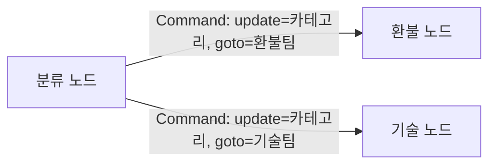
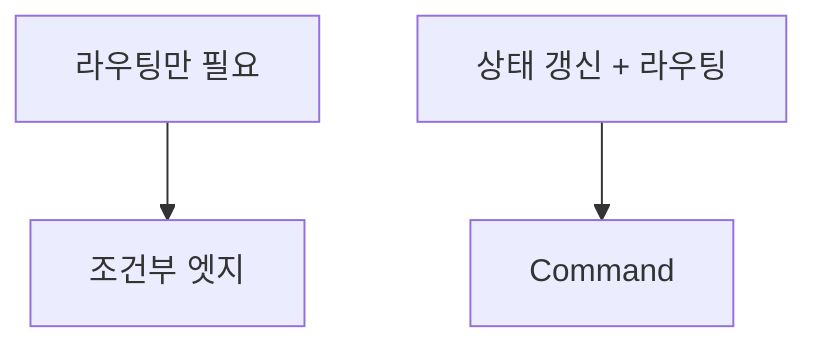

# Command(goto·update)

> LangGraph 노드가 반환값 하나로 "상태 갱신(update)"과 "다음에 갈 노드(goto)"를 동시에 지시하게 해 주는 객체.

## 쉽게 말하면
조건부 엣지는 교차로의 표지판이다. 길 안내만 하고 짐은 건드리지 않는다. `Command`는 운전사가 도착 직전에 "짐 목록을 이렇게 고쳤고, 다음은 B 창구로 간다"고 한 번에 메모를 남기는 것이다. 상태 변경과 이동이 한 곳에 붙어 있어 흐름을 읽기 쉽다.

## 자세히
LangGraph 공식 문서(Graph API, 확인 2026-11-02)의 `Command` 매개변수 4가지:
- **update**: 일반 노드가 dict를 반환하듯 상태를 갱신.
- **goto**: 다음에 실행할 노드(들)를 지정.
- **graph**: 서브그래프 안에서 부모 그래프로 이동하려면 `Command.PARENT`를 지정([서브그래프](#langgraph-subgraph)).
- **resume**: `interrupt()`로 멈춘 실행을 이어 가며 사람이 준 값을 넘긴다.
- 쓰이는 곳 3가지: 노드의 반환값, `invoke()`·`stream()`의 입력(resume용), 도구의 반환값.
- **언제 쓰나**: 문서의 기준은 "상태 갱신과 라우팅을 둘 다 해야 할 때". 라우팅만 하면 조건부 엣지가 더 단순하다([조건부 엣지](#langgraph-conditional-edges)).
- **주의**: `Command(goto=...)`는 동적 엣지라서 정적 `add_edge`를 대체하지 않는다. 같은 노드에 둘 다 있으면 두 목적지가 모두 실행된다. 노드당 라우팅 방식은 하나만 쓴다.
- **주의**: `Command(update=...)`만 입력으로 넘기면 끝난 스레드가 멈춘 것처럼 보일 수 있으니 대화를 이어 갈 땐 일반 입력 dict를 쓴다.
- 반환 타입에 `Literal["a","b"]` 주석을 달아 두면 그래프 시각화에서 가능한 이동 경로가 표시된다.

## 그림으로 보기



## 예시
```python
from typing import Literal
from langgraph.types import Command

def classify(state) -> Command[Literal["refund", "tech"]]:
    kind = "refund" if "환불" in state["text"] else "tech"
    return Command(update={"kind": kind}, goto=kind)
```

## 헷갈리는 것과 비교
| 개념 | 차이 |
| --- | --- |
| 조건부 엣지 | 라우팅만. 상태는 노드 반환값으로 따로 갱신 |
| Command | 갱신 + 이동을 한 반환값으로 |
| 정적 엣지 | 항상 같은 다음 노드. Command와 함께 쓰면 둘 다 실행 |
| [Send](#langgraph-send-map-reduce) | 같은 노드를 여러 입력으로 병렬 실행하는 팬아웃 |

## 더 읽을거리
- [LangGraph Graph API 문서](https://docs.langchain.com/oss/python/langgraph/graph-api) — Command, 조건부 엣지, compile 설명.
