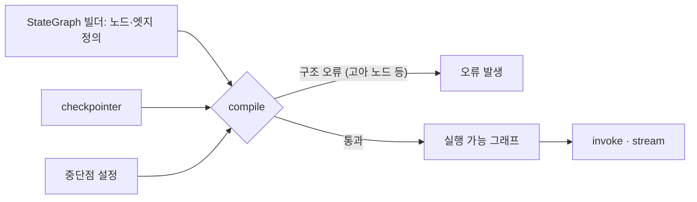

# compile과 그래프 검증

> `StateGraph`로 노드·엣지를 정의한 설계도를 실행 가능한 그래프로 바꾸는 단계. 구조 검사와 체크포인터·중단점 설정이 여기서 붙는다.

## 쉽게 말하면
건축 도면을 그린 것만으로는 집에 들어갈 수 없다. 준공 검사를 받고 전기·수도(저장소·중단 장치)를 연결해야 입주한다. `compile()`이 준공 검사와 설비 연결이다. 도면에 방이 연결 안 된 채 떠 있으면 여기서 걸린다.

## 자세히
LangGraph 공식 문서(확인 2026-11-02) 기준:
- **필수 단계**: 그래프는 `compile()`을 해야 사용할 수 있다. `StateGraph` 자체는 빌더이고 compile 결과가 실행 객체(`invoke`·`stream` 가능)다.
- **검증**: 주로 구조 검사다. 예를 들어 어디와도 연결되지 않은 고아 노드를 잡아낸다. 의미적 오류(상태 키 오타, 잘못된 로직)까지 잡아 주지는 않는다.
- **체크포인터**: `compile(checkpointer=...)`로 저장소를 넘기면 super-step 경계마다 상태가 저장되어 재개·시간여행이 가능하다([체크포인터](#langgraph-checkpoint), [super-step](#langgraph-super-step)).
- **중단점/인터럽트**: 사람 승인 지점도 compile 시점 옵션으로 설정한다. 세부 옵션은 인터럽트 문서를 참조(Graph API 페이지에는 상세 없음).
- 같은 빌더에서 설정을 달리해 여러 번 compile할 수 있다(예: 테스트는 메모리 체크포인터, 운영은 DB 체크포인터).

## 그림으로 보기


## 예시
```python
builder = StateGraph(State)
builder.add_node("classify", classify)
builder.add_edge(START, "classify")
graph = builder.compile(checkpointer=InMemorySaver())
graph.invoke({"text": "환불해 주세요"}, config={"configurable": {"thread_id": "1"}})
```

## 헷갈리는 것과 비교
| 개념 | 차이 |
| --- | --- |
| StateGraph | 설계도(빌더). 직접 실행 불가 |
| compile() | 검증 + 설비 연결 → 실행 객체 |
| 체크포인터 | 상태 저장소. compile 때 연결 |
| 단위 테스트 | compile은 구조만 확인, 동작은 실제 실행으로 검증 |

## 더 읽을거리
- [LangGraph Graph API 문서](https://docs.langchain.com/oss/python/langgraph/graph-api) — compile과 Command.
