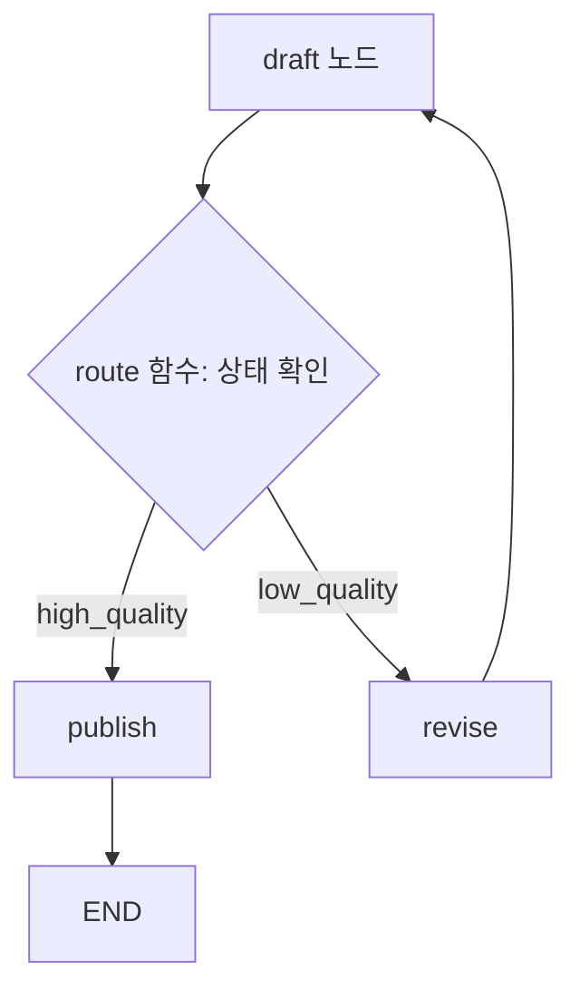

# 조건부 엣지와 라우팅 함수

> `add_conditional_edges`는 출발 노드 뒤에 **라우팅 함수**를 붙여, 현재 상태를 보고 다음에 실행할 노드의 이름을 고르게 하는 LangGraph 기능이다.

## 쉽게 말하면
고속도로 분기점의 안내 표지판이다. 차(상태)가 어떤 상태인지 보고 "서울 방면/부산 방면" 중 길을 정한다. 노드는 일을 하고, 갈림길 판단은 라우팅 함수가 맡는다.

## 자세히
- 형태: `graph.add_conditional_edges("draft", route, {"high_quality": "publish", "low_quality": "revise"})`
- 라우팅 함수는 상태(state)를 받아 **문자열(노드 이름 또는 매핑 키)**을 반환한다. 상태를 바꾸지 않고 판단만 한다.
- 매핑 dict는 라우터 반환값을 노드 이름으로 번역한다. 생략하면 반환값이 곧 노드 이름.
- 루프도 이렇게 만든다: "품질 미달이면 revise → 다시 draft 검사" 식으로 조건부로 되돌아가며, 종료는 `END`를 반환.
- 지침(2차 자료): **순수 라우팅은 조건부 엣지**, 상태 갱신과 이동을 함께 하려면 [Command](#langgraph-command).
- 공식 문서를 직접 열지는 못했고 튜토리얼·치트시트 기준이다.

## 그림으로 보기


## 예시
```python
def route(state):
    return "high_quality" if state["score"] >= 8 else "low_quality"

g.add_conditional_edges("draft", route,
    {"high_quality": "publish", "low_quality": "revise"})
```

## 헷갈리는 것과 비교
| 개념 | 차이 |
|---|---|
| 일반 엣지 | 항상 같은 다음 노드 |
| 조건부 엣지 | 상태에 따라 분기. 상태는 못 바꿈 |
| [Command](#langgraph-command) | 노드 안에서 상태 변경+이동 |
| [에이전트 루프](#agent-loop) | LLM이 스스로 다음을 정함. 여기선 코드가 정함 |

## 더 읽을거리
- [LangGraph 가이드북 (WikiDocs)](https://wikidocs.net/262302) — 한국어 튜토리얼
- [Codecademy LangGraph 치트시트](https://www.codecademy.com/learn/learn-fundamentals-of-langgraph/modules/introduction-to-langgraph/cheatsheet) — 문법 요약
