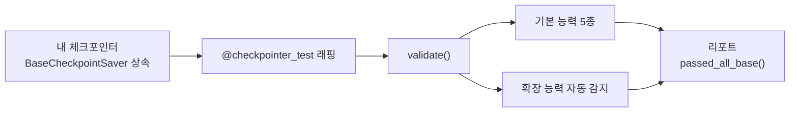

# 체크포인터 적합성 테스트 (Checkpointer Conformance Tests)

> `langgraph-checkpoint-conformance` 패키지는 직접 만든 LangGraph 체크포인터(`BaseCheckpointSaver` 서브클래스)가 저장 규약을 제대로 지키는지 자동으로 검증하는 테스트 모음이다.

## 쉽게 말하면
새 콘센트를 직접 만들었다면 꽂아서 전기가 흐르는지, 누전이 없는지 검사기부터 꽂아 봐야 한다. 이 패키지가 그 검사기다. 저장소(DB)를 바꿔 끼우는 체크포인터는 겉보기엔 돌아가도 저장·복원 규칙을 일부 어겨 나중에 사고가 나기 때문이다.

## 자세히
공식 README·LangSmith 문서(2026-11 확인, PyPI 버전 0.0.2 — 초기 버전이므로 확인 후 고정)의 내용:
- **설치**: `uv add langgraph-checkpoint-conformance`
- **사용 3단계**: ① 체크포인터를 yield하는 async 제너레이터에 `@checkpointer_test(name=...)` ② `validate(...)` 호출 → 리포트 ③ `print_report()` 후 `passed_all_base()` 확인. 독립 스크립트나 pytest(asyncio)로 실행.
- **기본(Base) 능력, 필수**: `put`, `put_writes`, `get_tuple`, `list`, `delete_thread`.
- **확장(Extended) 능력, 선택·자동 감지**: `delete_for_runs`, `copy_thread`, `prune`, `delta_channel_history`. 해당 메서드를 오버라이드한 경우에만 테스트가 돈다.
- **옵션**: `skip_capabilities`, `capabilities`(일부만 실행), `lifespan`(DB 같은 비싼 리소스 1회 준비), `ProgressCallbacks.default()/verbose()`.
- 검사 영역 예: 블롭 왕복(round-trip), 메타데이터 보존, 네임스페이스 격리, 증분 채널 업데이트.
- 문서 주장: 대부분의 오픈소스 체크포인터는 Agent Server가 요구하는 연산을 아직 다 구현하지 않았으므로 배포 전 검증을 권장.

## 그림으로 보기


## 예시
```python
@checkpointer_test(name="MyDBSaver")
async def make():
    saver = MyDBSaver(conn)
    yield saver          # 이후는 정리 코드
report = await validate(make)
report.print_report()
assert report.passed_all_base()
```
CI에 넣어 두면 DB 드라이버 업데이트 때 저장 규약이 깨지는 걸 바로 잡는다.

## 헷갈리는 것과 비교
| 개념 | 차이 |
|---|---|
| 적합성 테스트 | 저장소 구현이 규약을 지키는지 검사 |
| [직렬화(serde)](#langgraph-serde) | 테스트가 확인하는 대상 중 하나(왕복 직렬화) |
| 일반 단위 테스트 | 내 앱 로직 검증 — 규약 검증과 별개 |

## 더 읽을거리
- [checkpoint-conformance README](https://raw.githubusercontent.com/langchain-ai/langgraph/main/libs/checkpoint-conformance/README.md) — 사용법·능력 표.
- [Custom checkpointer 문서](https://docs.langchain.com/langsmith/custom-checkpointer) — 배포 전 검증 안내.
- [PyPI 패키지](https://pypi.org/project/langgraph-checkpoint-conformance) — 설치·버전.
