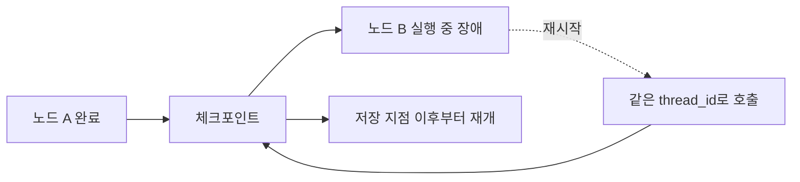

# 내구성 있는 실행

> 내구성 있는 실행(durable execution)은 실행 도중 프로세스가 죽거나 멈춰도 저장된 지점부터 이어서 할 수 있는 성질이다. LangGraph에서는 체크포인터와 thread_id가 그 바탕이다.

## 쉽게 말하면
긴 문서를 쓰다 정전이 나도 자동 저장 덕분에 마지막 저장 지점부터 이어 쓰는 것과 같다. 에이전트가 몇 시간 걸리는 작업 중간에 실패해도 처음부터 다시 하지 않는다.

## 자세히
확인한 LangGraph 영속성 문서(개요)가 말해 주는 범위:
- **요건**: 체크포인터를 붙여 `compile`하고, 실행 config의 `configurable`에 `thread_id`를 준다([체크포인터와 thread_id](#langgraph-checkpointer)).
- **재시작에 살아남으려면** 영속 저장소가 필요하다. `InMemorySaver`는 RAM이라 프로세스를 재시작하면 사라진다. 운영은 `PostgresSaver`, 로컬 개발은 `SqliteSaver`를 권장한다.
- 체크포인터는 사람 개입, 타임 트래블([타임 트래블](#langgraph-time-travel)), 장애 허용(fault tolerance)을 가능하게 한다.
- 대화가 길어지면 체크포인트가 쌓이므로 가지치기나 보존 정책을 두라고 권한다.
- **이 글에서 확인하지 못한 것**: 재실행 시 코드의 결정성(determinism) 요건, task 단위 체크포인트, 내구성 모드(durability mode)와 트레이드오프, 실패 후 재개의 상세 절차. 해당 문서를 열어 확인한 뒤 보강할 것(그 문서는 개요 페이지라 다루지 않았다).

## 그림으로 보기

## 예시
- 사람 승인 단계가 있는 결재 에이전트: 승인을 이틀 기다려도 상태가 DB에 있어 서버를 재배포한 뒤 같은 `thread_id`로 이어 간다.
- 장시간 리서치 에이전트가 3번째 단계에서 API 오류로 죽어도 앞 단계 결과를 재사용한다.

## 헷갈리는 것과 비교
| 개념 | 차이 |
|---|---|
| 내구성 있는 실행 | 중단 후 이어서 실행하는 성질 |
| 체크포인터 | 그 성질을 구현하는 저장 계층 |
| [타임 트래블](#langgraph-time-travel) | 과거 지점으로 돌아가 재실행·분기 |

## 더 읽을거리
- [LangGraph Persistence](https://docs.langchain.com/oss/python/langgraph/persistence) — 체크포인터 종류와 thread_id.
