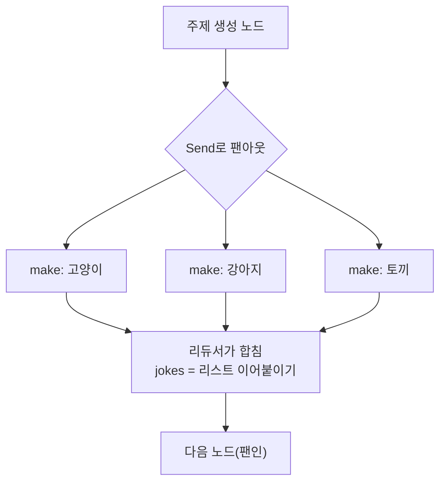
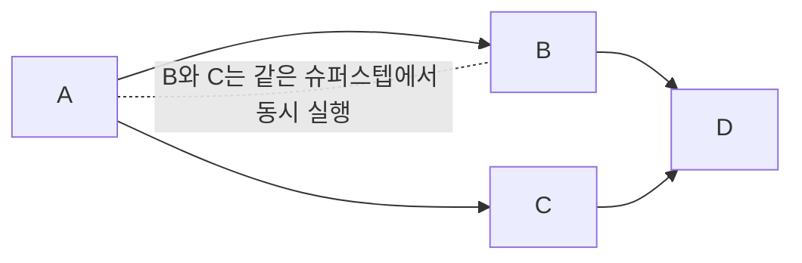

# 팬아웃·팬인 (fan-out / fan-in)

> 한 노드에서 여러 노드로 갈라져 동시에 실행하고(팬아웃), 그 결과를 한 노드에서 다시 모으는(팬인) LangGraph 구조. 갈라지는 개수를 미리 아는 정적 방식과, 실행 중에 정해지는 `Send` 방식이 있다.

## 쉽게 말하면
식당 주방에서 주문서 한 장이 들어오면 샐러드·메인·디저트를 각각 다른 요리사가 동시에 만들고(팬아웃), 마지막에 한 접시에 담아 내보내는(팬인) 것과 같다. 요리사 수가 메뉴에 따라 매번 다르면 `Send`로 그때그때 요리사를 배정한다.

## 자세히
**병렬 실행의 바탕(LangGraph 문서)**
- 실행은 Pregel 방식의 **슈퍼스텝** 단위로 진행된다. 병렬로 도는 노드는 같은 슈퍼스텝을, 순차인 노드는 서로 다른 슈퍼스텝을 쓴다.
- 한 노드에 나가는 간선이 여러 개면 목적지들이 **같은 다음 슈퍼스텝**에 들어가 병렬로 실행된다. 모든 노드가 비활성이고 이동 중인 메시지가 없으면 실행이 끝난다.
- 한 노드에는 정적 간선이나 동적 라우팅(조건부 간선·`Command`) 중 **하나만** 쓴다.

**두 가지 팬아웃**
1. **정적**: 개수가 고정. `add_edge("a","b")`, `add_edge("a","c")`로 둘을 동시에 실행하고 `add_edge(["b","c"],"d")`로 모은다.
2. **동적(`Send`)**: 같은 노드를 항목 수만큼 실행하되 각각 다른 입력을 준다. 항목 수는 실행 시점에야 안다. 조건부 간선에서 `Send` 객체 목록을 반환한다.
```python
def fan(state):
    return [Send("make", {"subject": s}) for s in state["subjects"]]
graph.add_conditional_edges("gen", fan, ["make"])
```

**팬인의 핵심은 리듀서**: 여러 작업자가 같은 상태 키를 쓰면 **리듀서**가 합쳐야 한다. 직접 실행(langgraph 1.2.22) 예에서 `jokes: Annotated[list[str], operator.add]`로 선언한 키에 세 작업자의 결과가 `['고양이 농담', '강아지 농담', '토끼 농담']`으로 모였다. 리듀서가 없으면 병렬 쓰기 충돌이 난다([잘못된 업데이트 오류](#invalid-update-error)).

**주의**: 병렬 결과의 순서는 의존하지 않는 편이 안전하다(필요하면 정렬 키를 결과에 포함). 병렬로 호출 수가 늘면 [속도 제한](#rate-limit-retry)과 비용에 닿을 수 있다.

## 그림으로 보기




## 예시
- 문서 30개를 각각 요약하는 맵-리듀스: 목록에서 `Send`로 요약 노드를 30번 띄우고, 요약 리스트를 합쳐 최종 보고서 노드로 보낸다.
- 정적 팬아웃: 한 질문을 "웹 검색"과 "사내 문서 검색"으로 동시에 보내고 결과를 합쳐 답변 노드가 쓴다([병렬화 패턴](#parallelization-pattern)).

## 헷갈리는 것과 비교
| 개념 | 차이 |
|---|---|
| 정적 팬아웃 | 갈래 수가 코드에 고정 |
| `Send` 팬아웃 | 갈래 수가 실행 중 데이터로 결정, 갈래마다 입력이 다름 |
| 팬인 | 결과를 합치는 단계. 리듀서 필요 |
| [슈퍼스텝](#langgraph-super-step) | 병렬 노드가 함께 도는 실행 단위 |
| [Send 맵리듀스](#langgraph-send-map-reduce) | `Send`를 쓰는 대표 패턴 노드 |

## 더 읽을거리
- [LangGraph Graph API (공식 문서)](https://docs.langchain.com/oss/python/langgraph/graph-api) — 슈퍼스텝·Send·리듀서
