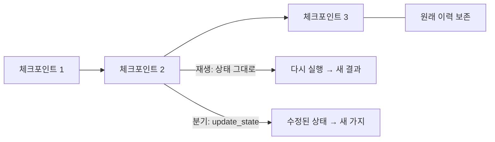

# 재생과 분기 비교

> LangGraph의 타임트래블에는 두 가지가 있다. **재생(replay)**은 과거 체크포인트에서 상태를 그대로 두고 다시 실행하고, **분기(fork)**는 과거 체크포인트의 상태를 `update_state`로 바꿔 새 가지에서 실행한다. 둘 다 체크포인트 이후 노드가 다시 돌아 부수효과가 반복된다.

## 쉽게 말하면
게임 세이브 파일을 불러오는 것과 같다. 재생은 같은 세이브에서 그냥 다시 플레이하고, 분기는 불러온 뒤 아이템 하나를 바꿔 다른 엔딩을 보는 것이다. 원래 세이브는 그대로 남는다. 다만 "게임 속 은행 송금" 같은 현실 세계 행동은 불러온다고 되돌려지지 않고 다시 일어난다.

## 자세히
공식 문서 기준(확인: 2026-11-13).
- **재생**: 이전 체크포인트의 config로 `invoke`한다. 체크포인트 **이전** 노드는 재실행하지 않고(결과가 저장돼 있음), **이후** 노드는 다시 돈다. "LLM 호출·API 요청·interrupt가 다시 발생하며 결과가 달라질 수 있다." 마지막 체크포인트(다음 노드 없음)에서 재생하면 아무 일도 안 일어난다(no-op).
- **분기**: 과거 체크포인트 config로 `update_state`를 호출해 새 값을 넣고, `invoke(None, 새 config)`로 이어 간다. 새 체크포인트가 그 지점에서 갈라져 나오고 **원래 이력은 보존된다.** 이후 노드는 바뀐 상태로 재실행되어 재생과 같은 부수효과 위험이 있다.
- `as_node`: 업데이트를 어느 노드가 한 것으로 볼지 정해 재개 지점을 결정한다. 기본은 이력에서 추론하고, 병렬 분기·새 스레드·노드 건너뛰기 때는 직접 지정한다.
- interrupt는 두 방식 모두에서 항상 다시 걸려 새 `Command(resume=...)`를 기다린다.
- 체크포인트 선택: `get_state_history`에서 항목을 골라 그 `config`(안에 checkpoint_id)를 `invoke`·`update_state`에 넘긴다.
- 실무 팁: 재실행 구간의 외부 호출은 [멱등](#idempotency)하게 만들어 두복 결제·중복 메일을 막는다.

## 그림으로 보기


## 예시
```python
history = list(graph.get_state_history(config))
past = history[2]                       # 되돌릴 체크포인트
graph.invoke(None, past.config)         # 재생
new_cfg = graph.update_state(past.config, {"topic": "고양이"})
graph.invoke(None, new_cfg)             # 분기
```

## 헷갈리는 것과 비교
| 개념 | 차이 |
| --- | --- |
| 재생 | 상태 그대로, 이후 노드 재실행 |
| 분기 | 상태 수정 + 새 가지, 원본 보존 |
| [update_state](#langgraph-update-state) | 분기를 만드는 도구 |
| [get_state](#langgraph-get-state) | 읽기만 함, 실행 없음 |

## 더 읽을거리
- [Use time-travel (LangGraph 공식 문서)](https://docs.langchain.com/oss/python/langgraph/use-time-travel) — 재생·분기·as_node
