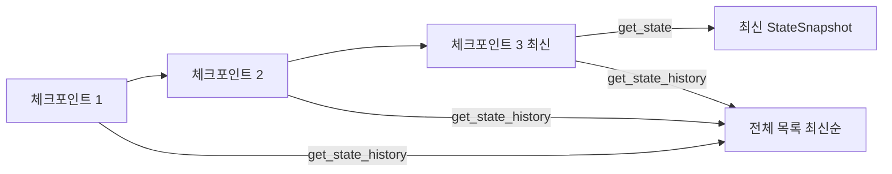
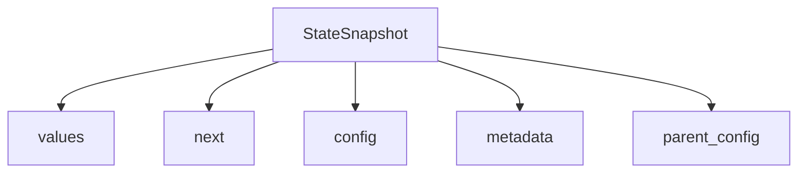

# get_state와 상태 기록

> 체크포인터가 있는 LangGraph에서 스레드의 현재 상태(`get_state`)와 과거 상태들(`get_state_history`)을 읽는 API.

## 쉽게 말하면
게임 저장 슬롯 목록이다. `get_state`는 "가장 최근 저장 슬롯", `get_state_history`는 "슬롯 전체 목록(최신순)"을 보여 준다. 슬롯을 열어 보기만 하는 것이고, 되돌려 실행하는 것은 [타임 트래블](#langgraph-time-travel)이다.

## 자세히
- 호출에는 `{"configurable": {"thread_id": "..."}}`가 필요하다. 특정 시점은 `checkpoint_id`를 더해 지정한다.
- 반환값 `StateSnapshot`의 주요 필드(공식 레퍼런스 기준, 버전에 따라 다를 수 있음 — 이 부분은 문서 페이지를 직접 확인하지 못해 기억에 근거한 설명):
  - `values`: 그 시점의 상태 값
  - `next`: 다음에 실행될 노드 목록(비어 있으면 종료, 중단 지점이면 그 노드)
  - `config`: 그 체크포인트의 thread_id·checkpoint_id
  - `metadata`: 스텝 번호, 어느 노드가 썼는지 등
  - `created_at`, `parent_config`: 생성 시각과 직전 체크포인트
  - `tasks`: 대기 중 작업과 interrupt 정보
- 스레드 저장소는 [체크포인터](#langgraph-checkpointer)가 맡는다. 체크포인터 없이 컴파일하면 쓸 수 없다.
- 용도: 디버깅, 승인 대기(human-in-the-loop) 화면에서 현재 상태 표시, 되돌릴 시점 고르기.

## 그림으로 보기



## 예시
```python
config = {"configurable": {"thread_id": "t1"}}
snap = graph.get_state(config)
print(snap.values, snap.next)
for s in graph.get_state_history(config):
    print(s.metadata.get("step"), s.next)
```

## 헷갈리는 것과 비교
| 개념 | 차이 |
|---|---|
| get_state | 읽기, 최신 1개 |
| get_state_history | 읽기, 전체 |
| [update_state](#langgraph-update-state) | 상태 수정(새 체크포인트 생성) |
| [타임 트래블](#langgraph-time-travel) | 과거 체크포인트에서 다시 실행 |

## 더 읽을거리
- [LangGraph Persistence](https://docs.langchain.com/oss/python/langgraph/persistence) — thread_id와 체크포인트 개념(열어 확인한 범위: thread·checkpointer 개요).
