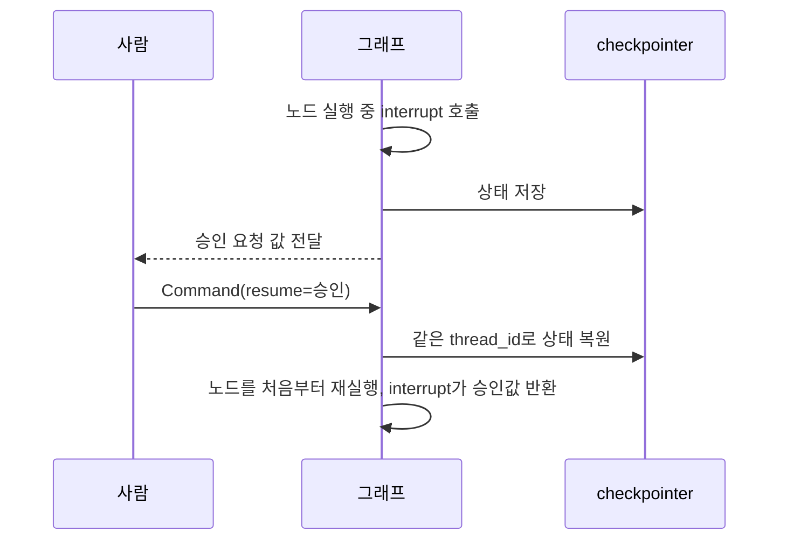
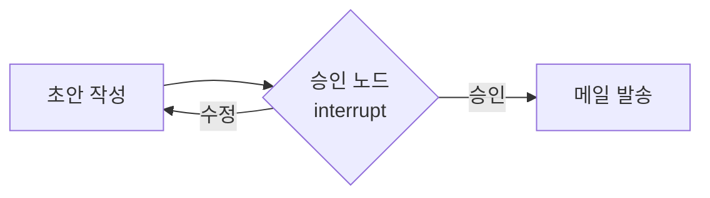

# interrupt와 사람 승인(HITL)

> `interrupt()`는 LangGraph 노드 안에서 실행을 **멈추고 사람의 입력을 기다리게** 하는 함수다. 같은 `thread_id`로 `Command(resume=값)`을 보내면 그 값을 받아 이어서 실행한다. 사람이 중간에 개입하는 HITL(Human-in-the-Loop)의 기본 도구다.

## 쉽게 말하면
결재 서류의 **"여기서 도장 받고 오세요"** 단계다. 직원(그래프)은 서류를 작성하다가 결재란에서 멈추고 서류함에 상태를 보관한다. 팀장이 며칠 뒤 도장을 찍어 돌려주면 보관된 서류를 꺼내 이어서 처리한다. 서류함이 checkpointer, 서류 번호가 thread_id다.

## 자세히
- **호출**: 노드 안에서 `answer = interrupt("승인하시겠습니까?")`. 넘긴 값은 호출자에게 전달되며 JSON 직렬화가 가능해야 한다.
- **재개**: `graph.invoke(Command(resume=True), config)`. resume 값이 `interrupt()`의 반환값이 된다.
- **필수 조건**: checkpointer(상태 저장소)와 `thread_id`. 개발은 `InMemorySaver`, 운영은 DB 기반 저장소를 권장한다. 같은 thread_id여야 같은 상태를 불러온다.
- **가장 헷갈리는 점**: 재개하면 `interrupt()` 줄이 아니라 **노드 처음부터 다시 실행**된다. 그래서 interrupt 앞의 부작용(DB 쓰기, 메일 발송)은 중복돼도 안전하게(멱등) 만들거나 interrupt 뒤로 옮긴다.
- **주의사항**(공식 문서): `interrupt()`를 bare `try/except`로 감싸지 않는다. 한 노드 안에서 호출 순서를 바꾸거나 조건부로 건너뛰지 않는다(resume 값은 호출 순서로 매칭). 함수·객체를 인자로 넘기지 않는다. 입력 검증 반복은 `while True`로 감싸지 말고 상태에 질문을 저장한 뒤 조건부 엣지로 노드에 되돌아가게 한다.
- **쓰임새**: 위험한 도구 호출 전 승인, 모델 초안 사람 수정, 부족한 정보 되묻기.

## 그림으로 보기



## 예시
```python
from langgraph.types import interrupt, Command

def approval_node(state):
    ok = interrupt({"question": "이 메일을 보낼까요?", "draft": state["draft"]})
    return {"approved": ok}

config = {"configurable": {"thread_id": "t1"}}
graph.invoke({"draft": "안녕하세요..."}, config)   # 승인 대기에서 멈춤
graph.invoke(Command(resume=True), config)         # 승인 후 이어서 실행
```
실무 예: 에이전트가 고객 환불을 처리하기 전 담당자 승인을 받는 흐름.

## 헷갈리는 것과 비교
| 개념 | 차이 |
|---|---|
| interrupt() | 노드 **안**에서 필요한 지점에 동적으로 멈춤 |
| 정적 중단(interrupt_before/after) | 컴파일 때 지정한 노드 앞뒤에서 멈춤 |
| [Command(goto·update)](#langgraph-command) | 상태 변경·이동 반환값. resume은 interrupt 재개용 Command |
| 체크포인터 | 멈춘 상태를 저장하는 곳. 없으면 interrupt 불가 |

## 더 읽을거리
- [LangGraph Interrupts](https://docs.langchain.com/oss/python/langgraph/interrupts) — interrupt·resume·주의사항 공식 문서.
