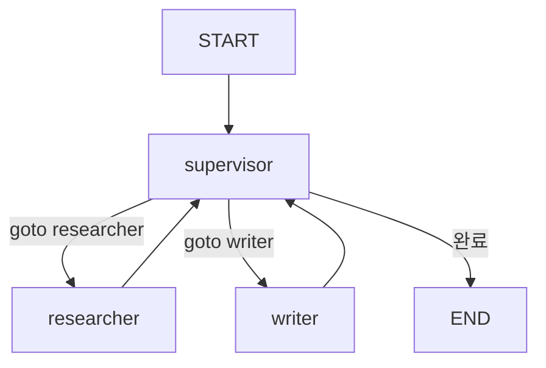
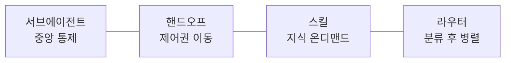

# 멀티 에이전트 그래프

> 여러 에이전트(각자 역할·도구·프롬프트를 가진 노드)를 **그래프로 연결해 협업**시키는 설계. LangChain 공식 문서는 서브에이전트(감독자), 핸드오프, 스킬, 라우터, 커스텀 워크플로 등의 패턴을 소개하며, "모든 복잡한 작업에 멀티 에이전트가 필요한 것은 아니다"라고 먼저 경고한다.

## 쉽게 말하면
프로젝트 팀장(감독자)이 자료 조사 담당과 글쓰기 담당에게 차례로 일을 나눠 주고 결과를 받아 마무리하는 모습이다. 한 사람이 다 해도 되는 일이면 굳이 팀을 꾸릴 필요가 없다.

## 자세히
(LangChain 공식 문서 multi-agent 페이지 요약 + 직접 실행, langgraph 1.2.24)
- **패턴**:

| 패턴 | 설명 | 장점 | 비용·단점(문서) |
|---|---|---|---|
| 서브에이전트(감독자) | 메인 에이전트가 서브에이전트를 **도구처럼 호출**, 모든 라우팅이 메인을 통과 | 중앙 통제, 병렬 가능 | 결과가 메인을 거쳐 **모델 호출 1회 추가**, 서브에이전트는 매번 새로 시작 |
| 핸드오프 | 에이전트끼리 도구 호출로 **제어권을 넘김** | 한 작업·반복 요청에 효율적(상태 유지) | 순차 실행, 다영역 질의에 부적합 |
| 스킬 | 한 에이전트가 필요할 때 전문 프롬프트·지식을 **불러옴** | 반복 요청에 효율적 | 불러온 문서가 쌓여 토큰 증가 |
| 라우터 | 입력을 분류해 전문 에이전트에 보내고 결과 합침 | 병렬 다영역 처리 | 상태 없음, 요청마다 라우팅 호출, 다단계 추론에 부적합 |
| 커스텀 워크플로 | LangGraph로 결정적 로직+에이전트 단계를 직접 구성 | 최대 유연성 | 설계 부담 |

- **언제 쓰나**(문서): ① 컨텍스트 창을 넘치게 하지 않고 전문 지식을 꺼내 쓸 때, ② 팀이 구성 요소를 독립적으로 개발할 때, ③ 하위 작업을 병렬로 돌릴 때. 한 에이전트가 도구가 너무 많아 잘못 고를 때도 도움이 된다. 핵심 트레이드오프는 **중앙 통제·컨텍스트 격리 vs 호출 수·토큰 비용**이다.
- **직접 실행(감독자 패턴, LLM 없이 규칙 기반 가짜 에이전트)**: `Command(goto=…, update=…)`로 노드가 다음 노드와 상태 갱신을 함께 지정했다. 실행 기록: `supervisor -> researcher` → `researcher: 자료 3건 수집` → `supervisor -> writer` → `writer: 초안 작성` → `supervisor: 완료`. 감독자가 완료한 역할을 확인해 다음 담당을 정하고 끝나면 종료한다.
- **설계 팁**: ① 종료 조건을 명확히(무한 루프 방지), ② 에이전트 간 인계 데이터를 상태 스키마로 정의, ③ 먼저 단일 에이전트로 시도하고 필요할 때만 분리.
- 한계: 위 실행은 구조를 보이기 위한 규칙 기반 예제이며 실제 LLM 에이전트는 라우팅 오류·비용·지연이 추가된다.

## 그림으로 보기



## 예시
```python
from langgraph.types import Command

def supervisor(s) -> Command:
    nxt = "researcher" if "researcher" not in s["done"] else "writer"
    return Command(goto=nxt, update={"log": [f"supervisor -> {nxt}"]})
```
- 사내 보고서 자동화: 조사 에이전트(웹·문서 검색) → 작성 에이전트 → 검수 에이전트, 감독자가 순서를 관리.

## 헷갈리는 것과 비교
| 개념 | 차이 |
|---|---|
| 멀티 에이전트 그래프 | 여러 에이전트를 LangGraph로 연결 |
| [서브에이전트(Claude Code)](#subagents) | 별도 컨텍스트로 위임하는 같은 계열의 개념 |
| [LangChain과 LangGraph](#langchain-vs-langgraph) | 구현 계층 선택 |
| [팩토리의 에이전트 역할](#factory-roles) | 개발 라인에서의 역할 분업 |

## 더 읽을거리
- [LangChain docs: Multi-agent](https://docs.langchain.com/oss/python/langchain/multi-agent) — 패턴 비교와 선택 기준.
