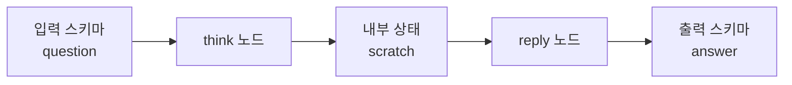
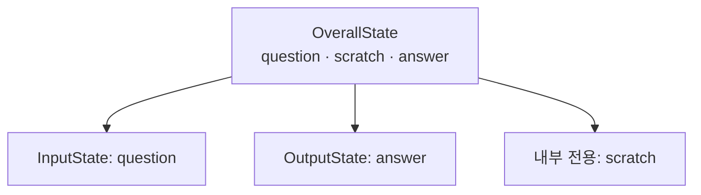

# 입력·출력·내부 스키마

> LangGraph 그래프는 **외부에서 받는 입력**, **외부로 돌려주는 출력**, **노드끼리만 공유하는 내부 상태**를 서로 다른 스키마로 나눌 수 있다. 사용자에게는 필요한 항목만 주고받고, 작업용 메모(중간 결과)는 내부에 숨기는 설계다.

## 쉽게 말하면
식당 주문서에는 "메뉴 이름"만 쓰고(입력), 손님은 "완성된 요리"만 받는다(출력). 주방 안에서는 손질한 재료·조리 메모(내부 상태)가 오가지만 손님에게는 보이지 않는다.

## 자세히
(LangGraph 공식 문서 Graph API 개념 설명 + 직접 실행, langgraph 1.2.24)
- **문서의 설명**: 입력·출력 스키마는 `invoke`가 받고 돌려주는 키를 제어한다. 기본적으로는 둘 다 전체 상태와 같고, **내부용 키가 있을 때 좁힌다**. 내부 전용 채널(private state)은 내부 노드끼리 공유하지만 그래프 입출력에는 포함되지 않는다. 스키마는 `TypedDict`·`dataclass`·Pydantic으로 정의할 수 있다. 문서는 "스트리밍에서 채널을 기본으로 숨기지는 않는다"고 주의를 준다.
- **직접 실행**: 전체 상태 `OverallState`(question, answer, scratch)에 `input_schema=InputState`(question만)와 `output_schema=OutputState`(answer만)를 지정해 `StateGraph(OverallState, input_schema=…, output_schema=…)`로 만들었다.

| 호출 | 결과 |
|---|---|
| `invoke({"question": "LangGraph란?"})` | `{'answer': "답: LangGraph란? ('LangGraph란?' 를 분석 중)"}` — **answer만** 반환(내부 `scratch` 노출 안 됨) |
| `invoke({"question": "x", "scratch": "외부가 넣음"})` | 에러 없이 실행, 외부가 넣은 `scratch`는 **무시**되고 노드가 만든 값이 쓰임 |

  내부 노드 `think`가 `scratch`를 만들고 `reply`가 그것을 읽어 답을 만들었다. 출력에는 `answer`만 남았다.
- **언제 쓰나**: ① API로 노출되는 그래프에서 내부 중간값 유출 방지, ② 입력 검증 항목 최소화, ③ 팀 간 계약(입출력)을 명확히.
- **주의**: 내부 키가 출력에서 숨겨져도 **스트리밍·디버깅 도구에서 보일 수 있고**, 노드는 자기 입력 스키마 밖의 채널에도 쓸 수 있다(문서). 비밀 정보를 "숨겼다고" 믿지 않는다.
- 한계: 선언 방법과 옵션 이름은 버전별로 달라질 수 있으니 공식 "입출력 스키마 정의" 절을 확인한다.

## 그림으로 보기



## 예시
```python
from typing import TypedDict
from langgraph.graph import StateGraph, START, END

class InputState(TypedDict):   question: str
class OutputState(TypedDict):  answer: str
class OverallState(InputState, OutputState):
    scratch: str                       # 내부 작업용

g = StateGraph(OverallState, input_schema=InputState, output_schema=OutputState)
# ... add_node / add_edge ...
app = g.compile()
print(app.invoke({"question": "LangGraph란?"}))   # {'answer': ...}
```

## 헷갈리는 것과 비교
| 개념 | 차이 |
|---|---|
| 입력 스키마 | `invoke`가 받는 키 |
| 출력 스키마 | `invoke`가 돌려주는 키 |
| 내부(private) 상태 | 노드끼리만 공유, 입출력 제외 |
| [TypedDict vs Pydantic](#typeddict-vs-pydantic) | 스키마를 정의하는 방식 선택 |
| [리듀서](#langgraph-reducer) | 키를 합치는 규칙 |

## 더 읽을거리
- [LangGraph: Graph API](https://docs.langchain.com/oss/python/langgraph/graph-api) — 다중 스키마 개념과 주의점.
