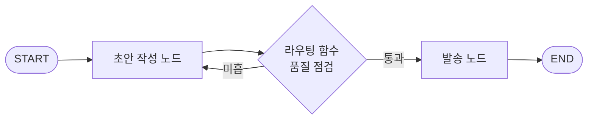
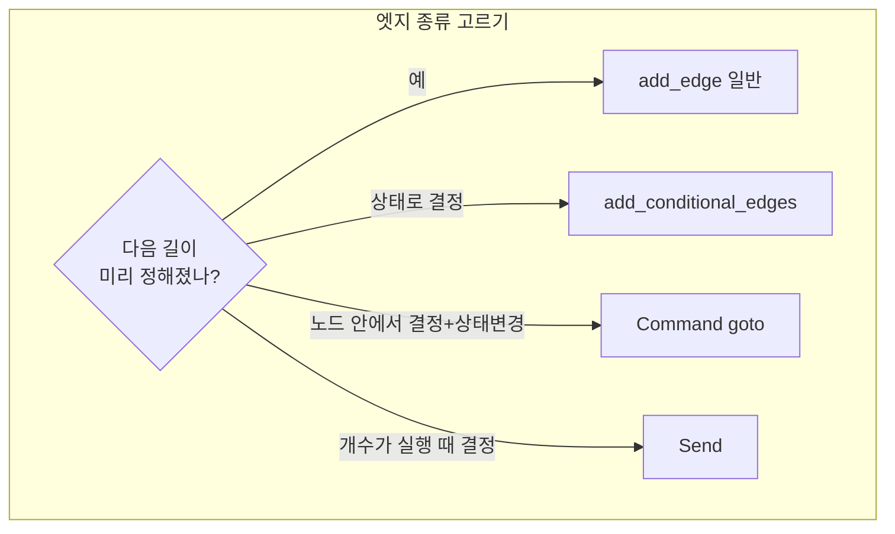

# 노드와 엣지

> LangGraph에서 **노드**는 실제 일을 하는 함수, **엣지**는 "다음에 어느 노드를 실행할지"를 정하는 연결이다. 공식 문서 표현으로 "nodes do the work, edges tell what to do next."

## 쉽게 말하면
업무 인수인계표를 떠올리면 된다. 각 칸(노드)에는 담당자가 하는 일이 적혀 있고, 칸과 칸 사이 화살표(엣지)가 다음 담당자를 가리킨다. 어떤 화살표는 항상 같은 곳을 향하고(고정), 어떤 화살표는 "검토 통과? 예면 발송, 아니면 수정으로"처럼 결과를 보고 길이 갈린다(조건부).

## 자세히
공식 Graph API 문서(2026-10 확인) 기준:
- **노드**: 상태(State)를 받아 **일부 변경분만** 돌려주는 파이썬 함수(동기·비동기 모두). `add_node("이름", 함수)`로 등록하고, 이름을 생략하면 함수 이름이 쓰인다. 상태 자체는 [LangGraph 상태](#langgraph-state) 참고.
- **START / END**: 진짜 노드가 아닌 가상의 입구·출구. `add_edge(START, "a")`가 시작점(entry point), `add_edge("z", END)`가 종료.
- **일반 엣지**: `add_edge("a", "b")` — 항상 a 다음 b.
- **조건부 엣지**: `add_conditional_edges("a", 라우팅함수, 매핑)` — 라우팅 함수가 상태를 읽고 다음 노드 이름(들)을 반환. 여러 노드를 반환하면 다음 super-step에서 **병렬 실행**된다.
- **Command**: 노드가 `Command(update=..., goto="다음노드")`를 반환해 상태 변경과 이동을 한 번에 한다. 반환 타입에 `Command[Literal["b"]]`처럼 갈 수 있는 곳을 적어 둔다.
- **Send**: 실행 시점에 개수가 정해지는 작업(예: 주제 목록마다 글 하나씩)을 각기 다른 입력으로 나눠 보내는 map-reduce용.
- **compile()**: 구조를 검사(고아 노드 등)하고 체크포인터·중단점 같은 실행 옵션을 붙여 실행 가능한 그래프로 만든다.
- 권장: 한 노드는 **라우팅 방식을 하나만** 쓴다(일반/조건부 엣지 또는 Command). 섞으면 실행 순서를 예측하기 어렵다.

## 그림으로 보기



## 예시
```python
from typing import Literal
from langgraph.graph import StateGraph, START, END

def route(state) -> Literal["send", "draft"]:
    return "send" if state["ok"] else "draft"

g = StateGraph(State)
g.add_node("draft", draft)
g.add_node("send", send)
g.add_edge(START, "draft")
g.add_conditional_edges("draft", route)   # 통과면 send, 아니면 draft 재실행
g.add_edge("send", END)
app = g.compile()
```
"draft로 되돌아가는 조건부 엣지"가 곧 [에이전트 루프](#agent-loop)의 반복 구조다.

## 헷갈리는 것과 비교
| 개념 | 차이 |
| --- | --- |
| 일반 엣지 | 항상 같은 다음 노드. 결정론적 |
| 조건부 엣지 | 엣지 쪽 함수가 상태를 보고 분기 |
| Command | 노드가 분기·상태 변경을 같이 처리(동적 엣지만 추가, 정적 엣지는 그대로 실행) |
| Send | 같은 노드를 서로 다른 입력으로 N번 병렬 호출 |
| [워크플로 vs 에이전트](#workflow-vs-agent) | 엣지를 사람이 고정하면 워크플로, 모델이 고르게 하면 에이전트에 가깝다 |

## 더 읽을거리
- [LangGraph Graph API (공식 문서)](https://docs.langchain.com/oss/python/langgraph/graph-api) — 노드·엣지·Command·Send 상세
- [LangGraph overview (공식 문서)](https://docs.langchain.com/oss/python/langgraph/overview) — 전체 개념과 최소 예제
