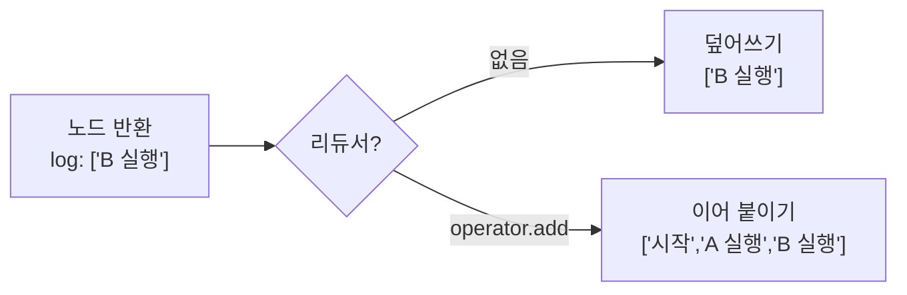
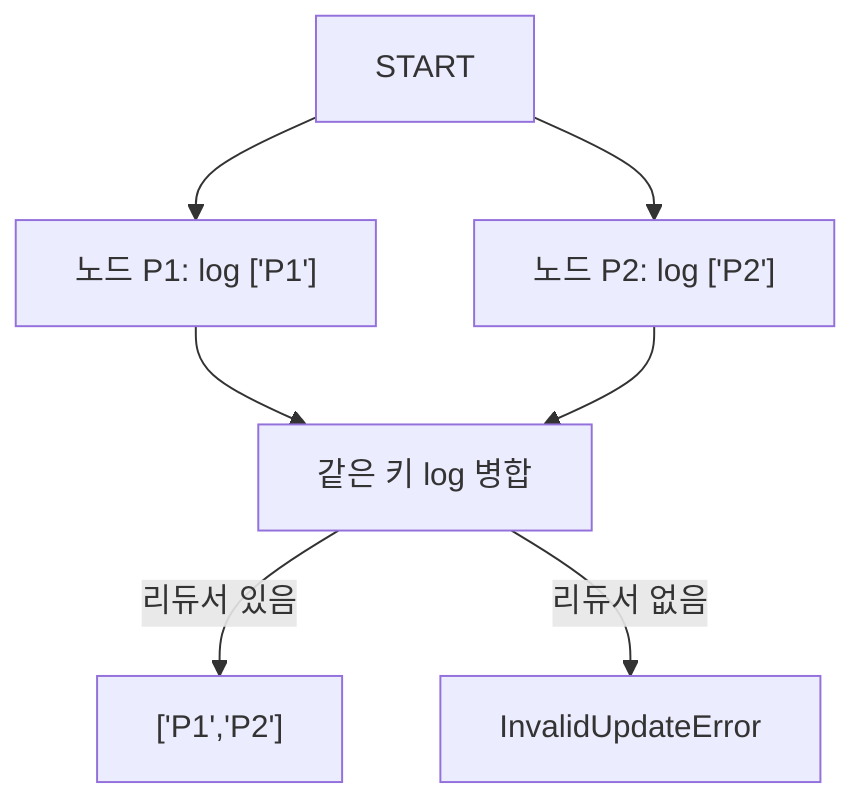

# 리듀서(reducer)

> LangGraph에서 **노드가 상태의 한 칸(키)을 갱신할 때 "기존 값과 새 값을 어떻게 합칠지"를 정하는 규칙.** 지정하지 않으면 새 값이 기존 값을 **덮어쓰고**, `Annotated`로 리듀서를 붙이면 **이어 붙이기** 같은 합치기가 된다.

## 쉽게 말하면
공유 메모장에 여러 사람이 글을 쓰는 상황이다. 규칙이 "마지막에 쓴 사람이 전체를 덮어쓴다"면 앞의 기록이 사라지고, "항상 맨 아래에 이어 적는다"면 모두의 기록이 남는다. 그 규칙이 리듀서다.

## 자세히
(LangGraph 공식 문서 Graph API 기준, 직접 실행은 langgraph 1.2.24)
- **기본 동작(덮어쓰기)**: 리듀서가 없으면 노드가 반환한 값이 기존 값을 **교체**한다. 노드는 **부분 갱신**만 반환하므로 반환하지 않은 키는 이전 값을 유지한다.
- **리듀서 붙이기**: `log: Annotated[list[str], operator.add]`처럼 쓰면 `log`는 덮어쓰지 않고 **이어 붙는다**. 문서 예: `{"foo":1,"bar":["hi"]}`에 `{"bar":["bye"]}`를 갱신하면 `{"foo":1,"bar":["hi","bye"]}`.
- **`add_messages`**: 대화 기록 `messages`용 리듀서. 새 메시지를 추가하고, **같은 ID의 메시지는 갱신**할 수 있다(`operator.add`는 이어 붙이기만 가능). `MessagesState`는 이 리듀서를 쓰는 `messages` 키 하나를 가진 미리 만든 상태([MessagesState와 add_messages](#messages-state)).
- **직접 실행 결과**:

| 상황 | 결과 |
|---|---|
| 직렬 A→B, 리듀서 없음(`list[str]`), 초기 `["시작"]` | `['B 실행']` (앞 기록이 사라짐) |
| 직렬 A→B, `operator.add` | `['시작', 'A 실행', 'B 실행']` |
| **병렬** 두 노드가 같은 키 갱신, 리듀서 없음 | 오류 `InvalidUpdateError: Can receive only one value per step. Use an Annotated key…` |
| 병렬 두 노드, `operator.add` | `['P1', 'P2']` |

  병렬 분기에서 같은 키를 동시에 바꾸려면 **리듀서가 필수**다. 오류 메시지가 `Annotated` 키를 쓰라고 안내한다.
- **언제 무엇을**: 최신 값만 필요(상태 플래그, 현재 단계) → 기본 덮어쓰기. 기록·누적(대화, 중간 결과 목록) → 리듀서. 사용자 정의 함수도 리듀서로 쓸 수 있다(두 값을 받아 합친 값을 반환).
- 한계: 버전에 따라 오류 문구·내부 동작은 바뀔 수 있으니 공식 문서를 확인한다.

## 그림으로 보기



## 예시
```python
from typing import Annotated, TypedDict
import operator
from langgraph.graph import StateGraph, START, END

class State(TypedDict):
    log: Annotated[list[str], operator.add]   # 이어 붙이기

def a(s): return {"log": ["A 실행"]}
def b(s): return {"log": ["B 실행"]}

g = StateGraph(State)
g.add_node("a", a); g.add_node("b", b)
g.add_edge(START, "a"); g.add_edge("a", "b"); g.add_edge("b", END)
print(g.compile().invoke({"log": ["시작"]})["log"])
```

## 헷갈리는 것과 비교
| 개념 | 차이 |
|---|---|
| 기본 리듀서 | 새 값이 기존 값을 교체 |
| `operator.add` | 리스트 이어 붙이기 |
| `add_messages` | 메시지 추가 + ID로 갱신 |
| [LangGraph 상태](#langgraph-state) | 리듀서가 붙는 대상(상태 스키마) |

## 더 읽을거리
- [LangGraph: Graph API](https://docs.langchain.com/oss/python/langgraph/graph-api) — 상태·리듀서·MessagesState 설명.
