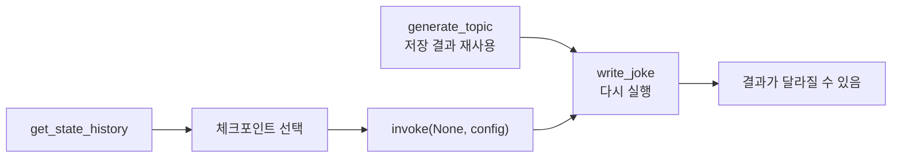

# 체크포인트 리플레이

> 과거 체크포인트의 `config`를 넣고 `graph.invoke(None, config)`를 호출해, 그 지점부터 그래프를 다시 실행하는 기능. 그 이전 노드는 저장된 결과를 쓰고 이후 노드는 새로 실행된다.

## 쉽게 말하면
요리 영상을 "소스 끓이는 장면"에서 되감아 다시 찍는 것이다. 재료 손질(앞 단계)은 이미 끝난 결과를 그대로 쓰고, 소스 단계부터는 진짜로 다시 요리한다. 그래서 같은 레시피라도 맛(LLM 출력)이 달라질 수 있다.

## 자세히
LangGraph 공식 time travel 문서 기준(확인 2026-11-12).
- `graph.get_state_history(config)`로 체크포인트 목록을 **최신 → 과거** 순으로 얻는다. 각 스냅샷의 `next`와 `config`(여기에 `checkpoint_id`)를 쓴다.
- 되돌릴 지점을 골라(예: `next == ("write_joke",)`인 스냅샷) 그 `config`로 `graph.invoke(None, snapshot.config)`.
- 입력으로 `None`을 주는 것은 "새 입력 없이 이 체크포인트에서 이어서 실행"이라는 뜻이다.
- 지점 **이전** 노드는 재실행되지 않는다. **이후** 노드는 LLM 호출·API 호출·interrupt 포함 전부 다시 실행되므로 결과가 달라질 수 있고 부작용(메일 발송 등)도 반복된다.
- 마지막 체크포인트(`next`가 비어 있음)에서 리플레이하면 아무 일도 일어나지 않는다.
- 체크포인터가 필수다(`InMemorySaver`, 운영은 Postgres 등).

## 그림으로 보기


## 예시
```python
history = list(graph.get_state_history(config))
before = next(s for s in history if s.next == ("write_joke",))
graph.invoke(None, before.config)   # write_joke만 다시 실행
```
에이전트가 잘못된 도구를 호출한 직후 상태로 돌아가, 프롬프트를 고친 뒤 그 지점부터 재현해 디버깅한다.

## 헷갈리는 것과 비교
| 개념 | 차이 |
|---|---|
| 리플레이 | 같은 상태에서 다시 실행(상태 편집 없음) |
| [타임 트래블](#langgraph-time-travel) | 리플레이 + 상태를 고쳐 새 갈래를 만드는 것까지 포함 |
| 재개(resume) | interrupt로 멈춘 지점에서 이어가기 |
| [StateSnapshot](#langgraph-state-snapshot) | 리플레이에 쓰는 `config`를 담은 객체 |

## 더 읽을거리
- [LangGraph Use time-travel](https://docs.langchain.com/oss/python/langgraph/use-time-travel) — Replay 절 코드
- [LangGraph Persistence](https://docs.langchain.com/oss/python/langgraph/persistence) — 체크포인터와 thread_id
