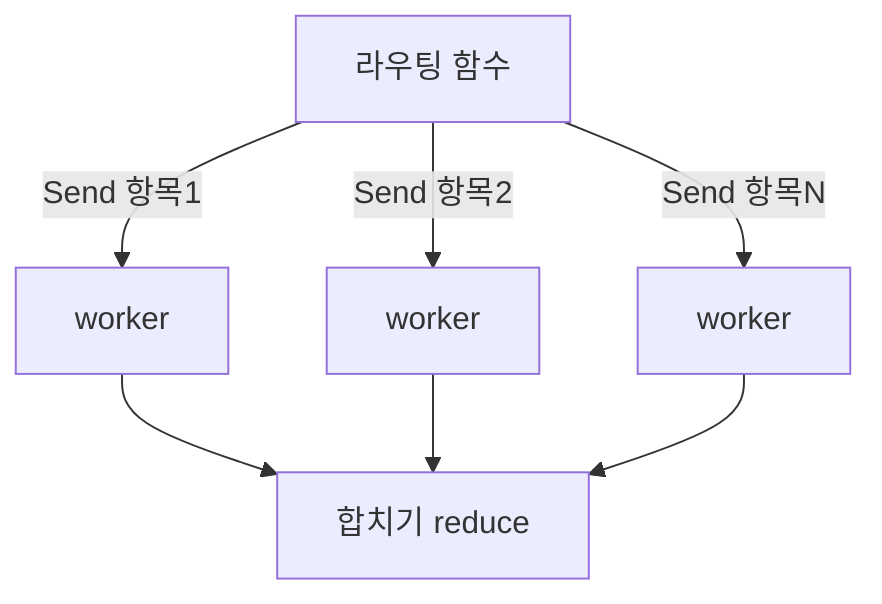

# Send와 map-reduce

> `Send`는 조건부 엣지에서 **여러 개의 병렬 작업을 실행 때 동적으로 만들어 보내는** LangGraph 기능이다. 나누어 처리(map)하고 합친다(reduce).

## 쉽게 말하면
선생님이 시험지 묶음을 받아 "채점 조교 N명에게 한 장씩" 나눠 주고, 조교 수는 시험지 장수에 따라 그때그때 정해지는 상황이다. 마지막에 점수표로 모은다.

## 자세히
- `Send(node_name, custom_state)`는 다음 step에서 지정 노드를 **그 작업 전용 상태**로 호출한다. 보통 라우팅 함수가 항목마다 Send를 하나씩 담아 리스트로 반환한다.
- 정적 엣지로는 분기 수를 미리 모를 때(문서 N개, 주제 N개) 유용하다.
- **map**: 각 Send가 병렬 브랜치. **reduce**: 브랜치가 같은 키에 쓰므로 `Annotated[list, operator.add]` 같은 리듀서로 합치고, 이후 팬인 노드가 처리한다.
- 병렬 브랜치는 하나의 [super-step](#langgraph-super-step)에서 실행된다.
- 출처는 공식 레퍼런스 설명과 튜토리얼 요약이다.

## 그림으로 보기


## 예시
```python
def fan_out(state):
    return [Send("summarize", {"doc": d}) for d in state["docs"]]
g.add_conditional_edges("start", fan_out, ["summarize"])
```
문서 7개면 summarize가 7번 병렬 실행되고, `summaries: Annotated[list, operator.add]`로 모인다.

## 헷갈리는 것과 비교
| 개념 | 차이 |
|---|---|
| Send | 개수가 동적인 병렬 팬아웃 |
| 여러 정적 엣지 | 개수 고정 |
| [Command](#langgraph-command) | 상태 변경+이동 |
| [조건부 엣지](#langgraph-conditional-edges) | Send를 반환하는 통로 |

## 더 읽을거리
- [LangGraph map-reduce parallel execution](https://machinelearningplus.com/gen-ai/langgraph-map-reduce-parallel-execution/) — 코드 예제
- [LangChain Reference: StateGraph](https://reference.langchain.com/python/langgraph/graph/state) — Send 설명
