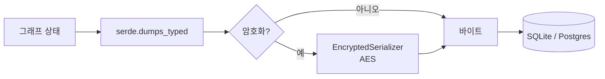
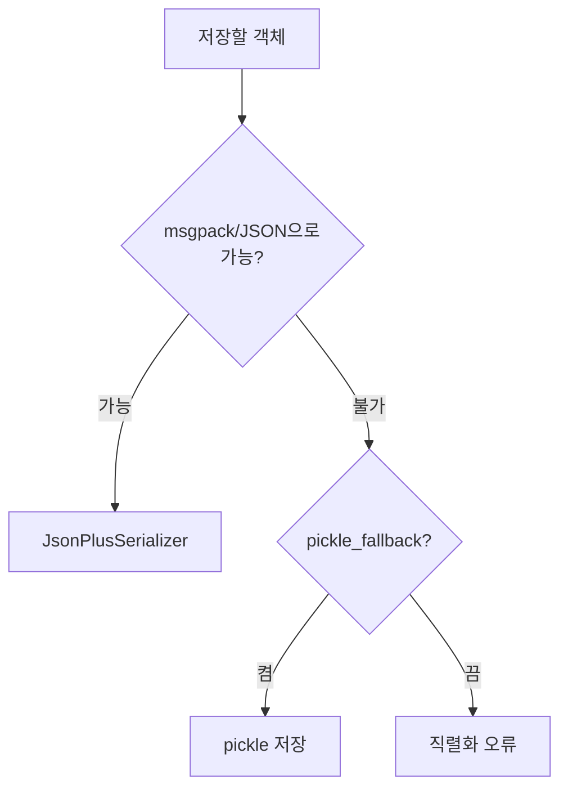

# 체크포인트 직렬화 (serde)

> 직렬화(serde)는 LangGraph 상태를 디스크·DB에 저장할 수 있는 바이트로 바꾸고(dumps), 다시 파이썬 객체로 되돌리는(loads) 변환기다. 체크포인터는 `serde` 인자로 이 변환기를 받는다.

## 쉽게 말하면
이삿짐을 박스에 포장하는 일이다. 책·옷은 표준 박스(msgpack/JSON)에 들어가지만, 피아노(Pandas DataFrame 같은 특수 객체)는 별도 포장(pickle)이 필요하다. 귀중품 박스에는 자물쇠(암호화)를 단다. 풀 때는 같은 방식으로 열어야 한다.

## 자세히
LangGraph Checkpointers 문서(2026-11 확인) 기준:
- **기본값 `JsonPlusSerializer`**: ormsgpack + JSON을 쓰며 LangChain/LangGraph 기본 타입, datetime, enum, Pydantic v2, dataclass, numpy 등을 처리한다. 문서는 "모든 객체에 맞지는 않는다"고 경고한다.
- **`pickle_fallback=True`**: msgpack이 못 다루는 객체(예: DataFrame)를 pickle로 저장. 편하지만 pickle은 불러올 때 코드가 실행될 수 있어 **신뢰할 수 없는 저장소엔 위험**하다(문서에 보안 설명은 없음 — 일반적인 pickle 특성에 대한 설명이며 주장 아닌 널리 알려진 사실).
- **`EncryptedSerializer`**: `from_pycryptodome_aes()`로 AES 암호화. 키는 환경 변수 `LANGGRAPH_AES_KEY` 또는 `key` 인자. SqliteSaver·PostgresSaver 모두 `serde=`로 전달. LangSmith 배포에선 변수만 설정하면 자동 적용. 다른 방식은 `CipherProtocol`을 구현.
- **커스텀 체크포인터**: `self.serde.dumps_typed(...)`/`loads_typed(...)`로 (타입, 바이트) 쌍을 저장한다. metadata는 모르는 키도 지우지 않고 통째로 저장. `langgraph-checkpoint-conformance` 테스트로 왕복(round-trip)을 검증.
- `DeltaChannel`(베타, langgraph>=1.2)은 `_DeltaSnapshot`을 msgpack ext 7로 저장하므로 커스텀 serde가 이를 왕복시켜야 한다.

## 그림으로 보기



## 예시
```python
import sqlite3
from langgraph.checkpoint.serde.encrypted import EncryptedSerializer
from langgraph.checkpoint.sqlite import SqliteSaver

serde = EncryptedSerializer.from_pycryptodome_aes()  # LANGGRAPH_AES_KEY 사용
saver = SqliteSaver(sqlite3.connect("checkpoint.db"), serde=serde)
```
고객 대화가 상태에 담기는 업무 에이전트라면, DB 파일이 유출돼도 읽히지 않도록 암호화를 켠다.

## 헷갈리는 것과 비교
| 개념 | 차이 |
|---|---|
| serde | 상태를 바이트로 바꾸는 방식 |
| [체크포인터](#langgraph-checkpointer) | 어디에·언제 저장하는가 |
| pickle_fallback | 편의 대신 위험을 감수하는 예외 경로 |
| 암호화 | 저장 형식이 아니라 그 위에 씌우는 보호 층 |

## 더 읽을거리
- [LangGraph Checkpointers](https://docs.langchain.com/oss/python/langgraph/checkpointers) — serde, pickle fallback, 암호화, 커스텀 체크포인터.
- [LangGraph Persistence](https://docs.langchain.com/oss/python/langgraph/persistence) — 체크포인터·thread 기본 개념.
