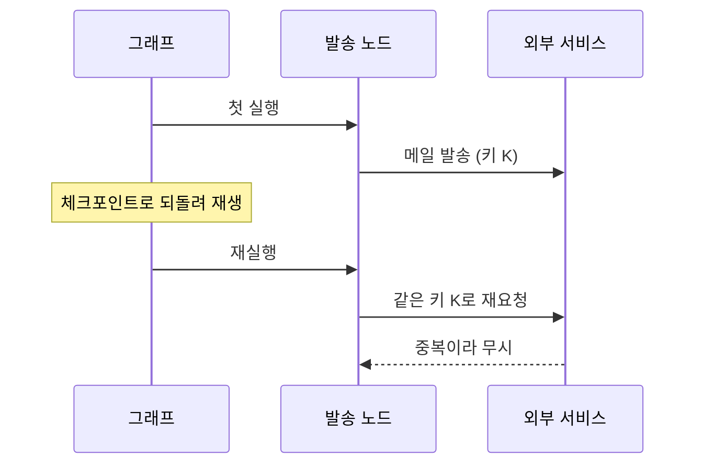

# 재생 시 부수효과 관리

> LangGraph에서 과거 체크포인트를 재생하거나 분기하면 그 이후 노드가 모두 다시 실행되어, 메일 발송·결제·API 쓰기 같은 외부 부수효과가 되풀이된다. 재실행 구간을 안전하게(멱등하게) 설계해야 한다.

## 쉽게 말하면
게임 세이브는 불러올 수 있어도 현실에서 이미 보낸 편지는 회수할 수 없다. 세이브를 불러와 다시 "편지 보내기" 버튼을 누르면 편지가 두 통 간다. 그래서 편지를 보낼 때 "이 편지는 이미 보냄" 표시를 남겨 두 번째엔 건너뛰도록 만든다.

## 자세히
- 공식 문서: 체크포인트 **이후** 노드는 다시 실행되며 "LLM 호출, API 요청, interrupt가 다시 발생하고 결과가 달라질 수 있다." 이전 노드는 저장된 결과를 쓰고 재실행하지 않는다. 분기(update_state)도 같은 위험이 있다.
- 위험한 노드: 메일·메신저 발송, 결제·주문, DB insert, 티켓 생성, 파일 업로드.
- 대처:
  1. **멱등 키**: 요청마다 고유 키(예: `thread_id + 단계`)를 보내고 서버가 중복을 무시하게 한다([멱등성](#idempotency)).
  2. **부수효과 분리**: 계산 노드와 "실행" 노드를 나눠, 재생은 계산 쪽 체크포인트에서 하고 실행 노드는 상태의 `sent: true` 같은 플래그를 확인해 건너뛴다.
  3. **dry-run 모드**: 재생·실험 시 환경 변수로 외부 쓰기를 막고 로그만 남긴다.
  4. **interrupt 재발동 대비**: interrupt는 재생 때도 다시 걸리므로 사람 승인 단계가 다시 나타난다. 자동 테스트에선 resume 값을 미리 준비한다.
- LLM 호출은 같은 입력이어도 결과가 달라질 수 있다. 재현이 필요하면 온도 0·시드·캐시를 쓰되 완전한 동일성은 보장되지 않는다(일반적 주의).
- 마지막 체크포인트에서 재생하면 다음 노드가 없어 아무 일도 안 일어난다.

## 그림으로 보기


## 예시
```python
def send_node(state):
    if state.get("sent"):
        return {}                                   # 재생 때 건너뜀
    mail_api.send(to=state["to"], idempotency_key=f"{state['run_id']}-mail")
    return {"sent": True}
```

## 헷갈리는 것과 비교
| 개념 | 차이 |
| --- | --- |
| 재생 | 상태 유지, 이후 노드 재실행(부수효과 반복) |
| [분기](#langgraph-fork-vs-replay) | 상태 수정 후 재실행(부수효과 반복) |
| [멱등성](#idempotency) | 반복해도 결과가 같게 만드는 설계 |
| [체크포인터](#langgraph-checkpointer) | 상태 저장 — 외부 세계는 되돌리지 못함 |

## 더 읽을거리
- [Use time-travel (LangGraph 공식 문서)](https://docs.langchain.com/oss/python/langgraph/use-time-travel) — 재생·분기 시 재실행 규칙
