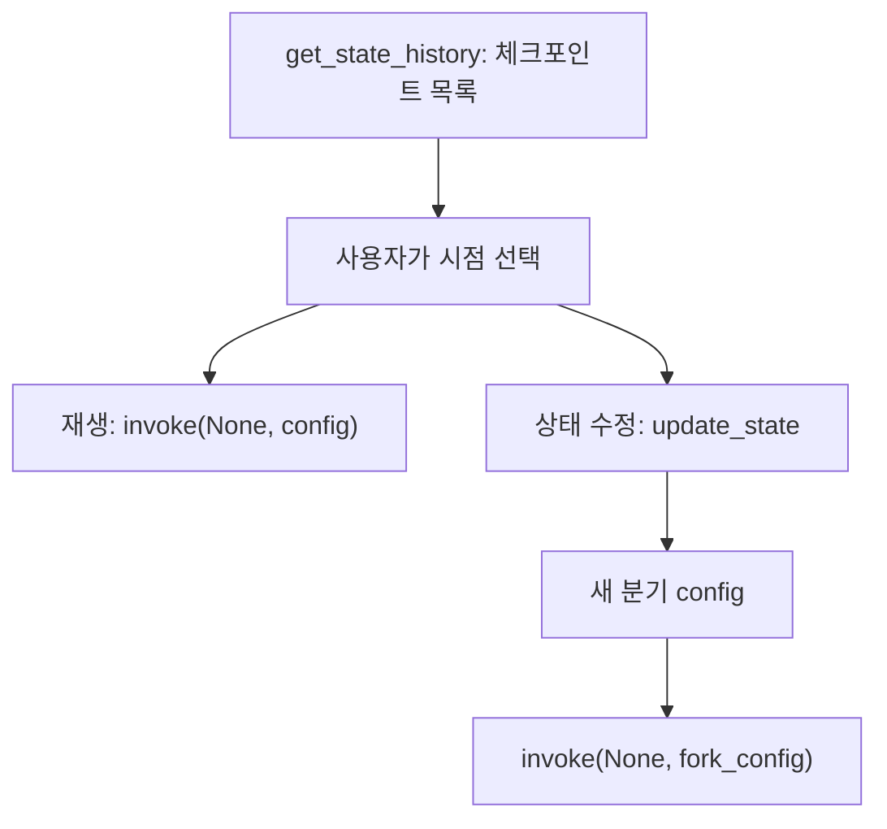

# 상태 기록 UI 패턴

> LangGraph가 저장한 체크포인트 목록을 화면에 보여 주고, 사용자가 시점을 골라 되돌려 재실행(replay)하거나 상태를 고쳐 분기(fork)하게 하는 설계 패턴이다.

## 쉽게 말하면
문서 편집기의 "버전 기록" 화면이다. 옛 버전을 눌러 보고, 그대로 이어 쓰거나 고쳐서 새 갈래로 이어 갈 수 있다. 원본 기록은 그대로 남는다.

## 자세히
- 목록: `graph.get_state_history(config)`는 스레드의 체크포인트를 최신순으로 돌려준다. 각 항목에 `next`(그 시점에서 다음에 실행될 노드)와 `config`(안에 `checkpoint_id`)가 있다.
- 재생: 과거 체크포인트의 config로 `invoke(None, config)`. 그 시점 이전 노드는 다시 실행하지 않고 이후 노드는 다시 돈다. LLM·API 호출 결과는 달라질 수 있다. 마지막 체크포인트는 `next`가 없어 아무 일도 안 한다.
- 분기: `update_state(ckpt_config, values=...)`가 새 분기 config를 반환, 이어서 `invoke(None, fork_config)`. 원래 기록은 유지된다(롤백이 아님). `as_node`로 어느 노드가 쓴 것으로 볼지 정한다.
- UI 설계 포인트: 목록은 `next`와 시각으로 라벨링, 선택 시 상태 값을 미리보기, "여기서 재실행"과 "수정해서 분기" 버튼 분리, 재실행은 부수효과(메일 발송 등)를 다시 일으킬 수 있음을 경고.
- 선행 개념: [get_state](#langgraph-get-state), [update_state](#langgraph-update-state), [time travel](#langgraph-time-travel), [체크포인터](#langgraph-checkpointer).

## 그림으로 보기


## 예시
```python
history = list(graph.get_state_history(config))
target = next(s for s in history if s.next == ("write_joke",))
fork = graph.update_state(target.config, values={"topic": "chickens"})
graph.invoke(None, fork)
```

## 헷갈리는 것과 비교
| 개념 | 차이 |
| --- | --- |
| 재생 | 같은 상태에서 이후 노드를 다시 실행 |
| 분기 | 상태를 고쳐 새 갈래를 만듦 |
| 롤백 | LangGraph는 기록을 지우지 않음 |

## 더 읽을거리
- [LangGraph: Use time-travel](https://docs.langchain.com/oss/python/langgraph/use-time-travel) — 재생·분기 코드
