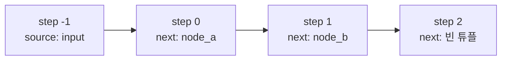
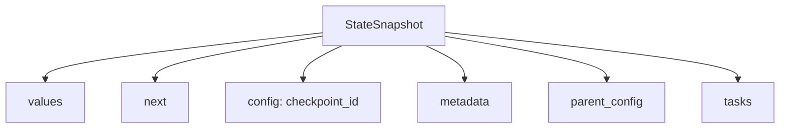

# StateSnapshot 필드

> LangGraph에서 `get_state`·`get_state_history`가 돌려주는, 한 체크포인트 시점의 상태를 담은 객체. 값·다음 노드·메타데이터·예약된 작업이 들어 있다.

## 쉽게 말하면
게임의 세이브 파일 속 정보 카드다. 카드에는 "지금 점수(values)", "다음에 갈 스테이지(next)", "저장 번호(checkpoint_id)", "언제 저장했나(created_at)", "직전 저장이 뭐였나(parent_config)"가 적혀 있다. 이 카드만 있으면 그 시점으로 돌아가 다시 하거나 갈래를 칠 수 있다.

## 자세히
각 스냅샷은 super-step 경계에서 찍힌다(공식 문서 기준, 2026-11 확인).
- `values`: 그 시점의 채널(상태) 값 dict.
- `next`: 다음에 실행될 노드 튜플. **빈 튜플이면 그래프가 끝난 것**.
- `config`: `thread_id`·`checkpoint_ns`·`checkpoint_id`로 스냅샷을 식별.
- `metadata`: `source`("input"·"loop"·"update"), `writes`(노드 출력), `step`(super-step 번호; 입력 체크포인트는 -1).
- `created_at`: ISO 8601 시각.
- `parent_config`: 직전 체크포인트의 config. 첫 체크포인트는 `None`.
- `tasks`: 이 단계에 예약된 작업(`id`·`name`·`error`·`interrupts`). `interrupts`는 최상위 필드가 아니라 task 안에 있다. 서브그래프 스트리밍 땐 task의 `state`에 하위 스냅샷이 담긴다.

## 그림으로 보기



## 예시
```python
config = {"configurable": {"thread_id": "1"}}
snap = graph.get_state(config)
print(snap.values, snap.next)          # next == () 이면 종료
for s in graph.get_state_history(config):   # 최신 → 과거 순
    print(s.metadata["step"], s.metadata["source"], s.next)
```
- 과거로 되감기: `snap.config`를 그대로 `graph.invoke(None, snap.config)`에 넣으면 그 지점 이후 노드가 다시 실행된다.

## 헷갈리는 것과 비교
| 개념 | 차이 |
|---|---|
| StateSnapshot | 읽기용 시점 사진 객체 |
| `get_state` | 최신(또는 `checkpoint_id` 지정) 스냅샷 1개 |
| `get_state_history` | 스레드 전체 스냅샷, 최신순 |
| `thread_id` vs `checkpoint_id` | 대화 줄기 vs 그 안의 한 시점 |

## 더 읽을거리
- [LangGraph Checkpointers 문서](https://docs.langchain.com/oss/python/langgraph/checkpointers) — StateSnapshot 표와 예제
- [LangGraph Persistence 개요](https://docs.langchain.com/oss/python/langgraph/persistence) — thread·서브그래프 체크포인트 네임스페이스
