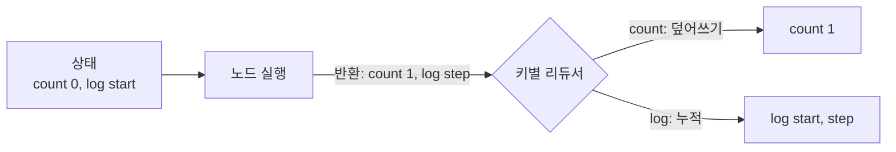
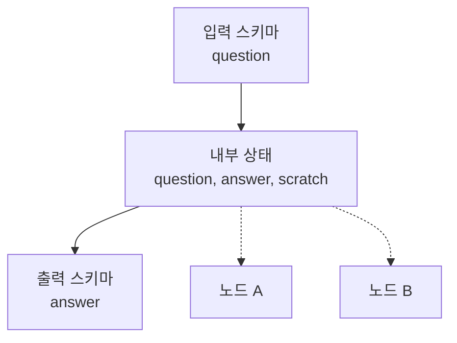

# State(상태)

> LangGraph에서 모든 노드가 함께 읽고 고치는 공유 데이터 묶음. 키 목록(스키마)과, 키마다 갱신을 합치는 규칙(리듀서)으로 이루어진다.

## 쉽게 말하면
여러 사람이 릴레이로 일하는 **공용 화이트보드**다. 각자(노드)는 보드를 보고, 자기가 바꾼 칸만 고쳐 쓴다. 어떤 칸은 지우고 새로 쓰고, 어떤 칸(예: 회의록)은 덧붙이기만 한다. "어떻게 반영할지"가 칸마다 정해져 있는 것이 리듀서다.

## 자세히
LangGraph 공식 문서(Graph API) 기준:
- **스키마**: 보통 `TypedDict`. 기본값이 필요하면 `dataclass`, 재귀적 검증이 필요하면 Pydantic `BaseModel`(TypedDict·dataclass보다 느림, 고수준 `create_agent`는 Pydantic 상태 미지원).
- **리듀서**: 키마다 하나. 현재 값(`left`)과 노드의 업데이트(`right`)를 받아 새 값을 돌려준다. 리듀서가 없으면 **덮어쓴다**. `Annotated[list[str], add]`처럼 달면 **누적**한다.
- **노드의 반환**: 전체 상태가 아니라 **바꾼 키만** 돌려준다. LangGraph가 키별 리듀서를 적용한다.
- **함정**: 누적 키에 빈 리스트를 돌려줘도 지워지지 않는다(빈 값이 합쳐질 뿐). 지우려면 `Overwrite([])`로 감싼다.
- **MessagesState**: 대화 기록용 프리빌트 상태. `add_messages` 리듀서가 새 메시지를 추가하고, ID가 같으면 교체한다(사람이 고친 메시지 반영에 쓰임). 확장 가능.
- **다중 스키마**: `input_schema`·`output_schema`로 호출자가 주고받는 키를 제한하고, 내부 스키마엔 작업용 키를 둔다. 단, 값 스트리밍에는 비공개 키도 보인다(`output_keys`로 제한).
- **왜 중요한가**: 상태가 곧 에이전트의 "기억"이고, [체크포인트](#langgraph-checkpoint)는 이 상태를 단계마다 저장한 것이다.

## 그림으로 보기



## 예시
```python
from operator import add
from typing import Annotated
from typing_extensions import TypedDict

class State(TypedDict):
    count: int                      # 덮어쓰기
    log: Annotated[list[str], add]  # 누적

def step(state: State):
    return {"count": state["count"] + 1, "log": ["step"]}
```
상태가 `{"count": 0, "log": ["start"]}`이면 실행 후 `{"count": 1, "log": ["start", "step"]}`.

## 헷갈리는 것과 비교
| 개념 | 차이 |
| --- | --- |
| State | 그래프 한 실행 안에서 노드들이 공유하는 데이터 |
| [체크포인트](#langgraph-checkpoint) | 상태를 단계마다 저장해 두는 장치. 재개·되감기에 쓰임 |
| 프롬프트 속 대화 기록 | 모델에 들어가는 텍스트. State의 `messages`에서 만들어짐 |
| [노드·엣지](#langgraph-nodes-edges) | 상태를 바꾸는 단계와 그 연결 |

## 더 읽을거리
- [LangGraph Graph API (공식 문서)](https://docs.langchain.com/oss/python/langgraph/graph-api) — 스키마, 리듀서, MessagesState, 다중 스키마
