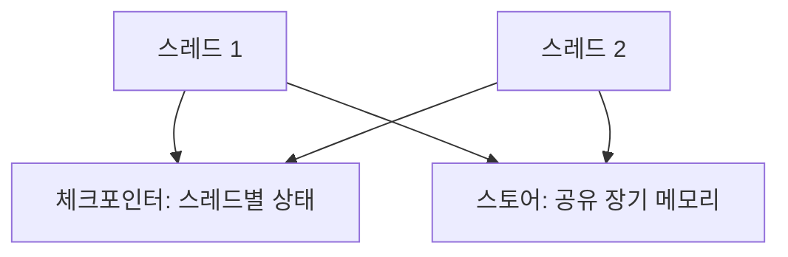
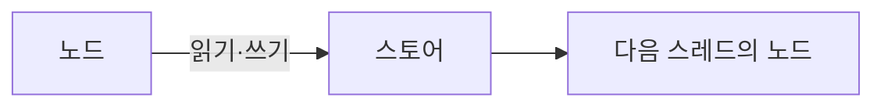

# LangGraph 스토어

> **스토어(Store)** 는 LangGraph에서 **스레드(대화) 경계를 넘어** 유지되는 장기 메모리 저장소다. 체크포인터가 한 스레드의 상태를 기록한다면, 스토어는 사용자 선호·사실 같은 공유 지식을 담는다.

## 쉽게 말하면
체크포인터가 "이번 상담의 진행 메모"라면 스토어는 "고객 카드"다. 상담이 끝나도, 새 상담이 시작돼도 카드는 남아 있고 다음 상담에서 꺼내 본다.

## 자세히
(LangGraph 공식 persistence 문서 확인)
- 스토어는 그래프 상태 밖의 **애플리케이션 정의 데이터**를 담는다. 사용자 선호, 사실, 공유 지식 같은 **장기·스레드 간 메모리**용이다.
- 예시처럼 `InMemoryStore()`를 만들고 `builder.compile(checkpointer=checkpointer, store=store)`로 체크포인터와 함께 그래프에 넘긴다.
- 노드나 앱 코드가 항목을 읽고 쓴다. 상위 그래프와 서브그래프가 서로의 체크포인트 갱신을 바로 보지 못할 때 스토어로 데이터를 넘길 수 있다.
- **체크포인터와 비교**: 체크포인터 = `thread_id` 단위 상태 스냅샷(단기 메모리, 사람 개입, 타임트래블, 장애 복구). 스토어 = 스레드와 무관한 키-값. 문서는 둘을 함께 쓰라고 권한다.
- 네임스페이스 구조, `put/get/search` 시그니처, 의미 기반 검색 지원 여부는 이 문서에 없어 확인하지 않았다(별도 Stores 가이드 참고).

## 그림으로 보기



## 예시
```python
from langgraph.store.memory import InMemoryStore
store = InMemoryStore()
graph = builder.compile(checkpointer=checkpointer, store=store)
```
- 사용자가 "존댓말로 답해 줘"라고 한 선호를 스토어에 저장해 다음 대화에서 재사용.

## 헷갈리는 것과 비교
| 개념 | 차이 |
|---|---|
| 체크포인터 | 스레드 단위 상태 저장, 단기 |
| 스토어 | 스레드 간 공유, 장기 |
| [메모리 종류](#memory-types) | 의미·에피소드 기억을 스토어로 구현 |

## 더 읽을거리
- [LangGraph persistence 문서](https://docs.langchain.com/oss/python/langgraph/persistence) — 체크포인터와 스토어.
