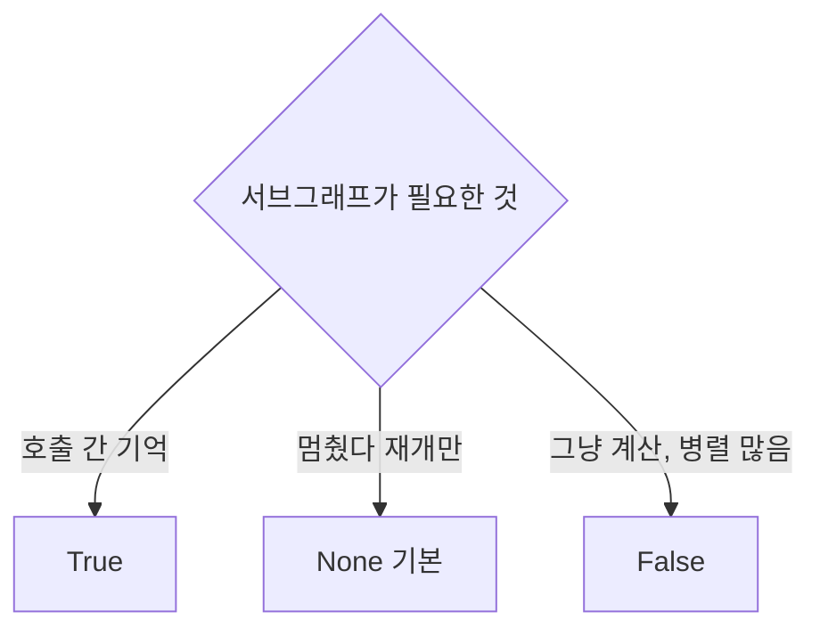

# 서브그래프 checkpointer 모드

> `subgraph.compile(checkpointer=...)`의 값(`None`·`True`·`False`)이 서브그래프의 상태 유지·interrupt·병렬 호출 방식을 정한다. 부모 그래프에 checkpointer가 있어야 의미가 있다.

## 쉽게 말하면
외주팀을 쓰는 세 방식이다. 매번 새 직원이 와서 일하고 가는 방식(None), 같은 담당자가 지난 일을 기억하며 이어가는 방식(True), 기록을 전혀 남기지 않는 일회성 심부름(False).

## 자세히
공식 Subgraphs 문서 기준(확인 2026-11-12).
- **`None`(기본, 호출당)**: 매 호출이 새 상태로 시작하되 그 호출 동안 부모의 checkpointer를 상속한다. interrupt 지원, 호출 간 기억 없음, 같은 서브그래프 병렬 호출 가능(호출마다 체크포인트 네임스페이스가 따로).
- **`True`(스레드당)**: 같은 스레드에서 호출 간 상태가 누적된다. interrupt 지원. 단 같은 서브그래프의 **병렬 도구 호출은 지원하지 않는다**(네임스페이스 충돌). 해결 팁: 각각 고유한 노드 이름의 StateGraph로 감싼다.
- **`False`(무상태)**: 체크포인트 없음. 일반 함수 호출처럼 동작하고 interrupt·내구 실행 불가, 병렬 호출 가능.

## 그림으로 보기


## 예시
```python
research = builder.compile(checkpointer=True)   # 대화형 하위 에이전트, 이전 맥락 기억
lookup   = builder.compile(checkpointer=False)  # 상태 없는 변환 함수
```
사용자와 여러 턴 대화하는 하위 에이전트는 True, 병렬로 여러 번 부르는 검색 도구는 None 또는 False.

## 헷갈리는 것과 비교
| 값 | interrupt | 호출 간 기억 | 같은 서브그래프 병렬 |
|---|---|---|---|
| None | O | X | O |
| True | O | O | X |
| False | X | X | O |
[서브그래프 상태 조회](#langgraph-subgraph-state)는 이 설정에 영향받는다.

## 더 읽을거리
- [LangGraph Use subgraphs](https://docs.langchain.com/oss/python/langgraph/use-subgraphs) — 모드 표와 병렬 호출 주의
