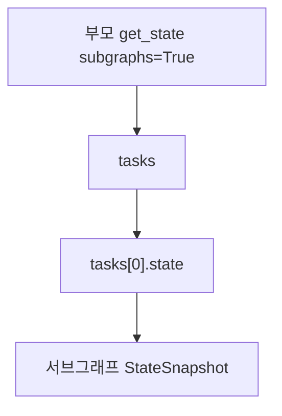
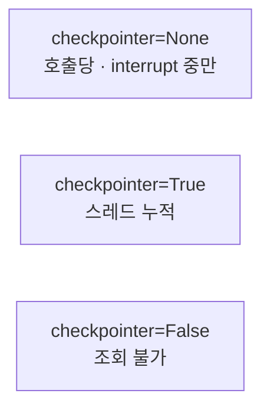

# 서브그래프 상태 조회

> 부모 그래프에서 `get_state(config, subgraphs=True)`를 호출하면 하위 그래프의 상태가 `tasks[0].state`에 담겨 나온다.

## 쉽게 말하면
본사(부모) 보고서에는 "물류팀이 작업 중"이라고만 나온다. 물류팀 내부 진행표를 보려면 "하위 팀 포함해서 보여 줘" 옵션을 켜야 한다. 그 옵션이 `subgraphs=True`다.

## 자세히
공식 문서 기준(2026-11 확인).
- 부모 그래프에 checkpointer가 있어야 한다. 하위 그래프는 부모 것을 상속한다.
- **호출당(기본, `checkpointer=None`)**: 현재 호출에 대한 상태만, 그것도 **interrupt로 멈춰 있는 동안**에만 읽힌다. 매 호출이 새로 시작.
- **스레드당(`checkpointer=True`)**: 스레드에서 호출이 쌓인 상태가 누적된다. 대화형 하위 에이전트에 적합.
- `checkpointer=False`는 체크포인트를 저장하지 않아 조회 불가.
- 한계: 하위 그래프가 노드로 추가되거나 노드 안에서 호출돼야 정적으로 발견된다. 도구 함수 안에서 호출하면 조회 불가. 단 하위 그래프의 interrupt는 도구 안이어도 최상위로 전파된다.
- 예제는 서브그래프를 `tasks[0]`으로 가정한다. 실제로는 tasks 중 어느 것인지 확인해야 한다.

## 그림으로 보기



## 예시
```python
graph.invoke({"foo": ""}, config)          # 하위 노드에서 interrupt
sub = graph.get_state(config, subgraphs=True).tasks[0].state
graph.invoke(Command(resume="bar"), config)  # 재개
```

## 헷갈리는 것과 비교
| 개념 | 차이 |
|---|---|
| 부모 `get_state()` | 부모 값만 |
| `subgraphs=True` | task에 하위 스냅샷 포함 |
| [StateSnapshot](#langgraph-state-snapshot) | 그 결과의 객체 구조 |

## 더 읽을거리
- [LangGraph: Use subgraphs](https://docs.langchain.com/oss/python/langgraph/use-subgraphs) — 상태 조회·persistence 모드 예제
