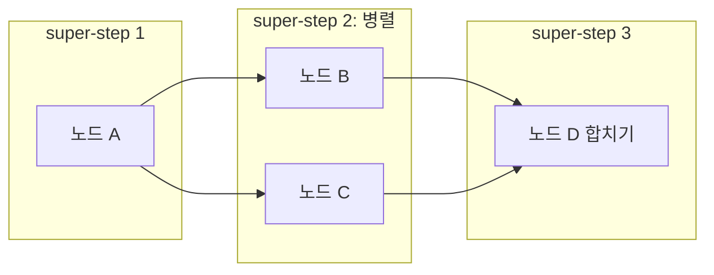

# Super-step과 병렬 실행

> Super-step은 LangGraph(Pregel 모델)의 **실행 단위**다. 한 단계에서 선택된 노드들이 동시에 실행되고, 모두 끝나 상태에 반영된 뒤에야 다음 단계가 시작된다.

## 쉽게 말하면
조별 과제 회의 라운드다. 라운드마다 각 조원이 동시에 자기 일을 하고, 모두 끝나면 결과를 칠판(상태)에 한꺼번에 적고, 그 칠판을 보고 다음 라운드 담당을 정한다.

## 자세히
- 공식 레퍼런스 설명: Pregel은 벌크 동기(bulk synchronous) 모델. 각 step의 실행 단계에서 선택된 노드가 병렬로 돌고, 채널 업데이트는 **다음 step까지 다른 노드에 보이지 않는다**.
- step 사이의 장벽(barrier)은 우회할 수 없다. 한 step의 쓰기가 전부 반영돼야 다음에 어떤 노드를 깨울지 정할 수 있어서다(포럼 답변).
- 같은 키에 병렬 노드가 동시에 쓰면 **리듀서**(예: `operator.add`)가 필요하다. 없으면 `INVALID_CONCURRENT_GRAPH_UPDATE` 오류.
- 이 step 수가 `recursion_limit`로 제한된다(기본값은 [종료 조건](#stop-conditions) 참고).
- 병렬 팬아웃은 한 노드에서 여러 엣지를 내거나 [Send](#langgraph-send-map-reduce)로 만든다.

## 그림으로 보기

## 예시
- 요약 A 후 감성 분석 B와 키워드 추출 C를 동시에 → D에서 합쳐 리포트. B·C가 `results` 키에 쓰면 `Annotated[list, operator.add]`로 합친다.

## 헷갈리는 것과 비교
| 개념 | 차이 |
|---|---|
| super-step | 병렬 실행 후 동기화 한 라운드 |
| 일반 함수 호출 | 한 번에 하나씩 순차 |
| [Send](#langgraph-send-map-reduce) | 개수가 실행 때 정해지는 병렬 생성 |
| [조건부 엣지](#langgraph-conditional-edges) | 다음 노드 선택 |

## 더 읽을거리
- [LangChain Reference: StateGraph](https://reference.langchain.com/python/langgraph/graph/state) — 공식 레퍼런스
- [Best practices for parallel nodes (LangChain forum)](https://forum.langchain.com/t/best-practices-for-parallel-nodes-fanouts/1900/2) — 커뮤니티 답변
