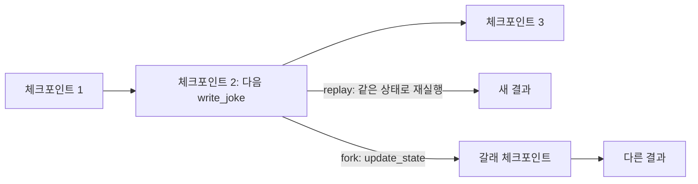
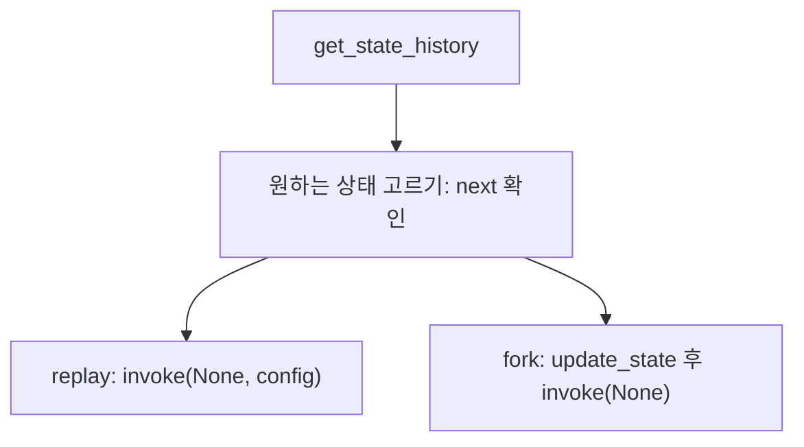

# 타임 트래블

> LangGraph 타임 트래블은 저장된 과거 체크포인트에서 스레드를 다시 실행(replay)하거나, 상태를 바꿔 새 갈래(fork)를 만드는 기능이다.

## 쉽게 말하면
게임에서 저장 슬롯 목록을 보고 "보스전 직전" 슬롯을 불러와 다시 하거나, 아이템을 바꿔 다른 루트로 진행하는 것이다. 원래 저장본은 지워지지 않고 그대로 남는다.

## 자세히
LangGraph 문서 기준:
- 체크포인트 이전 노드는 다시 실행하지 않는다(결과가 저장돼 있음). **이후 노드는 다시 실행**되므로 LLM 호출·API·인터럽트의 결과가 달라질 수 있다([체크포인터와 thread_id](#langgraph-checkpointer)).
- `get_state_history(config)`는 스레드 상태를 **최신순**으로 돌려준다. 각 상태의 `next`는 다음에 실행될 노드, `config`에는 `checkpoint_id`가 있다.
- **Replay**: 과거 체크포인트의 config와 입력 `None`으로 `invoke`. 마지막 체크포인트(`next` 없음)에서는 아무 일도 안 일어난다.
- **Fork**: 과거 체크포인트 config에 `update_state(config, values=...)`를 호출하면 새 갈래 체크포인트가 생긴다. 문서 경고: `update_state`는 스레드를 **롤백하지 않는다**(기존 기록은 유지). 이어서 `None`으로 invoke하면 그 갈래에서 진행한다. `as_node`로 업데이트가 어느 노드에서 온 것처럼 할지 정해 재개 위치를 정한다.
- 디버깅, "만약 이 입력이었다면?" 실험, 사람의 개입 후 수정 재실행에 쓴다. 사람 개입은 [인터럽트](#langgraph-interrupt)와 연결된다.

## 그림으로 보기



## 예시
```python
history = list(graph.get_state_history(config))   # 최신순
before = next(s for s in history if s.next == ("write_joke",))
graph.invoke(None, before.config)                  # replay
fork = graph.update_state(before.config, values={"topic": "chickens"})
graph.invoke(None, fork)                           # fork
```

## 헷갈리는 것과 비교
| 개념 | 차이 |
|---|---|
| Replay | 같은 체크포인트에서 이후 노드를 다시 실행 |
| Fork | 상태를 바꿔 새 갈래를 만듦 |
| 롤백 | LangGraph는 하지 않음. 기록은 보존 |

## 더 읽을거리
- [LangGraph: Use time travel](https://docs.langchain.com/oss/python/langgraph/use-time-travel) — replay·fork 코드.
