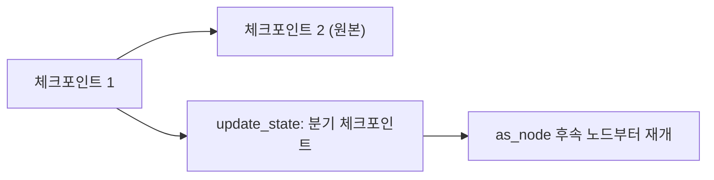
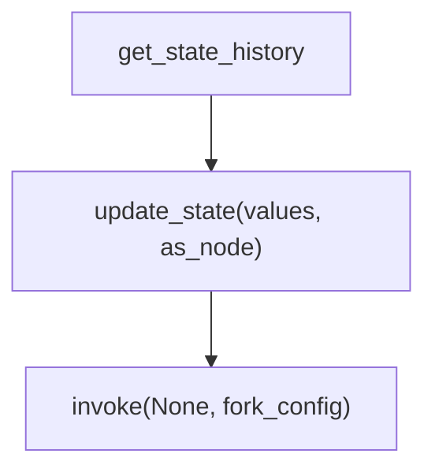

# update_state와 as_node

> `update_state`는 과거 체크포인트에서 갈라지는 새 체크포인트를 만들어 상태를 직접 고치는 API이고, `as_node`는 그 수정을 "어느 노드가 한 것으로 볼지" 정해 재개 위치를 결정한다.

## 쉽게 말하면
게임 저장 슬롯 중 하나를 불러와 아이템을 몇 개 바꾼 뒤 "새 슬롯"으로 저장하는 것이다. 원래 슬롯은 그대로 남고, 새 슬롯에서 다시 진행한다.

## 자세히
LangGraph time-travel 문서 기준:
- `graph.update_state(config, values)`는 지정한 체크포인트의 config로 호출하며 **새 체크포인트(분기)**를 만든다. 스레드를 되감지 않고 원래 기록은 그대로다.
- **`as_node`**: 이 업데이트를 어느 노드가 낸 것으로 볼지. 값은 그 노드의 writer(리듀서 포함)를 거치고, 실행은 그 노드의 **후속 노드**부터 재개된다. 기본은 체크포인트 버전 기록에서 추론한다.
- 명시해야 하는 경우: ① 병렬 가지가 같은 단계에서 상태를 갱신해 `InvalidUpdateError`가 날 때 ② 실행 기록이 없는 스레드(테스트) ③ 뒤쪽 노드를 지정해 건너뛰고 싶을 때.
- 분기 절차: `get_state_history`로 체크포인트 찾기 → `update_state`로 수정(새 config 반환) → `invoke(None, fork_config)`로 재개.
- 체크포인트 **이전** 노드는 다시 실행되지 않고 **이후** 노드는 다시 실행되어 LLM 호출 결과가 달라질 수 있다. 인터럽트는 time travel 중 항상 다시 걸려 새 `Command(resume=...)`가 필요하다([타임 트래블](#langgraph-time-travel)).

## 그림으로 보기



## 예시
```python
history = list(graph.get_state_history(config))
before_joke = next(s for s in history if s.next == ("write_joke",))
fork_config = graph.update_state(before_joke.config, values={"topic": "chickens"}, as_node="generate_topic")
result = graph.invoke(None, fork_config)  # write_joke이 새 topic으로 재실행
```
에이전트가 잘못된 검색어를 쓴 지점으로 돌아가 값을 고쳐 다시 실행해 본다.

## 헷갈리는 것과 비교
| 개념 | 차이 |
|---|---|
| update_state | 상태를 고쳐 새 분기를 만듦 |
| [체크포인터](#langgraph-checkpointer) | 상태를 저장하는 계층 |
| [get_state](#langgraph-get-state) | 상태를 읽기만 함 |
| 재생(replay) | 같은 입력으로 다시 실행 |

## 더 읽을거리
- [LangGraph Time travel](https://docs.langchain.com/oss/python/langgraph/use-time-travel) — update_state, as_node, 분기 절차.
